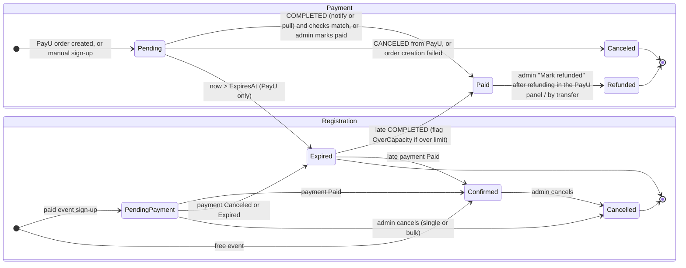
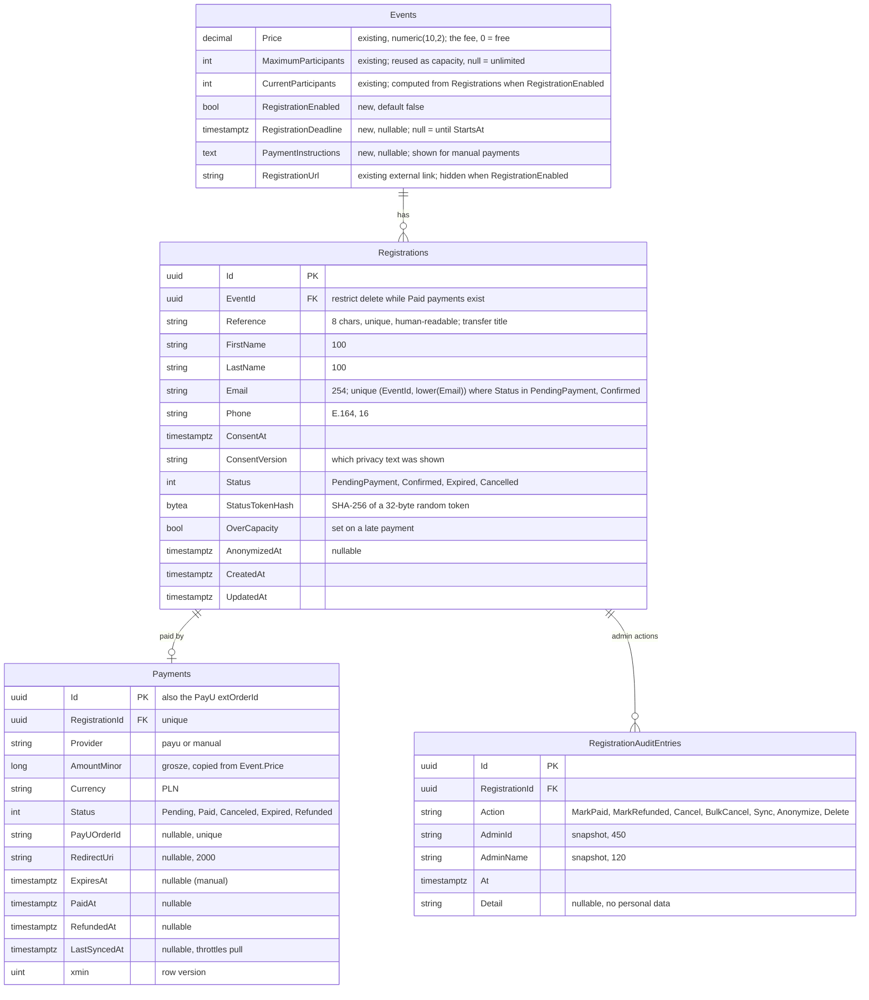
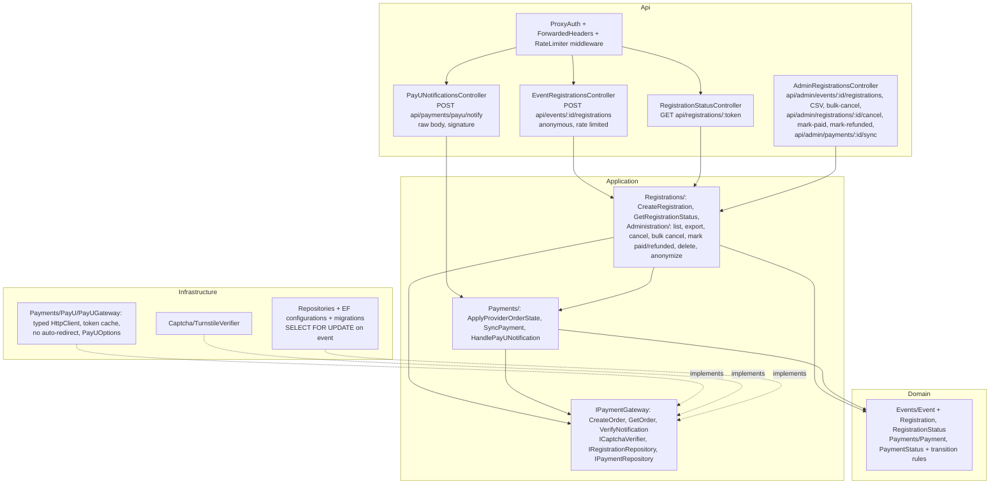

# ADR-005: Event registration and PayU payments

## Status

Proposed (2026-11-19), revised after the `security` and `skeptic` reviews (both: accept with changes; see "Review: objections and responses"). Needs the owner's choice between v1 paths P1 and P2 before it is Accepted. Amends the "public controllers are GET-only" rule in [CLAUDE.md](../../CLAUDE.md) (two named exceptions, see Decision).

Refs [#105](https://github.com/ESN-App/ESN-App/issues/105) (registration without accounts), [#106](https://github.com/ESN-App/ESN-App/issues/106) (payments). Provider research: `docs/research/payments.md` (PR #107). Current architecture: `docs/architecture/` (PR #108); this ADR does not repeat it.

## Context

### What exists today (v0.5.7)

- `Event` ([Event.cs](../../backend/src/EsnApp.Domain/Events/Event.cs)) already has `Price` (`numeric(10,2)`), `MinimumParticipants`, `MaximumParticipants`, `CurrentParticipants` (typed by hand in the admin form) and `RegistrationUrl` (an external link). There is no registration or payment entity.
- Every public controller is anonymous and GET-only; writes live under `api/admin/*` with `[Authorize(Roles = "Admin")]`. The only anonymous non-GET endpoints are `POST /api/auth/login` and `POST /api/auth/reset-password`.
- No rate limiting in the API, and no `ForwardedHeaders` middleware, so the API does not see the real client IP. nginx ([nginx.conf.template](../../docker/nginx.conf.template), line 17) forwards `X-Forwarded-For` with `$proxy_add_x_forwarded_for`, which **appends** to whatever the client sent, so the left-most entries are attacker-controlled. On Render `$remote_addr` is Render's own proxy, not the student.
- `esn-gdansk-api` also has its own public `onrender.com` URL, so anyone can bypass nginx and call the API directly.
- Login has no lockout ([IdentityService.cs](../../backend/src/EsnApp.Infrastructure/Identity/IdentityService.cs) `LoginAsync` uses `CheckPasswordAsync` only).
- The frontend [retryInterceptor](../../frontend/src/app/core/retry.interceptor.ts) retries **GETs only**; a POST that hits a sleeping API fails with 502/504.
- [ExceptionHandlingMiddleware](../../backend/src/EsnApp.Api/Middleware/ExceptionHandlingMiddleware.cs) logs the request `{Path}` on unhandled errors, so a token in the path would land in the logs.
- Hosting is the Render free tier ([render.yaml](../../render.yaml)): both services sleep after 15 min (about 50 s cold start), SMTP is blocked (#25), the disk is ephemeral (#24) and the free Postgres expires after 30 days (#26).

### Owner decisions already made

- Provider: **PayU** (fallback Przelewy24). JSON REST API, OAuth `client_credentials`, `POST /api/v2_1/orders` with our `extOrderId`, signed notifications, `GET /api/v2_1/orders/{orderId}`, refunds API with refund notifications.
- What is paid for: the **participation fee**, paid when a student signs up through **our own registration form** (#105). No student accounts, no tickets or QR codes.
- Form fields (#105 comment): first name, last name, phone number with country prefix, e-mail, GDPR consent.
- Registration closes on a deadline or when capacity is reached, both set per event in our admin form.
- Payee: Stowarzyszenie ESN Gdańsk (KRS 0000783383), Nest Bank account. The association has a cash register; fiscal receipts are recorded manually, outside the app.

### PayU facts this design relies on

Verified on [PayU payment lifecycle](https://developers.payu.com/europe/docs/payment-flows/lifecycle/) (read 2026-11-19) unless marked:

- Order statuses: `PENDING`, `WAITING_FOR_CONFIRMATION` (only when auto-receive is off; it is on by default), `COMPLETED`, `CANCELED`. (`NEW` is in the order API but not on that page.)
- Notifications: POST to our `notifyUrl`; we must answer HTTP 200, anything else is retried. Up to 20 attempts: immediately, then after 1, 2, 5, 10 and 30 min, then 1, 2, 3, 6, 9, 12, 15, 18, 21 and 24 h, then 36, 48, 60 and 72 h. Duplicates must be handled.
- Signature header: `OpenPayu-Signature: sender=checkout;signature=…;algorithm=MD5;content=DOCUMENT`. Check: hash(raw body + second key) with the named algorithm, compare to `signature`.
- Notification source IPs: production `185.68.12.10–12, .26–28`; sandbox `185.68.14.10–12, .26–28`.
- Sandbox host `https://secure.snd.payu.com`, production `https://secure.payu.com`; token at `/pl/standard/user/oauth/authorize`; a public sandbox POS exists ([PayU sandbox](https://developers.payu.com/europe/docs/testing/sandbox/)).
- `validityTime` (seconds) limits how long an order can be paid; default 86400 ([Authorize and Order](https://developers.payu.com/europe/docs/payment-flows/auth-and-order/)).
- **To verify in the sandbox (not re-checked):** order create returns HTTP 302 with a JSON body containing `redirectUri` and `orderId` (so the HTTP client must not follow redirects); `customerIp` is required; amounts are strings in minor units (grosze); the OAuth token lifetime; the exact refund notification body.

### Forces

| Force | What it means here |
|---|---|
| Cost | Non-profit. PayU fee is about 0.52–0.62 PLN on a 20 PLN fee (research section 9). Money records must not sit in a database that expires: #26 (paid Postgres, Basic-256mb is listed at **$6/month** on [Render pricing](https://render.com/pricing), read via search) is a hard prerequisite for real payments. Keeping the API on the free plan is acceptable (see failure modes); Starter is about **$7/month (third-party sources, unverified)**. |
| Load | ~1000 visits/day, peaks ~5000; a popular event may get a burst of 50–200 sign-ups in minutes when it opens. One Postgres row lock per sign-up is fine at that scale. |
| Volunteer team | Few moving parts, no new infrastructure (no queue, no cron, no Redis), no new framework. Everything is unit-testable without PayU. |
| Free tier | API and web sleep; first request ~50 s. No background scheduler we can rely on. No e-mail. |
| Security | Two new anonymous POSTs on a system that had none apart from auth. Money: the amount must come from the server, status must come from PayU, not from the browser. |
| GDPR | We collect personal data of students; PayU becomes a recipient. |
| Mobile UX | Sign-up to paid in under a minute on a phone; a clear status page after returning from PayU. |

## Options considered

### A. Manual "paid" toggle only (change as little as possible)

Our form (#105) creates a registration. Paid events show payment instructions (a transfer title or a PayU payment link created by hand in the PayU panel, or cash). An admin checks the PayU panel / bank statement and flips "paid" on the attendee list.

- **Pros:** no PayU code, no webhook, no secrets, no invariant change beyond the #105 sign-up POST; works on the free tier; days of work.
- **Cons:** an admin matches every payment by hand (name/e-mail/transfer title); capacity counts unpaid sign-ups or needs manual cleanup; no automatic expiry of unpaid seats; refunds fully manual; students wait for a human to see "paid".
- **Cost:** 0 PLN infra beyond #26; effort ~2–3 days on top of #105 (estimate).
- **Risks:** payments that cannot be matched; overbooking. **Reversibility:** trivial, it is a subset of B and C.

### B. PayU order created server-side + notify webhook

Sign-up creates `Registration` + `Payment(Pending)`, the API creates a PayU order (amount from `Event.Price`, `extOrderId` = our payment id) and returns PayU's `redirectUri`. PayU calls our `notifyUrl`; we verify the signature, re-read the order from PayU, check amount/currency/`extOrderId` and move the payment forward. The return page polls our status endpoint.

- **Pros:** status in our DB within seconds; capacity counts only paid seats plus short holds; unpaid seats expire automatically; refunds from the admin panel; least admin work per event.
- **Cons:** a second anonymous POST (the webhook); money logic and a PayU client in our code; secrets to manage; PayU sandbox setup.
- **Cost:** PayU fees only (29 PLN one-off registration per research); effort ~2–3 weeks of volunteer work after #105 (estimate).
- **Risks:** missed notifications during cold starts (mitigated by PayU retries and reconcile-on-read), signature bugs, leaked second key. **Reversibility:** medium; turning PayU off (empty config) falls back to A without data loss.

### C. PayU order + status sync without a webhook

As B, but no `notifyUrl`. Status is pulled with `GET /api/v2_1/orders/{orderId}`: (1) when the return page polls our status endpoint, (2) from an admin "Sync payments" action under `api/admin/*`.

- **Pros:** no anonymous webhook, so only the #105 sign-up POST breaks the rule; still automatic amount and status; same PayU client as B.
- **Cons:** if the student closes the browser before returning (or pays by slow bank transfer), the payment stays Pending until an admin presses Sync; capacity holds then expire wrongly and can release a seat that was paid; refund status also needs manual sync.
- **Cost/effort:** ~1.5–2.5 weeks (estimate), about 2–3 days less than B.
- **Risks:** overbooking from late payments on a nearly full event; admins forgetting to sync. **Reversibility:** easy; adding the webhook later turns C into B.

### Combinations

- **A + B with pull (target):** B for paid events, the pull path from C as a safety net, plus the A toggle for cash/transfer exceptions.
- **A first, then B with pull (path P1, recommended):** ship registrations with manual payments, then add PayU as one stage. Both reviews preferred this over shipping C as a separate step.

### Not considered further

Ticketing platforms (pretix etc.) and payment links without our form: excluded by the owner (research sections 3 and 8). Client-side PayU widgets / card tokenisation: puts card UI in our app, no benefit for us. A message queue or background worker for notifications: unnecessary at our volume.

## Decision (proposed)

**Target architecture: B with the pull path built in ("B with pull"), plus the A toggle for exceptions.** The server creates a PayU order per sign-up; status arrives by signed notification and, as a safety net, is pulled from PayU when the student's status page polls or an admin presses Sync on one payment; admins can still mark cash/transfer payments by hand. C alone is not enough (both reviews agree): without the webhook, payments of students who close the browser stay Pending until someone remembers to sync.

Why: the webhook makes capacity and "paid" trustworthy without volunteer work, and PayU's 72-hour retry schedule tolerates our sleeping services. The pull path costs one extra call (`GET order`) and covers a cold start racing a returning student.

**v1 scope is the owner's choice between two paths.** Both use the same steps (see the implementation plan); they differ only in where v1 ends.

| | **P1: registrations + manual payment first, PayU as stage 2** | **P2: registrations + PayU "B with pull" in v1** |
|---|---|---|
| v1 contains | Steps 1–7: paid DB, hardening, free registration (BE + FE), retention, manual payments (per-event payment instructions: transfer with a registration reference code, cash, or a payment link made by hand in the PayU panel if the panel offers one, **unverified**) and admin "mark paid / refunded" | Steps 1–10: everything in P1 plus PayU order creation, notify webhook, pull on status poll, single-payment Sync, return page |
| Stage 2 | Steps 8–10 when the PayU contract and sandbox are ready | Refunds API (step 11) only if panel refunds become a burden |
| Rough effort to v1 (estimate, one part-time volunteer dev per side) | ~3–4 weeks | ~5–7 weeks |
| Depends on PayU contract | No | Yes (sandbox for development, contract for go-live) |
| Admin work per paid event | Match payments by reference code, mark paid | Almost none; refunds in the PayU panel + one click in the app |
| New anonymous POSTs | 1 (sign-up) | 2 (sign-up, notify) |

**Recommendation: P1.** It ships #105 without waiting for the board's PayU contract, every step is reused by P2 unchanged, and a semester of manual matching tells us whether the PayU integration is worth it. Choose P2 if the PayU sandbox and contract are already in hand and several paid events are planned for the coming semester. In both paths, refunds in v1 are done in the PayU panel (which has its own login) and recorded in the app with "Mark refunded"; the refunds API is not built.

What would change this: if the PayU contract is refused, P1 still stands and stage 2 switches to Przelewy24 behind the same `IPaymentGateway`; if a semester has fewer than ~5 paid events, stage 2 may never be needed.

### Amended invariant

> Public controllers stay GET-only and anonymous. The only anonymous non-GET endpoints are `POST /api/auth/login`, `POST /api/auth/reset-password`, **`POST /api/events/{eventId}/registrations`** (`EventRegistrationsController`) and, from stage "PayU", **`POST /api/payments/payu/notify`** (`PayUNotificationsController`). An allow-list test in `EsnApp.Api.Tests` enumerates all anonymous non-GET actions through the endpoint data source and fails on any other.

### Edge hardening (applies to all anonymous endpoints, including login)

- **Real client IP.** `UseForwardedHeaders` with `ForwardedHeaders.XForwardedFor` and a fixed `ForwardLimit` equal to the number of trusted hops (Render edge → nginx → Render edge → API); the client IP is the entry at that position **counted from the right**, never the left-most one. The hop count is **measured on Render** (log the raw `X-Forwarded-For` once in sandbox) before limits are enabled; `KnownProxies` cannot be listed statically on Render, so the networks are cleared and the limit alone decides. nginx keeps `$proxy_add_x_forwarded_for` (it must, to preserve Render's entry); the API, not nginx, picks the right entry.
- **No nginx bypass.** nginx adds a shared-secret header (`X-Proxy-Auth`, value from env `API_PROXY_SECRET` on both services); in Production the API rejects every `/api` request without it (403). `/health` stays open for Render's health check. A Render private service would remove the public API URL, but private services are not on the free plan (**unverified**), so the header is the v1 answer.
- **Rate limits** (ASP.NET Core built-in limiter, no new package), partitioned by client IP with IPv6 addresses bucketed per `/64`:
  - sign-up: 30 per 10 min per IP (a university NAT or eduroam puts many students behind one address) **and** a global limit per endpoint (e.g. 300/min) as a flood guard;
  - status GET: 60/min per IP;
  - notify: global 120/min only;
  - login: 10 per 10 min per IP, plus ASP.NET Identity lockout (`lockoutOnFailure: true`, 5 attempts, 15 min).
- **Headers:** nginx adds `Referrer-Policy: no-referrer` for the app (the status token is in the URL). Requests on the new endpoints are JSON only (`[Consumes("application/json")]`, 415 otherwise).
- **Logs:** `ExceptionHandlingMiddleware` and request logging write the route template (`api/registrations/{statusToken}`) instead of the raw path, so tokens never reach the logs.

### How each exception is protected

| Protection | Sign-up POST | PayU notify POST |
|---|---|---|
| Input validation | FluentValidation: names 1–100 chars, e-mail format and ≤254, phone E.164 (`+` and 8–15 digits), consent must be true, unknown fields rejected | Parse only after the signature check; reject bodies without `order.orderId` |
| Body size | `[RequestSizeLimit(4 KB)]` | `[RequestSizeLimit(16 KB)]` |
| Rate limiting | See edge hardening | See edge hardening |
| Fake sign-ups / bots | Honeypot field + minimum fill time; **Cloudflare Turnstile ready from v1 behind a feature flag** (`registrationCaptcha`, off by default; server-side token check against Turnstile when on; secret in env). **Hold cap:** at most `max(5, 20% of capacity)` concurrent `PendingPayment` holds per event, so a bot cannot hold a whole event with unpaid sign-ups. Admin **bulk-cancel** on the attendee list. Free events are confirmed without an e-mail check (residual risk, accepted for v1; e-mail verification comes with #25) | n/a |
| Authenticity | n/a (anonymous by design) | Signature verification, steps below. No IP allow-list: PayU's IPs cannot be checked reliably behind Render + nginx (kept off) |
| Never trust the payload | Amount comes from `Event.Price`; the client sends no amount | Re-read the order from PayU and compare, steps below |
| Duplicate submit / enumeration | Partial unique index on `(EventId, lower(Email))` for active registrations. A duplicate gets **the same `202` shape as a closed event** with a generic text ("We couldn't create a new sign-up. If you already signed up, use the link from your confirmation page or contact ESN"), **no token, no 409**. The response for a new sign-up differs (it carries a token), so a residual "this e-mail is registered" signal remains; it is rate limited and accepted | Forward-only state machine; a duplicate notification is a no-op that returns 200 |
| Capacity race | One transaction: `SELECT … FOR UPDATE` on the event row, count seats and holds, insert | n/a |
| Logging | Registration id only, no personal data | Never the body or the signature; `PayUOrderId`, PayU status, outcome |
| Errors | 400 ProblemDetails, 202 generic for closed/full/duplicate, 429, 415 | 200 for processed or duplicate; 400 for a bad signature; 500 only for our own failure (PayU retries) |

**Notify verification steps** (one code path, unit-tested with captured sandbox bodies):
1. Read the raw body (`EnableBuffering`, before model binding).
2. Parse `OpenPayu-Signature` as `;`-separated `key=value` pairs, independent of order; require `signature` and `algorithm` ∈ {`MD5`, `SHA-256`}; anything else → 400.
3. Compute hash(raw body bytes + second key), lowercase hex; compare with the lowercased header value using `CryptographicOperations.FixedTimeEquals`; mismatch → 400.
4. Take `order.orderId` from the body and look up **our** `Payment` by stored `PayUOrderId` (not by the body's `extOrderId`); unknown → 200 and log (nothing to do, stop retries).
5. `GET /api/v2_1/orders/{orderId}` and require: `merchantPosId` == our `PosId`, `orderId` == stored `PayUOrderId`, `extOrderId` == our `Payment.Id`, `totalAmount` == `AmountMinor`, `currencyCode` == `Currency`. Any mismatch → do not change state, log at error level, flag for admin, return 200.
6. Apply the forward-only transition from the re-fetched status, return 200.
7. Refund notifications in v1 are verified (steps 1–3) and acknowledged with 200 but change nothing; when the refunds API is built (step 11) they follow the same path, re-fetching the refund and matching our stored `PayURefundId`.

The same step 5 checks run in the pull path (status poll, admin Sync).

`GET /api/registrations/{statusToken}` is a GET with a side effect (it may call PayU and update the row). That is allowed because the update is idempotent and derived only from PayU's authoritative state; it only calls PayU when the payment is Pending and the last sync is older than 15 s. The response contains status, event title, date, amount and `payAgainUrl` only, **never name, e-mail or phone**.

## Target design

### Sequence: sign-up to paid (PayU stage)

```mermaid
sequenceDiagram
    autonumber
    actor S as Student (browser)
    participant W as esn-gdansk-web (nginx /api proxy)
    participant A as esn-gdansk-api
    participant D as Postgres
    participant P as PayU

    S->>W: GET /health (pre-warm when the form opens, retried by the frontend)
    W->>A: proxy (wakes both services, up to ~100 s on a double cold start)
    S->>W: POST /api/events/{id}/registrations {firstName, lastName, email, phone, consent, honeypot, turnstile?}
    W->>A: proxy (same origin, ADR-002, X-Forwarded-For, X-Proxy-Auth)
    A->>A: proxy header, rate limit, validate, honeypot (+ Turnstile if flag on)
    A->>D: BEGIN; SELECT event FOR UPDATE; check enabled, deadline, capacity, hold cap
    A->>D: INSERT Registration(PendingPayment) + Payment(Pending, AmountMinor = Price*100, ExpiresAt); COMMIT
    A->>P: POST /pl/standard/user/oauth/authorize (client_credentials, cached token)
    A->>P: POST /api/v2_1/orders {extOrderId = Payment.Id, totalAmount, currencyCode PLN, customerIp, notifyUrl, continueUrl, validityTime, buyer.email}
    P-->>A: 302 + {orderId, redirectUri}
    A->>D: store PayUOrderId, RedirectUri
    A-->>S: 201 {statusToken, redirectUrl}
    S->>S: check redirectUrl host is secure.payu.com (or secure.snd.payu.com outside Production)
    S->>P: redirect, pays (BLIK / card / pay-by-link)
    P-->>S: redirect to continueUrl /events/{id}/registration/{statusToken}
    par notification (web and API may both be asleep)
        P->>W: POST /api/payments/payu/notify (OpenPayu-Signature)
        W->>A: proxy (first attempts may time out; PayU retries after 1, 2, 5, 10 min)
        A->>A: verify signature on raw body
        A->>P: GET /api/v2_1/orders/{orderId}
        A->>D: checks match; Payment Paid, Registration Confirmed (forward-only)
        A-->>P: 200
    and return page polling
        loop every 3 s for up to 2 min, then every 15 s
            S->>A: GET /api/registrations/{statusToken}
            alt Pending and last sync older than 15 s
                A->>P: GET /api/v2_1/orders/{orderId}
                A->>D: same checks, same forward-only update
            end
            A-->>S: {status, eventTitle, amount, payAgainUrl?} (no personal data)
        end
    end
```

Free events (`Price = 0`) skip PayU: the registration is `Confirmed` immediately and the response has no `redirectUrl`. With manual payments (P1, or PayU disabled), a paid sign-up returns the status token and the status page shows the event's payment instructions and the registration's reference code.

### State diagram (v1)

Registration and payment are separate on purpose: a registration can exist without a payment (free event, cash), and its status is what capacity and the attendee list read.



Notes:
- **Seats held:** `Confirmed` + `PendingPayment` that has not expired. Expiry is evaluated on read (capacity check, status poll, admin list), so no scheduler is needed.
- **Manual payments** have no `ExpiresAt`; unpaid manual sign-ups hold seats until an admin cancels them (bulk-cancel helps). The hold cap applies to them too.
- **Hold vs PayU validity:** `validityTime` = 20 min, our hold = 30 min. Whether PayU can still move an order from `PENDING` to `COMPLETED` after `validityTime` (slow pay-by-link) is **unverified; test it in the sandbox before building anything beyond the single `Expired → Paid` transition**. If it happens, we accept the money (`OverCapacity` flag, admin decides). The flag alone may be enough; no further states are planned.
- **Pay again:** while a `PendingPayment` hold is valid, the status page (reached only with the token) shows `payAgainUrl` = the stored `redirectUri`. If order creation failed, the payment is `Canceled` at once, the seat is released and the student submits the form again (an expired/cancelled registration does not block the e-mail). There is no "resend my link" by e-mail address.
- `Refunded` also moves the registration to `Cancelled`.

### Data model sketch



Decisions inside the model:
- **Reuse** `Price` as the fee and `MaximumParticipants` as capacity. `Price` is 0 or 1.00–10 000 PLN with at most two decimals; conversion to grosze is checked to be an integer.
- `Payment` is 1:0..1 per registration (a new attempt is a new registration). No `ProcessedWebhookEvent` table: the forward-only update is the idempotency, because PayU notifications carry the whole order state.
- The status token is stored hashed; the token exists only in the URL the student holds.
- `RegistrationAuditEntries` is append-only (no update/delete endpoints); deleting a registration on request anonymizes the row, so its audit trail survives. Automatic state changes (notify, pull) are not audited there; they are logged.

### Component placement (Clean Architecture)



- Transition rules (forward-only, amount and identity checks) live in `Payment` in Domain and are unit-tested without HTTP.
- `IPaymentGateway` keeps PayU behind an interface, so the Przelewy24 fallback is one Infrastructure class.
- The PayU client is a small typed `HttpClient` (three calls in v1). No new NuGet package.
- CSV export prefixes any cell that starts with `=`, `+`, `-`, `@`, tab or CR with `'` (CSV injection).
- Frontend: sign-up form and status page in `features/events`; attendees view in `features/admin`. The form pre-warms the API with a retried `GET /health` when it opens and disables Submit until it answers. Designed in Penpot first.

### Configuration and secrets

Environment variables only (Render dashboard with `sync: false`; documented in `.env.example`; never in appsettings):

| Variable | Example / note |
|---|---|
| `Payments__PayU__BaseUrl` | `https://secure.snd.payu.com` (sandbox) or `https://secure.payu.com` (production) |
| `Payments__PayU__PosId` | POS id (`merchantPosId`) |
| `Payments__PayU__ClientId` / `ClientSecret` | OAuth client credentials |
| `Payments__PayU__SecondKey` | second key for notification signatures |
| `Payments__OrderValiditySeconds` | `1200` |
| `Payments__SeatHoldMinutes` | `30` |
| `Registrations__MaxHoldPercent` | `20` |
| `Turnstile__SiteKey` / `Turnstile__SecretKey` | only used when the `registrationCaptcha` flag is on |
| `API_PROXY_SECRET` | same random value on web (nginx) and API; API reads it as `Proxy__Secret` |
| `Email__FrontendBaseUrl` (existing, `FRONTEND_BASE_URL` in compose) | reused to build `continueUrl` and `notifyUrl` (`{base}/api/payments/payu/notify`, via nginx) |

- If `PosId` is empty, PayU is **disabled** and paid events use manual payments (P1 behaviour, also the local-dev default).
- **In Production, PayU is enabled only if `BaseUrl` is exactly `https://secure.payu.com`**; any other value logs an error and disables PayU (no sandbox orders in Production). Outside Production, the production URL is refused the same way.
- Production keys are entered on Render only by the treasurer or a board-appointed admin. Local dev uses the public sandbox POS; a laptop's notify URL is unreachable from PayU, so local tests rely on the pull path.

## Failure modes

| Situation | What happens | Mitigation |
|---|---|---|
| API asleep when a student opens the form | A POST to a sleeping API returns 502/504; `retryInterceptor` does not retry POSTs | The form pre-warms with a retried `GET /health` and enables Submit once it answers. The POST itself is not retried automatically (a timed-out POST may have succeeded). |
| Web and API asleep when PayU notifies | The notify goes through nginx then the API: two cold starts, up to ~100 s, so the first attempts fail | PayU retries after 1, 2, 5, 10 min; meanwhile the returning student's status poll pulls the order. |
| Duplicate or out-of-order notifications | `PENDING` after `COMPLETED`, repeats | Forward-only transitions; duplicate returns 200 with no change. |
| Forged notification | Fake `COMPLETED` | Signature check fails → 400; even a valid body is re-checked against `GET order`. |
| Sandbox keys in Production | Free "payments" | Production accepts only the production base URL; `merchantPosId` must equal our POS id. |
| Amount or identity mismatch | PayU order differs from our row | Not marked Paid; error log, admin flag; 200 to stop retries. |
| Student closes the browser after paying | No return page | Notification (retries over 72 h); admin Sync on the payment as backstop. |
| Student closes the browser before paying | Order unpaid | PayU validity ends at 20 min, our hold at 30 min. |
| PayU order creation fails | No `redirectUri` | Payment `Canceled` at once, seat released, 503 "try again in a few minutes"; the student resubmits. Long outage: admins clear PayU config, events fall back to manual payments. |
| PayU outage after the student paid | Notify and `GET order` fail | Notifications resume for 72 h; admin Sync afterwards. |
| Late payment after expiry on a full event | Money for a released seat | Accepted, `Confirmed`, `OverCapacity` flag; admin refunds or squeezes in. Behaviour to be confirmed in the sandbox. |
| Bot fills an event | Many fake sign-ups | Hold cap, rate limits, honeypot, Turnstile flag, bulk-cancel. Free events remain exposed until e-mail verification (#25). |
| Refund | Admin refunds in the PayU panel (or by transfer for manual payments), then clicks "Mark refunded" | Audited; registration `Cancelled`. Refunds API is step 11, not v1. |
| Reconciliation | DB vs PayU panel vs bank | CSV export per event (reference, PayU order id, amount, paid at, status); the treasurer compares monthly and records receipts on the cash register. |
| Free DB expires (#26) | Loss of personal and payment data | Step 1 (paid Postgres) is a dependency of the first step that stores personal data. |
| Seeder | `DbSeeder` re-adds seed events at every start | Seed events keep `RegistrationEnabled = false`; never seed registrations or payments in Production. |

## GDPR and data retention

- **Data collected:** first and last name, e-mail, phone, consent timestamp and version. Nothing else in v1.
- **Notice:** a privacy notice next to the consent checkbox names the controller (the association), purpose, recipients (PayU S.A. as payment operator from the PayU stage, Render as hosting processor, Cloudflare if Turnstile is switched on), retention and rights. Drafted and approved by the board; the app stores the text version.
- **Data sent to PayU:** `buyer.email` and `customerIp`; names only if PayU requires them (**to confirm** in the sandbox). No phone.
- **Retention (recommended, to confirm with the accountant):** names, e-mail and phone are anonymized 30 days after the event ends; payment rows keep amount, dates, reference, PayU order id and provider for the accounting period (Polish practice is 5 years from the end of the financial year; **not legal advice**). Anonymization runs on **API startup** (the free API restarts often), when an admin opens the registrations list, and as an explicit admin action.
- **Backups** of the paid database keep personal data for the backup retention window after anonymization; the privacy notice says so.
- **Rights:** admins can delete a registration on request (anonymizes if a payment exists).
- **Access:** only admins see attendee data; the CSV is a personal-data file and the UI says so.
- **Logs:** no personal data, no tokens (route templates only), no PayU bodies.

## Out of scope

Student accounts (#22), tickets/QR/check-in, waitlist, the refunds API and `RefundPending` state (refund in the PayU panel in v1), "Sync all pending", partial refunds, discount codes / ESNcard pricing, price tiers, invoices, fiscal receipts in the app, ESNcard or membership fees, confirmation e-mails before #25, a background scheduler, a separate refund role (see review M6), making Swagger private in Production (existing issue, tracked separately).

## Consequences

- The GET-only rule gains one named exception in P1 v1 and a second with the PayU stage, guarded by an allow-list test; CLAUDE.md and `docs/architecture/backend.md` are updated when the endpoints land.
- Personal and financial data make #26 (paid, backed-up Postgres, about $6/month) a blocker for the first registration step. The API can stay on the free plan.
- The API gains forwarded-headers handling, a proxy secret, rate limiting and login lockout; this also hardens the existing login.
- `CurrentParticipants` stops being hand-typed for events with in-app registration.
- PayU sits behind `IPaymentGateway`; the Przelewy24 fallback is contained.
- The volunteer team owns PayU panel access (two board members, 2FA in the panel), keys, monthly reconciliation and refunds.

## Open questions for the owner

Each has a recommended answer; the plan assumes the recommendation.

1. **v1 path: P1 or P2?** Recommended: P1 (registrations + manual payment first, PayU as stage 2).
2. **Form fields beyond name, phone, e-mail, consent?** Recommended: none in v1.
3. **Capacity and waitlist?** Recommended: capacity yes (reuse `MaximumParticipants`), no waitlist; when full, the form says "Full".
4. **Seat hold and hold cap?** Recommended: 30 min hold (PayU validity 20 min), at most 20% of capacity (minimum 5) held unpaid at once.
5. **Confirmation e-mail?** Recommended: none from us until #25; the bookmarkable status page is the confirmation; PayU's own payment e-mail reaches the payer (**unverified**).
6. **Student self-cancellation and refund rules?** Recommended: no self-service cancel; the student writes to ESN, an admin cancels and refunds per the board's terms of sale.
7. **Retention?** Recommended: anonymize 30 days after the event; keep payment records without personal data for the accounting period.
8. **Replace the external link?** Recommended: per event, `RegistrationEnabled` hides the `RegistrationUrl` button.
9. **Who can mark paid/refunded?** Recommended: any admin, audited; revisit a separate role if the refunds API is ever built.
10. **Paid DB (#26) budget?** Recommended: yes, Basic-256mb (~$6/month), before step 4.

## Implementation plan (for `pm`)

Each step is a separate branch + PR into `main` and ships alone. **P1 v1 = steps 1–7; PayU stage = steps 8–10. P2 v1 = steps 1–10.** Step 11 is not planned.

| # | Task | Agent | Scope and files likely touched | Acceptance criteria | Bump | Depends on |
|---|---|---|---|---|---|---|
| 0 | Board/owner prerequisites | owner | Path choice, terms of sale, privacy notice, accountant on receipts and retention, answers to open questions; for the PayU stage: contract (statute + KRS) and sandbox | Texts approved; for PayU: sandbox keys exist | n/a | — |
| 1 | Paid Postgres + backups (#26) | backend (+ owner on Render) | `render.yaml` (`plan`), data move runbook, `docs/architecture/deployment.md` | Production DB on a paid plan; one backup restore tested | patch | owner budget |
| 2 | Penpot designs | ui-ux | Sign-up form (open, full, closed, warming up, submitting, generic duplicate message, error), status page (pending/manual instructions with reference/paid/expired/free confirmed), admin event form fields, attendees view with bulk-cancel and payment column | Owner approves the boards | n/a | open questions 2–3, 8 |
| 3 | Edge hardening | backend | `Program.cs` (`UseForwardedHeaders` with measured `ForwardLimit`, proxy-secret check, rate limiter with IPv6 /64), `docker/nginx.conf.template` (`X-Proxy-Auth`, `Referrer-Policy`), `render.yaml` + `.env.example` (`API_PROXY_SECRET`), Identity lockout in `IdentityService`, route-template logging in `ExceptionHandlingMiddleware`, allow-list test in `EsnApp.Api.Tests` | Raw XFF measured on Render and documented; direct call to the API's onrender URL → 403; 429 after limits; login locks after 5 failures; allow-list test lists login + reset-password | patch | — |
| 4 | Registration backend (free events) | backend | `Domain/Events/Registration.cs`, `Event` (`RegistrationEnabled`, `RegistrationDeadline`), `RegistrationAuditEntries`, EF config + migration (review SQL), `Application/Registrations/*`, `EventRegistrationsController`, `RegistrationStatusController`, `AdminRegistrationsController` (list, CSV with injection guard, cancel, bulk-cancel, delete), honeypot, Turnstile behind `registrationCaptcha` flag (`FeatureFlagKeys`), allow-list test updated, Swagger annotations | Paid events reject sign-up (generic 202) until step 7; capacity race test; duplicate → generic 202 without token; status response has no personal data; `security` review passed | minor | **1**, 3 |
| 5 | Registration frontend | frontend | `features/events` form (pre-warm `GET /health`, Turnstile widget when flag on) + status page, `features/admin` attendees view + event form fields, models/data-access | Matches Penpot; mobile; reduced motion; `tests` + `ui-ux` checked | minor | 2, 4 |
| 6 | Retention / anonymization | backend (+ small frontend) | Anonymize on startup, on admin list open and as an admin action; audit entries | Personal data cleared N days after the event; payment rows kept; audited | patch | 4, open question 7 |
| 7 | Manual payments (option A) | backend + frontend | `Domain/Payments/Payment.cs` + migration (`Provider = manual`), `Event.PaymentInstructions`, `Registration.Reference`, hold cap, admin mark-paid / mark-refunded (audited), status page shows instructions + reference | Paid events take sign-ups as PendingPayment; hold cap enforced; admin marks paid/refunded; CSV has reference and payment columns | minor | 4, 5 |
| 8 | PayU "B with pull" backend | backend | `Infrastructure/Payments/PayU/*` (typed HttpClient, token cache, no auto-redirect), `IPaymentGateway`, order creation in `CreateRegistration`, `PayUNotificationsController` with the verification steps, pull in status GET, admin single-payment Sync, Production base-URL guard, `merchantPosId` check, `.env.example`, `render.yaml` (`sync: false`), allow-list test, CLAUDE.md invariant text, `docs/architecture/backend.md`; **first** a sandbox check of late `COMPLETED` after `validityTime` | Sandbox payment reaches Paid by notify and, separately, by pull; bad signature → 400; duplicate → 200 no-op; mismatched amount/POS not Paid; PayU disabled when `PosId` empty; `security` review passed | minor | 0 (sandbox), 7 |
| 9 | PayU frontend | frontend | Status page polling (3 s, then 15 s, stop on final state), pay-again, `redirectUrl` host check, admin payment status + Sync button, over-capacity flag | `tests` runs a sandbox payment end to end; `ui-ux` checked | minor | 2, 8 |
| 10 | PayU go-live | owner + backend | Production keys in Render, base URL switch, one real low-value payment refunded in the panel and marked refunded, CLAUDE.md Deployment update | Real payment visible in app and panel; ADR status → Accepted | patch | 0 (contract), 8, 9 |
| 11 | (not planned) Refunds API | backend + frontend | PayU refunds API, `RefundPending`, refund notifications matched by `PayURefundId` | Only if panel refunds become a burden | minor | 10 |

## Review: objections and responses

Reviews by `security` and `skeptic` on PR #109, both "accept with changes".

### Security

| # | Objection | Response |
|---|---|---|
| H1 | Fake sign-ups can fill events; honeypot and a client timestamp are weak | **Accepted.** Hold cap of `max(5, 20%)` concurrent unpaid holds per event, Turnstile behind the `registrationCaptcha` flag from v1, admin bulk-cancel. Residual: free events are confirmed without e-mail verification until #25 (accepted risk, stated). |
| H2 | Per-IP limits are bypassable: nginx appends client-supplied XFF, and the API has a public Render URL | **Accepted.** Right-counted XFF with a fixed hop count measured on Render, shared-secret header nginx → API (403 otherwise), IPv6 /64 buckets, login lockout added. PayU IP allow-list stays off (infeasible behind Render). |
| H3 | Returning the same status token on a duplicate submit is impossible (hashed) and would leak the link to anyone who knows the e-mail; 409 confirms attendance | **Accepted.** Duplicate gets a generic 202 without a token; pay-again only through the existing token; failed order creation cancels the payment and the student resubmits. Residual signal (new sign-up returns a token, duplicate does not) is rate limited and accepted. |
| M4 | Sandbox keys could run in Production | **Accepted.** Production requires the production base URL, else PayU is disabled; `merchantPosId` is checked on every re-fetch. |
| M5 | Webhook verification needs explicit steps | **Accepted.** Seven numbered steps in Decision; lookup by stored `PayUOrderId`; `FixedTimeEquals` on lowercase hex; refund notifications acknowledged without state change in v1 and matched by `PayURefundId` when the refunds API exists. |
| M6 | Admin actions need an audit trail; no 2FA, so consider a refund role | **Mitigated.** Append-only `RegistrationAuditEntries` for mark-paid, mark-refunded, cancel, bulk-cancel, sync, anonymize, delete. **Refund role rejected for v1:** the app does not move money in v1 (refunds happen in the PayU panel, which has its own login and 2FA); "Mark refunded" only records it. Revisit with step 11. |
| M7 | CSV injection | **Accepted.** Cells starting with `=`, `+`, `-`, `@`, tab, CR are prefixed with `'`. |
| M8 | Token in the URL leaks via Referer and logs; status must not return personal data | **Accepted.** `Referrer-Policy: no-referrer` in nginx, route-template logging (including `ExceptionHandlingMiddleware`), status response without name/e-mail/phone. |
| L9 | Anonymization should also run on startup; backups keep personal data | **Accepted.** Startup run added; backup window stated in the privacy notice. |
| L10 | Frontend should check the redirect host | **Accepted.** Only `secure.payu.com` (and `secure.snd.payu.com` outside Production). |
| L11 | JSON only | **Accepted.** `[Consumes("application/json")]`, 415 otherwise. |
| L12 | Swagger is public in Production | **Rejected for this ADR** (not caused by it): an existing limitation listed in `docs/architecture/known-limitations.md`; to be handled in its own change. The new endpoints carry no secrets in their Swagger descriptions. |

### Skeptic

| # | Objection | Response |
|---|---|---|
| 1 | Steps 4–5 store personal data in a DB that expires around 2026-12-06 | **Accepted.** Step 1 (#26) is now a hard dependency of step 4. |
| 2 | On Render `$remote_addr` is Render's proxy, and eduroam/office NAT would hit 5 per 10 min at registration opening | **Accepted.** Measured XFF hop count (see H2), per-IP limit raised to 30 per 10 min plus a global per-endpoint limit; the hold cap, not the IP limit, is the main defence against filling an event. |
| 3 | The claim that `retryInterceptor` covers the sign-up POST is false; the webhook faces two cold starts (~100 s) | **Accepted.** Text corrected; the form pre-warms with a retried `GET /health`; the double cold start is covered by PayU retries and the status poll. |
| 4 | 13 PRs are too much for volunteers | **Accepted.** Cut from v1: refunds API, `RefundPending`, `Canceled → Paid`, "Sync all pending". Plan regrouped into P1 (7 steps to v1) and P2 (10). |
| 5 | Token leak on duplicate submit | **Accepted.** Same fix as H3. |
| 6 | Late `PENDING → COMPLETED` after expiry is unverified | **Accepted.** Step 8 starts with a sandbox check; only the single `Expired → Paid` transition with a flag is planned. |
| View | C alone is not enough; B with pull is cheap and right; A stays; cheaper v1 is steps 3–6 + manual payment, then PayU as one stage without refunds | **Accepted.** That is P1, the recommended path. |

## References

- PayU payment lifecycle and notifications: https://developers.payu.com/europe/docs/payment-flows/lifecycle/
- PayU authorize and order (`validityTime`): https://developers.payu.com/europe/docs/payment-flows/auth-and-order/
- PayU sandbox: https://developers.payu.com/europe/docs/testing/sandbox/
- PayU refunds: https://developers.payu.com/europe/docs/payment-flows/refunds/
- Render pricing: https://render.com/pricing
- Provider research: `docs/research/payments.md` (PR #107)
