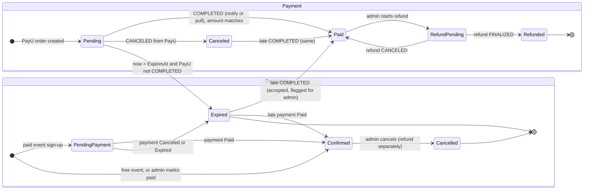
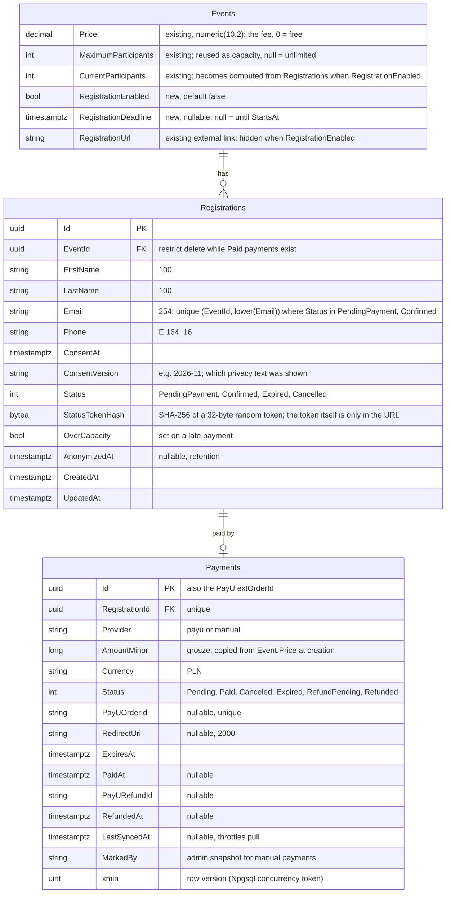
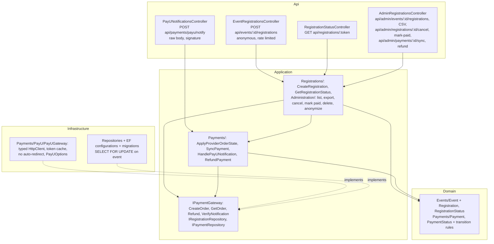

# ADR-005: Event registration and PayU payments

## Status

Proposed (2026-11-19). Needs the owner's decision, a `skeptic` review and a `security` review before it is Accepted. Amends the "public controllers are GET-only" rule in [CLAUDE.md](../../CLAUDE.md) (two named exceptions, see Decision).

Refs [#105](https://github.com/ESN-App/ESN-App/issues/105) (registration without accounts), [#106](https://github.com/ESN-App/ESN-App/issues/106) (payments). Provider research: `docs/research/payments.md` (PR #107). Current architecture: `docs/architecture/` (PR #108); this ADR does not repeat it.

## Context

### What exists today (v0.5.7)

- `Event` ([Event.cs](../../backend/src/EsnApp.Domain/Events/Event.cs)) already has `Price` (`numeric(10,2)`), `MinimumParticipants`, `MaximumParticipants`, `CurrentParticipants` (typed by hand in the admin form) and `RegistrationUrl` (an external link). There is no registration or payment entity.
- Every public controller is anonymous and GET-only; writes live under `api/admin/*` with `[Authorize(Roles = "Admin")]`. The only anonymous non-GET endpoints are `POST /api/auth/login` and `POST /api/auth/reset-password`.
- No rate limiting in the API, and no `ForwardedHeaders` middleware, so the API does not see the real client IP. nginx ([nginx.conf.template](../../docker/nginx.conf.template)) already sends `X-Forwarded-For` / `X-Real-IP`.
- Hosting is the Render free tier ([render.yaml](../../render.yaml)): both services sleep after 15 min (about 50 s cold start), SMTP is blocked (#25), the disk is ephemeral (#24) and the free Postgres expires after 30 days (#26).

### Owner decisions already made

- Provider: **PayU** (fallback Przelewy24). JSON REST API, OAuth `client_credentials`, `POST /api/v2_1/orders` with our `extOrderId`, signed notifications, `GET /api/v2_1/orders/{orderId}`, refunds API with refund notifications.
- What is paid for: the **participation fee**, paid when a student signs up through **our own registration form** (#105). No student accounts, no tickets or QR codes.
- Form fields (#105 comment): first name, last name, phone number with country prefix, e-mail, GDPR consent.
- Registration closes on a deadline or when capacity is reached, both set per event in our admin form.
- Payee: Stowarzyszenie ESN Gdańsk (KRS 0000783383), Nest Bank account. The association has a cash register; fiscal receipts are recorded manually, outside the app.

### PayU facts this design relies on

Verified on [PayU payment lifecycle](https://developers.payu.com/europe/docs/payment-flows/lifecycle/) (read 2026-11-19) unless marked:

- Order statuses: `PENDING`, `WAITING_FOR_CONFIRMATION` (only when auto-receive is off; it is on by default), `COMPLETED`, `CANCELED`. (`NEW` is in the order API but not on that page.)
- Notifications: POST to our `notifyUrl`; we must answer HTTP 200, anything else is retried. Up to 20 attempts: immediately, then after 1, 2, 5, 10 and 30 min, then 1, 2, 3, 6, 9, 12, 15, 18, 21 and 24 h, then 36, 48, 60 and 72 h. Duplicates must be handled.
- Signature header: `OpenPayu-Signature: sender=checkout;signature=…;algorithm=MD5;content=DOCUMENT`. Check: hash(raw body + second key) with the named algorithm, compare to `signature`.
- Notification source IPs: production `185.68.12.10–12, .26–28`; sandbox `185.68.14.10–12, .26–28`.
- Sandbox host `https://secure.snd.payu.com`, production `https://secure.payu.com`; token at `/pl/standard/user/oauth/authorize`; a public sandbox POS exists ([PayU sandbox](https://developers.payu.com/europe/docs/testing/sandbox/)).
- `validityTime` (seconds) limits how long an order can be paid; default 86400 ([Authorize and Order](https://developers.payu.com/europe/docs/payment-flows/auth-and-order/)).
- **To verify in the sandbox (not re-checked):** order create returns HTTP 302 with a JSON body containing `redirectUri` and `orderId` (so the HTTP client must not follow redirects); `customerIp` is required; amounts are strings in minor units (grosze); the OAuth token lifetime; the exact refund notification body.

### Forces

| Force | What it means here |
|---|---|
| Cost | Non-profit. PayU fee is about 0.52–0.62 PLN on a 20 PLN fee (research section 9). Money records must not sit in a database that expires: #26 (paid Postgres, Basic-256mb is listed at **$6/month** on [Render pricing](https://render.com/pricing), read via search) is a hard prerequisite for real payments. Keeping the API on the free plan is acceptable (see failure modes); Starter is about **$7/month (third-party sources, unverified)**. |
| Load | ~1000 visits/day, peaks ~5000; a popular event may get a burst of 50–200 sign-ups in minutes when it opens. One Postgres row lock per sign-up is fine at that scale. |
| Volunteer team | Few moving parts, no new infrastructure (no queue, no cron, no Redis), no new framework. Everything is unit-testable without PayU. |
| Free tier | API and web sleep; first request ~50 s. No background scheduler we can rely on. No e-mail. |
| Security | Two new anonymous POSTs on a system that had none apart from auth. Money: the amount must come from the server, status must come from PayU, not from the browser. |
| GDPR | We collect personal data of students; PayU becomes a recipient. |
| Mobile UX | Sign-up to paid in under a minute on a phone; a clear status page after returning from PayU. |

## Options considered

### A. Manual "paid" toggle only (change as little as possible)

Our form (#105) creates a registration. Paid events show payment instructions (a transfer title or a PayU payment link created by hand in the PayU panel, or cash). An admin checks the PayU panel / bank statement and flips "paid" on the attendee list.

- **Pros:** no PayU code, no webhook, no secrets, no invariant change beyond the #105 sign-up POST; works on the free tier; days of work.
- **Cons:** an admin matches every payment by hand (name/e-mail/transfer title); capacity counts unpaid sign-ups or needs manual cleanup; no automatic expiry of unpaid seats; refunds fully manual; students wait for a human to see "paid".
- **Cost:** 0 PLN infra beyond #26; effort ~2–3 days on top of #105 (estimate).
- **Risks:** payments that cannot be matched; overbooking. **Reversibility:** trivial, it is a subset of B and C.

### B. PayU order created server-side + notify webhook

Sign-up creates `Registration` + `Payment(Pending)`, the API creates a PayU order (amount from `Event.Price`, `extOrderId` = our payment id) and returns PayU's `redirectUri`. PayU calls our `notifyUrl`; we verify the signature, re-read the order from PayU, check amount/currency/`extOrderId` and move the payment forward. The return page polls our status endpoint.

- **Pros:** status in our DB within seconds; capacity counts only paid seats plus short holds; unpaid seats expire automatically; refunds from the admin panel; least admin work per event.
- **Cons:** a second anonymous POST (the webhook); money logic and a PayU client in our code; secrets to manage; PayU sandbox setup.
- **Cost:** PayU fees only (29 PLN one-off registration per research); effort ~2–3 weeks of volunteer work after #105 (estimate).
- **Risks:** missed notifications during cold starts (mitigated by PayU retries and reconcile-on-read), signature bugs, leaked second key. **Reversibility:** medium; turning PayU off (empty config) falls back to A without data loss.

### C. PayU order + status sync without a webhook

As B, but no `notifyUrl`. Status is pulled with `GET /api/v2_1/orders/{orderId}`: (1) when the return page polls our status endpoint, (2) from an admin "Sync payments" action under `api/admin/*`.

- **Pros:** no anonymous webhook, so only the #105 sign-up POST breaks the rule; still automatic amount and status; same PayU client as B.
- **Cons:** if the student closes the browser before returning (or pays by slow bank transfer), the payment stays Pending until an admin presses Sync; capacity holds then expire wrongly and can release a seat that was paid; refund status also needs manual sync.
- **Cost/effort:** ~1.5–2.5 weeks (estimate), about 2–3 days less than B.
- **Risks:** overbooking from late payments on a nearly full event; admins forgetting to sync. **Reversibility:** easy; adding the webhook later turns C into B.

### Combinations

- **A + B (recommended, see below):** B for paid events, plus the A toggle for cash/transfer exceptions (a student pays at the office).
- **C first, then B:** ship order creation + reconcile-on-read + admin sync (C) first, add the webhook as a separate small step. This is how the implementation plan is ordered, so each step ships alone.

### Not considered further

Ticketing platforms (pretix etc.) and payment links without our form: excluded by the owner (research sections 3 and 8). Client-side PayU widgets / card tokenisation: puts card UI in our app, no benefit for us. A message queue or background worker for notifications: unnecessary at our volume.

## Decision (proposed)

**B with C's pull path built in, plus the A toggle for exceptions.** In one sentence: the server creates a PayU order per sign-up; status arrives by signed notification and, as a safety net, is pulled from PayU when the student's status page polls or an admin presses Sync; admins can still mark cash payments by hand.

Why: the webhook is what makes capacity and "paid" trustworthy without volunteer work, and PayU's 72-hour retry schedule tolerates our sleeping API. The pull path costs little (the same `GET order` call) and covers the cases a webhook alone does not (a cold start racing a returning student, a notification lost for 72 h).

What would change this: if the board's PayU contract is delayed or refused, ship A now (it is step 1–3 of the plan anyway) and switch the client to Przelewy24 later; if a semester shows fewer than ~5 paid events, C without the webhook is enough.

### Amended invariant

> Public controllers stay GET-only and anonymous. The only anonymous non-GET endpoints are `POST /api/auth/login`, `POST /api/auth/reset-password`, **`POST /api/events/{eventId}/registrations`** (`EventRegistrationsController`) and **`POST /api/payments/payu/notify`** (`PayUNotificationsController`). An allow-list test in `EsnApp.Api.Tests` enumerates all anonymous non-GET actions through the endpoint data source and fails on any other.

How each exception is protected:

| Protection | Sign-up POST | PayU notify POST |
|---|---|---|
| Input validation | FluentValidation: names 1–100 chars, e-mail format and ≤254, phone E.164 (`+` and 8–15 digits), consent must be true, unknown fields rejected | Parse only after the signature check; reject bodies without `order.extOrderId`/`order.orderId` |
| Body size limit | `[RequestSizeLimit(4 KB)]` | `[RequestSizeLimit(16 KB)]` |
| Rate limiting | ASP.NET Core built-in rate limiter (in the framework, no new package): per client IP, e.g. 5 per 10 min and 30 per hour; needs `UseForwardedHeaders` trusting only the nginx hop | Generous global limit (e.g. 120/min) only to stop floods; never lower than PayU's retries need |
| Bot protection | Honeypot field + minimum fill time (form token issued by the GET event details is not needed; a hidden field and a client timestamp are enough for v1). Cloudflare Turnstile only if spam shows up (a new external service, so not in v1) | Not applicable |
| Authenticity | n/a (anonymous by design) | `OpenPayu-Signature` over the raw body (`EnableBuffering`, read before binding), constant-time compare, algorithm must be MD5 or SHA-256 (reject others); optional IP allow-list as defence in depth, off by default because it depends on correct forwarded headers through Render + nginx |
| Never trust the payload | Amount comes from `Event.Price`; the client sends no amount | After the signature check, re-read the order with `GET /api/v2_1/orders/{orderId}` and compare `totalAmount`, `currencyCode`, `extOrderId` with our `Payment` row |
| Idempotency | Partial unique index on `(EventId, lower(Email))` for active registrations; a repeat submit while Pending returns the same status token and `redirectUri` | Forward-only state machine (a late `PENDING` never overwrites `Paid`); a duplicate notification is a no-op that returns 200 |
| Capacity race | Inside one transaction: `SELECT … FOR UPDATE` on the event row, count active seats, insert | n/a |
| Logging | No personal data in logs (registration id only) | Never log the body or the signature; log `extOrderId`, PayU status and the outcome |
| Errors | 400 ProblemDetails (existing middleware), 409 for full/closed/duplicate, 429 for rate limit | 200 for valid + processed or duplicate; 400 for a bad signature; 500 only for our own failure (PayU retries) |

`GET /api/registrations/{statusToken}` is a GET with a side effect (it may call PayU and update the row). That is allowed because the update is idempotent and derived only from PayU's authoritative state; it is rate limited per IP and only calls PayU when the payment is Pending and the last sync is older than 15 s.

## Target design

### Sequence: sign-up to paid

```mermaid
sequenceDiagram
    autonumber
    actor S as Student (browser)
    participant W as esn-gdansk-web (nginx /api proxy)
    participant A as esn-gdansk-api
    participant D as Postgres
    participant P as PayU

    S->>W: POST /api/events/{id}/registrations {firstName, lastName, email, phone, consent, honeypot}
    W->>A: proxy (same origin, ADR-002, X-Forwarded-For)
    A->>A: rate limit, validate, honeypot
    A->>D: BEGIN; SELECT event FOR UPDATE; check enabled, deadline, capacity
    A->>D: INSERT Registration(PendingPayment) + Payment(Pending, AmountMinor = Price*100, ExpiresAt); COMMIT
    A->>P: POST /pl/standard/user/oauth/authorize (client_credentials, cached token)
    A->>P: POST /api/v2_1/orders {extOrderId = Payment.Id, totalAmount, currencyCode PLN, customerIp, notifyUrl, continueUrl, validityTime, buyer.email}
    P-->>A: 302 + {orderId, redirectUri}
    A->>D: store PayUOrderId, RedirectUri
    A-->>S: 201 {statusToken, redirectUrl}
    S->>P: redirect, pays (BLIK / card / pay-by-link)
    P-->>S: redirect to continueUrl /events/{id}/registration/{statusToken}
    par notification (API may be asleep)
        P->>W: POST /api/payments/payu/notify (OpenPayu-Signature)
        W->>A: proxy (first attempt may time out on a cold start; PayU retries after 1, 2, 5, 10 min)
        A->>A: verify signature on raw body
        A->>P: GET /api/v2_1/orders/{orderId}
        A->>D: amount/currency/extOrderId match; Payment Paid, Registration Confirmed (forward-only)
        A-->>P: 200
    and return page polling
        loop every 3 s for up to 2 min, then every 15 s
            S->>A: GET /api/registrations/{statusToken}
            alt Pending and last sync older than 15 s
                A->>P: GET /api/v2_1/orders/{orderId}
                A->>D: same forward-only update
            end
            A-->>S: {status, eventTitle, amount, payAgainUrl?}
        end
    end
```

Free events (`Price = 0`) skip PayU: the registration is `Confirmed` immediately and the response has no `redirectUrl`.

### State diagram

Registration and payment are separate on purpose: a registration can exist without a payment (free event, cash), and its status is what capacity and the attendee list read.



Notes:
- **Seats held:** `Confirmed` + `PendingPayment` with `ExpiresAt > now`. `Expired` and `Cancelled` hold nothing. Expiry is evaluated on read (capacity check, status poll, admin list), so no scheduler is needed; a stale `Pending` row is moved to `Expired` the next time anything reads it.
- **Hold vs PayU validity:** `validityTime` = 20 min, our `ExpiresAt` = created + 30 min, so PayU stops accepting new payment attempts before we release the seat. A slow bank transfer started at minute 19 can still complete later; that late `COMPLETED` is accepted (we never reject money), the registration becomes `Confirmed` and the admin list flags "over capacity" if it exceeds the limit. The admin decides whether to refund.
- **Pay again:** a `PendingPayment` registration returns its stored `redirectUri` while `ExpiresAt` has not passed. After that, the student submits the form again (an expired registration does not block the e-mail in the unique index). No extra endpoint.
- `Refunded` also moves the registration to `Cancelled` if it was not already.

### Data model sketch



Decisions inside the model:
- **Reuse** `Price` as the fee and `MaximumParticipants` as capacity instead of adding `Fee`/`Capacity` columns. `Price` must have at most two decimals and be 0 or between 1.00 and 10 000 PLN (validator); conversion to grosze is `decimal * 100` checked to be an integer.
- `MinimumParticipants` stays informational.
- `Payment` is 1:0..1 per registration (a new attempt is a new registration). No `ProcessedWebhookEvent` table: the forward-only status update is the idempotency, because PayU notifications carry the whole order state, not an event id.
- The status token is stored hashed, so a database leak does not expose working status links.

### Component placement (Clean Architecture)



- Transition rules (forward-only, amount check) live in `Payment` in Domain so they are unit-tested without HTTP.
- `IPaymentGateway` keeps PayU behind an interface, so the Przelewy24 fallback is one new Infrastructure class.
- No official PayU .NET SDK is assumed; the client is a small typed `HttpClient` (four calls). No new NuGet package.
- Frontend: sign-up form and status page in `features/events` (`pages/event-registration-status`, form component on event details); attendee list in `features/admin` (a registrations view per event). Designed in Penpot first.

### Configuration and secrets

Environment variables only (Render dashboard with `sync: false`; documented in `.env.example`; never in appsettings):

| Variable | Example / note |
|---|---|
| `Payments__PayU__BaseUrl` | `https://secure.snd.payu.com` (sandbox) or `https://secure.payu.com` (production) |
| `Payments__PayU__PosId` | POS id (merchantPosId) |
| `Payments__PayU__ClientId` | OAuth client id (often equal to POS id) |
| `Payments__PayU__ClientSecret` | OAuth secret |
| `Payments__PayU__SecondKey` | MD5 "second key" for notification signatures |
| `Payments__OrderValiditySeconds` | `1200` |
| `Payments__SeatHoldMinutes` | `30` |
| `Email__FrontendBaseUrl` (existing, `FRONTEND_BASE_URL` in compose) | reused to build `continueUrl` and `notifyUrl` (`{base}/api/payments/payu/notify`, via nginx, same origin) |

- If `PosId` is empty, PayU is **disabled**: paid events accept sign-ups as `PendingPayment` with provider `manual` and no expiry, and admins mark them paid (option A). This is also the local-dev default.
- Sandbox and production use different POS ids and keys; production keys are entered on Render only by the treasurer or a board-appointed admin. Local dev uses the public sandbox POS. The notify URL on a laptop is unreachable from PayU; local testing relies on the pull path, or a tunnel if someone needs it.
- Startup check: if `BaseUrl` is production but `ASPNETCORE_ENVIRONMENT` is not `Production`, log an error and disable PayU.

## Failure modes

| Situation | What happens | Mitigation |
|---|---|---|
| API (and nginx) asleep when PayU notifies | First attempt times out during the ~50 s cold start | PayU retries after 1, 2, 5, 10 min; meanwhile the returning student's status poll wakes the API and pulls the order. The frontend `retryInterceptor` already covers the cold start for the sign-up POST. |
| Duplicate or out-of-order notifications | Same order delivered several times, `PENDING` after `COMPLETED` | Forward-only transitions; duplicate returns 200 with no change. |
| Forged notification | Attacker POSTs a fake `COMPLETED` | Signature check fails → 400. Even a valid-looking body is never trusted: we re-read the order from PayU. |
| Amount mismatch | PayU order amount differs from our row (bug or tampering) | Do not mark Paid; log at error level, flag for admin; return 200 so PayU stops retrying. |
| Student closes the browser after paying | No return page, no poll | Notification (with retries over 72 h) updates the row. Admin Sync is the manual backstop. |
| Student closes the browser before paying | Order stays unpaid | PayU `validityTime` ends payments at 20 min, our hold ends at 30 min, the seat returns on the next read. |
| PayU order creation fails (outage, bad config) | Sign-up cannot get a `redirectUri` | Registration and payment rows are kept as `Pending` with no order; the response is 503 with "try again in a few minutes"; the row expires normally. Resubmitting the same e-mail retries order creation for the existing row. Admins can switch the event to manual payment by clearing PayU config if the outage is long. |
| PayU outage after the student paid | Notification and `GET order` both fail | Notifications continue for 72 h after recovery; admin Sync afterwards. |
| Late payment after expiry on a full event | Money arrives for a released seat | Accepted, registration `Confirmed`, `OverCapacity = true`, highlighted for the admin (refund or squeeze in). |
| Refund | Admin presses Refund on a Paid registration | `POST /api/v2_1/orders/{orderId}/refunds` (full amount, our refund id as `extRefundId` for idempotency), status `RefundPending`; the refund notification or Sync moves it to `Refunded` or back to `Paid`. Partial refunds out of scope for v1. Fees kept by PayU on refunds: unverified. |
| Event cancelled | Paid registrations remain | Admin bulk refund is a later step; v1: refund each from the list. |
| Reconciliation | Our DB vs PayU panel vs bank | Admin CSV export per event (registration, PayU order id, amount, paid at, status); the treasurer compares with the PayU panel monthly and records receipts on the cash register. "Sync all pending" for an event is one admin action. |
| Free DB expires (#26) | Loss of payment records | Prerequisite: paid Postgres with backups before the first real payment. |
| Redeploy during payment | API restarts | Stateless apart from the DB; the OAuth token cache is rebuilt. |
| Seeder | `DbSeeder` re-adds seed events at every start | Seed events keep `RegistrationEnabled = false`; never seed registrations or payments in Production. |

## GDPR and data retention

- **Data collected:** first and last name, e-mail, phone, consent timestamp and consent text version. Nothing else (no ESNcard, university, country in v1 unless the owner asks).
- **Legal basis and notice:** a privacy notice linked next to the consent checkbox names the controller (the association), purpose (event organisation and payment), recipients (**PayU S.A.** as payment operator, Render as hosting processor), retention and rights. Drafted and approved by the board; the app shows the text and stores its version.
- **Data sent to PayU:** `buyer.email` (and names, which PayU may use for receipts/fraud checks; **to confirm** whether the e-mail alone is enough) and `customerIp`. No phone.
- **Retention (recommended, to confirm with the accountant):** registrations are anonymized (names, e-mail, phone cleared) 30 days after the event ends. Payment rows keep amount, dates, PayU order id and provider, without personal data, for the accounting period (Polish practice is 5 years from the end of the financial year; **not legal advice**). Anonymization runs as an admin action and opportunistically when the admin opens the registrations list (no cron on the free tier).
- **Rights:** admins can delete a single registration on request (deletion of a paid one anonymizes instead, to keep the payment trail).
- **Access:** only admins see attendee data; the CSV export is a personal-data file and the admin UI says so.
- **Logs:** no personal data or PayU bodies in logs.

## Out of scope

Student accounts and login (#22), tickets/QR/check-in, waitlist (unless the owner wants it), partial refunds, discount codes / ESNcard pricing, multiple price tiers, invoices, fiscal receipts in the app (done on the cash register), ESNcard or membership fees, confirmation e-mails before #25 is solved, Turnstile/CAPTCHA (only if spam appears), a background scheduler.

## Consequences

- The GET-only rule gains two named exceptions guarded by an allow-list test; CLAUDE.md and `docs/architecture/backend.md` must be updated when the endpoints land.
- New personal and financial data in the DB makes #26 (paid, backed-up Postgres) a blocker for production payments. Monthly cost rises by about $6 (DB); the API can stay on the free plan.
- The API gains forwarded-headers handling and a rate limiter (useful for login too).
- `CurrentParticipants` stops being a hand-typed number for events with in-app registration.
- PayU sits behind `IPaymentGateway`, so the Przelewy24 fallback is a contained change.
- The volunteer team owns: PayU panel access (two board members, 2FA), sandbox/production keys, monthly reconciliation, refunds.

## Open questions for the owner

Each has a recommended answer; the plan assumes the recommendation.

1. **Form fields beyond name, phone, e-mail, consent?** (ESNcard number, university, country, dietary needs.) Recommended: none in v1; add a per-event optional "comment" field later only if events need it.
2. **Capacity and waitlist?** Recommended: capacity yes (reuse `MaximumParticipants`), waitlist no in v1; when full the form shows "Full" and the external `RegistrationUrl`, if set, can point to a waitlist form.
3. **Seat hold for unpaid sign-ups?** Recommended: 30 min (PayU validity 20 min).
4. **Confirmation e-mail?** Depends on #25 (SMTP blocked on free Render). Recommended: v1 has no e-mail from us; the status page (bookmarkable link) is the confirmation, and PayU's own payment confirmation reaches the payer (**unverified**, check in sandbox). Add our e-mail once #25 picks an HTTP e-mail API.
5. **Student self-cancellation and refund rules?** Recommended: no self-service cancel in v1; the student writes to ESN, an admin cancels and refunds per the terms of sale written by the board.
6. **Retention?** Recommended: personal data anonymized 30 days after the event; payment records kept without personal data for the accounting period (confirm with the accountant).
7. **Does in-app registration replace the external link?** Recommended: per event, `RegistrationEnabled` hides `RegistrationUrl`'s button; both stay possible.
8. **Who can refund?** Recommended: any admin in the app (the refund is logged with the admin snapshot); the board may restrict this later with a second role.
9. **Paid DB (#26) budget approved?** Recommended: yes, Basic-256mb (~$6/month) before real payments; API stays free.

## Implementation plan (for `pm`)

Each step is a separate branch + PR into `main` and is shippable alone. Prerequisites first. "Owner" steps are not agent work.

| # | Task | Agent | Scope and files likely touched | Acceptance criteria | Bump | Depends on |
|---|---|---|---|---|---|---|
| 0 | Board/owner prerequisites | owner | PayU contract (statute + KRS), sandbox account, terms of sale, privacy notice, accountant on receipts and retention, answers to open questions | Sandbox keys exist; texts approved | n/a | — |
| 1 | Paid Postgres + backups (#26) | backend (+ owner on Render) | `render.yaml` (`plan`), `docs/architecture/deployment.md`, data move runbook | Production DB on a paid plan, backup restore tested once | patch | owner budget |
| 2 | Penpot designs | ui-ux | Sign-up form on event details (states: open, full, closed, submitting, error), status page (pending/paid/expired/failed/free confirmed), admin event form fields, admin attendees view | Owner approves the boards | n/a | open questions 1–2, 7 |
| 3 | Rate limiting + forwarded headers + anonymous-endpoint allow-list test | backend | `Program.cs`, `EsnApp.Api.Tests` (new allow-list test), apply limiter to `AuthController.Login` | Test lists exactly login + reset-password today; 429 after limit; real client IP visible behind nginx | patch | — |
| 4 | Free registration backend | backend | `Domain/Events/Registration.cs`, `Event` (`RegistrationEnabled`, `RegistrationDeadline`), EF config + migration (review SQL), `Application/Registrations/*`, `EventRegistrationsController`, `RegistrationStatusController`, `AdminRegistrationsController` (list, CSV, cancel, delete), allow-list test updated, Swagger annotations | Free events only (`Price = 0`; paid events reject sign-up with 409 until step 6); capacity race test; duplicate e-mail → 409; honeypot rejected; `security` review passed | minor | 3 |
| 5 | Free registration frontend | frontend | `features/events` form + status page, event details button logic, `features/admin` attendees view + event form fields, models/data-access | Matches Penpot; works on mobile; reduced-motion respected; `tests` + `ui-ux` checked | minor | 2, 4 |
| 6 | Manual payment for paid events (option A) | backend + frontend | `Domain/Payments/Payment.cs` + migration, `Provider = manual`, admin mark-paid/unpaid, status page shows payment instructions text set per event | Paid events take sign-ups as PendingPayment; admin marks paid; capacity counts them | minor | 4, 5 |
| 7 | PayU gateway + order creation + pull sync (option C) | backend | `Infrastructure/Payments/PayU/*` (typed HttpClient, options, token cache), `IPaymentGateway`, create order in `CreateRegistration`, reconcile-on-read in status GET, admin `payments/{id}/sync` and "sync all pending", `.env.example`, `render.yaml` env keys (`sync: false`), state-transition unit tests | Sandbox payment goes Pending → Paid by polling; amount mismatch not marked Paid; PayU disabled when `PosId` empty; no secrets in repo | minor | 0 (sandbox), 1 before production keys, 6 |
| 8 | PayU notify webhook (option B) | backend | `PayUNotificationsController`, raw-body signature verifier, allow-list test updated, `docs/architecture/backend.md`, CLAUDE.md invariant text | Valid signature → updated; bad signature → 400; duplicate → 200 no-op; works through nginx in sandbox; `security` review passed | minor | 7 |
| 9 | Return page and admin payment UI | frontend | Status page polling (3 s then 15 s, stop on final state), pay-again button, admin payment status column, Sync / Refund buttons, over-capacity flag | `tests` runs a sandbox payment end to end; `ui-ux` checked | minor | 2, 7 (8 optional) |
| 10 | Refunds | backend + frontend | `RefundPayment` (PayU refunds API, `extRefundId`), refund notification handling in step 8 controller, admin button state | Sandbox refund reaches Refunded; refund cancel goes back to Paid | minor | 8, 9 |
| 11 | Retention / anonymization | backend + frontend | Admin "anonymize past registrations" action + opportunistic run, CSV export column notes | Personal data cleared N days after the event; payment rows kept | patch | 4, owner answer 6 |
| 12 | Go-live | owner + backend | Production PayU keys in Render, switch `BaseUrl`, one real low-value payment and refund, update CLAUDE.md Deployment | Real payment visible in app and PayU panel; ADR status → Accepted | patch | 1, 8–11 |

Steps 3–6 deliver #105 and the manual part of #106 without PayU; steps 7–10 add PayU incrementally; each PayU step leaves the system working if the next one never ships.

## References

- PayU payment lifecycle and notifications: https://developers.payu.com/europe/docs/payment-flows/lifecycle/
- PayU authorize and order (`validityTime`): https://developers.payu.com/europe/docs/payment-flows/auth-and-order/
- PayU sandbox: https://developers.payu.com/europe/docs/testing/sandbox/
- PayU refunds: https://developers.payu.com/europe/docs/payment-flows/refunds/
- Render pricing: https://render.com/pricing
- Provider research: `docs/research/payments.md` (PR #107)
