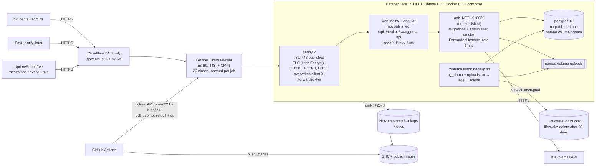

# ADR-006: Host production on one Hetzner Cloud server with Docker Compose

## Status

Accepted (2026-11-20). Replaces the Render hosting described in [render.yaml](../../render.yaml) and the "triggers the Render deploy" part of [ADR-004](004-main-is-primary-again.md) once the cut-over below is done; the branch policy of ADR-004 stays. Research and the `skeptic` review: [docs/research/hosting.md](../research/hosting.md). Refs #24, #25, #26, ADR-005 (PR #109, proposed) and its tasks #110, #112.

## Context

Production runs on the Render free tier ([docs/architecture/deployment.md](../architecture/deployment.md)): services sleep after 15 min (about 50 s cold start), SMTP is blocked (#25), uploads are lost on every deploy (#24) and the free Postgres expires after 30 days (#26). ADR-005 (guest registration, PayU) adds hard requirements: no sleeping services, a known proxy chain so the API can pick the real client IP from `X-Forwarded-For`, a proxy secret between nginx and the API, per-IP rate limits, and personal data deleted 30 days after an event, with backups holding it for at most 14–30 days more.

Load is small: about 1,000 visits/day, 5,000 at peaks. Production holds only mock data, so nothing is migrated. The owner's priority is **lowest price**; the team is a few volunteers.

Facts this ADR relies on (checked 2026-11-20, prices without VAT):

| Fact | Value | Source |
|---|---|---|
| CPX02 (the "Regular Performance from €5.49" plan) | 1 vCPU AMD, **1 GB RAM**, 20 GB NVMe, 20 TB, €5.49 HEL1 / €6.49 FSN1+NBG1, IPv4 included | [hetzner.com/cloud/regular-performance](https://www.hetzner.com/cloud/regular-performance) |
| CPX12 | 1 vCPU AMD, 2 GB RAM, 40 GB NVMe, 20 TB, **€9.99 HEL1** / €11.99 FSN1+NBG1, IPv4 included | same page, and the owner's check |
| CPX22 (upgrade path) | 2 vCPU, 4 GB, 80 GB, €16.99 HEL1 / €19.99 NBG1, not listed in FSN1 | same page |
| Server backups | flat **20% of the server price**, daily, 7 slots; **attached Volumes are not included** | [Hetzner billing FAQ](https://docs.hetzner.com/cloud/billing/faq/), [backups overview](https://docs.hetzner.com/cloud/servers/backups-snapshots/overview/) |
| Cost-Optimized plans | not orderable; Hetzner restricts new servers for some new customers | owner's check; [third-party report](https://www.bitdoze.com/hetzner-cloud-cost-optimized-plans/) |
| Cloudflare R2 free tier | 10 GB-month storage, 1 M Class A, 10 M Class B ops, free egress | [R2 pricing](https://developers.cloudflare.com/r2/pricing/) |
| Caddy `reverse_proxy` | ignores client-supplied `X-Forwarded-*` unless `trusted_proxies` is set, then sets its own | [Caddy docs](https://caddyserver.com/docs/caddyfile/directives/reverse_proxy) |
| Repo visibility | public, so GHCR images can be public (no pull credentials on the server) | `gh repo view` |

**Unverified:** DDoS protection terms for Hetzner Cloud; whether R2 needs a card on file to enable the free tier; R2 EU-jurisdiction buckets on the free tier; whether `hetznercloud/setup-hcloud` is the current official action name; Brevo free 300 e-mails/day (from the research, not rechecked).

## Options considered

Full comparison in [docs/research/hosting.md](../research/hosting.md) sections 4–9. In short:

1. **Stay on Render, paid plans** (change least): cost per research section 5 (est.); keeps the PaaS comfort, still no persistent disk without a paid disk add-on.
2. **DigitalOcean App Platform + Managed PostgreSQL** (research top pick, about 170 PLN gross): least ops, needs object storage for images.
3. **DigitalOcean Droplet + Managed PostgreSQL** (budget pick, about 143 PLN gross).
4. **Hetzner Cloud, one server, everything in Docker Compose** (cheapest, about 63 PLN gross). Chosen.

The owner chose option 4 for price. The research named its main risk: an untested restore. This ADR makes the restore test automatic.

## Decision

### 1. Target architecture

**Reverse proxy and TLS: Caddy in front of the existing nginx.** Compared:

| | Caddy in front (chosen) | nginx + certbot in the web container |
|---|---|---|
| TLS | Automatic issue and renewal, OCSP, HTTP→HTTPS, no cron | certbot container or cron, shared cert volume, nginx reload hook, webroot challenge location |
| Client IP | Caddy **drops** any client-supplied `X-Forwarded-For` and sets the real peer address. nginx appends Caddy's address. The API sees `XFF = client, caddy` from nginx, a fixed chain of two proxies on one Docker network | One hop fewer, but nginx's `$proxy_add_x_forwarded_for` **appends** to the client's header, so the API must count from the right anyway |
| Change to the web image | Small: pass through `X-Forwarded-Proto` from Caddy instead of `$scheme`, plus the ADR-005 header | Larger: TLS server blocks, cert paths, a second listen port, renewal plumbing |
| Cost | ~20–30 MB RAM (est.) | ~10 MB for certbot (est.) |

The extra hop lives inside the VM and is deterministic, so it does not weaken ADR-005: the API uses `UseForwardedHeaders` with `XForwardedFor`, `KnownNetworks` = the compose network's fixed subnet (set in `docker-compose.prod.yml`, for example `172.30.0.0/24`), `KnownProxies` cleared and `ForwardLimit = 2`. #110 must still log the raw header once and confirm this. The API and Postgres publish no ports; only Caddy listens on the host. nginx keeps adding `X-Proxy-Auth` (it overwrites any client value) as defence in depth.

**Plan: CPX12 (2 GB).** CPX02 (€5.49) has only 1 GB, too little for .NET + Postgres + nginx + Caddy with headroom. CPX12 is x86 (AMD), so images stay `linux/amd64`; no multi-arch build. Memory limits in compose (est.: api 768 MB, postgres 512 MB, web and caddy 64 MB each) plus a 2 GB swap file. Images are built in GitHub Actions, never on the server. If memory gets tight, rescale to CPX22 (€16.99 HEL1) keeping the disk size, which keeps a later downgrade possible.

**Location: HEL1 (Helsinki).** €2/month cheaper than FSN1/NBG1, EU (Finland), and CPX22 is listed there for the upgrade path (not in FSN1). Round-trip time from Gdańsk to Helsinki and to Frankfurt are both in the tens of milliseconds (est., not measured); the difference does not matter for this app. Fall back to NBG1 if HEL1 cannot create servers.

**Data on the root disk, not on a Hetzner Volume.** `pgdata` and `uploads` are Docker named volumes on the server's 40 GB disk, because Hetzner backups do not include attached Volumes. This fixes #24 without object storage.

**Secrets.** Source of truth is the GitHub Environment `production` (and `backup-restore` for the restore test). The deploy job writes `/opt/esn/.env` (mode 600, owner `deploy`) on every deploy, so rotating a secret = change it in GitHub + redeploy. The age **private** key for backups is not on the server: one copy in the association's password manager (board), one as the `backup-restore` secret. Nothing secret is baked into the public images.

### 2. What must be prepared (owner actions)

| # | Item | Who | Notes |
|---|---|---|---|
| P1 | Hetzner account in the association's name (association e-mail), 2FA, **≥ 2 project members** with their own logins | Board member + tech lead | One Hetzner project for production only, so an API token cannot touch anything else |
| P2 | Association's payment card on the Hetzner account; budget awareness (expected ~€15 gross/month); calendar note to review the invoice monthly | Treasurer | Hetzner has no hard spending cap (unverified); the invoice review is the control |
| P3 | **DPA** signed in the Hetzner console | Board member | Also list Hetzner, Brevo and Cloudflare (encrypted backups) in the ADR-005 privacy notice |
| P4 | Domain: who owns it, access to its DNS, decide the app hostname and a temporary one for the smoke test | Board member | Move DNS to Cloudflare (free) if it is not there |
| P5 | Cloudflare account (association e-mail, 2FA, ≥ 2 members): DNS zone, R2 bucket `esn-backups` with a 30-day lifecycle rule, two R2 tokens (read+write for the server, read-only for the restore test) | Tech lead | R2 may require a card on file (unverified) |
| P6 | Brevo account (association e-mail, 2FA), sender domain authenticated: SPF, DKIM, DMARC records in Cloudflare DNS; API key | Tech lead | Needed for #25 |
| P7 | age key pair for backups: private key in the association's password manager, public key in GitHub | Tech lead + board | Without the private key backups are useless |
| P8 | UptimeRobot account (association e-mail), alerts to the association mailbox and two volunteers | Tech lead | |
| P9 | GitHub: Environment `production` (deployment branches: `main` only; optional required reviewer), Environment `backup-restore`; secrets below; 2FA required in the org | Repo admin | |
| P10 | SSH deploy key pair (ed25519) for the `deploy` user, generated for CI only; personal keys of 2 volunteers for break-glass | Tech lead | |
| P11 | Runbooks read by two people: deploy/rollback, restore, secret rotation, server rebuild | Two volunteers | Written in task H5/H7 |

GitHub secrets (names only). `production`: `HCLOUD_TOKEN`, `PROD_SSH_PRIVATE_KEY`, `PROD_SSH_KNOWN_HOSTS`, `POSTGRES_PASSWORD`, `JWT_KEY`, `SEED_ADMIN_EMAIL`, `SEED_ADMIN_PASSWORD`, `BREVO_API_KEY`, `API_PROXY_SECRET`, `R2_ACCESS_KEY_ID`, `R2_SECRET_ACCESS_KEY`; variables `PROD_HOST`, `APP_DOMAIN`, `TEMP_DOMAIN`, `HCLOUD_FIREWALL`, `R2_ENDPOINT`, `BACKUP_AGE_RECIPIENTS`, `EMAIL_FROM_ADDRESS`. `backup-restore`: `R2_READ_ACCESS_KEY_ID`, `R2_READ_SECRET_ACCESS_KEY`, `BACKUP_AGE_IDENTITY`. PayU secrets are added later by ADR-005. All values are new; none are reused from Render.

### 3. Server baseline

- **Provisioning: scripted, no Terraform.** `infra/hetzner/provision.sh` (hcloud CLI) creates the SSH key, the firewall and its rules, and the server (`cpx12`, `hel1`, latest Ubuntu LTS image Hetzner offers, `--enable-backup`, `--user-data-from-file infra/hetzner/cloud-init.yaml`). Reason: five resources that change about once a year do not justify Terraform state (a remote backend to secure, lock and back up) for volunteers; the script plus cloud-init in the repo is the documentation and can rebuild the server in minutes. Revisit Terraform if a second environment (staging) is added.
- **cloud-init:** user `deploy` (sudo, in group `docker`, SSH key only); `PermitRootLogin no`, `PasswordAuthentication no`; Docker CE + compose plugin from Docker's apt repository (not the one-click image, so it is reproducible); `/etc/docker/daemon.json` with the `local` log driver (`max-size 10m`, `max-file 3`); journald capped (`SystemMaxUse=200M`); `unattended-upgrades` for security updates with automatic reboot at 04:30 UTC (after the backup; containers use `restart: unless-stopped`); 2 GB swap file; `fail2ban` skipped (port 22 is closed by default); `/opt/esn` owned by `deploy`; time zone UTC (the app stores UTC; the site time zone stays a site setting).
- **Firewall (Hetzner Cloud Firewall, stateful, free):** inbound TCP 80 and 443 from `0.0.0.0/0` and `::/0`, ICMP; **no SSH rule by default**; outbound unrestricted.
- **SSH access: temporary firewall rule opened by the workflow.** Compared:

| | Open 22, key-only | Tailscale/WireGuard | Temporary rule via hcloud API (chosen) |
|---|---|---|---|
| Exposure | Port scanned all day; safe with keys but noisy, wants fail2ban | None public | None except during a job (minutes), only for the runner's IP |
| New service | none | Tailscale account, auth keys, agent on the server, `tailscale/github-action` | none (Hetzner API already exists) |
| Human access | easy | easy | `hcloud firewall add-rule` for one's own IP (script in the runbook), Hetzner web console as break-glass |
| Main risk | key leak = shell | another account to own | `HCLOUD_TOKEN` can delete the server: one project for prod only, token only in the `production` environment, restricted to `main` |

  The job adds a rule for its own IP (`/32`), always removes it in an `if: always()` step, and all SSH jobs share one concurrency group so rules do not collide. The daily ops job also deletes any leftover SSH rule. Host keys are pinned through `PROD_SSH_KNOWN_HOSTS`.
- **Compose:** `postgres` has no `ports:`; only `caddy` publishes 80/443. Healthchecks on all four services so `docker compose up -d --wait` blocks until they are healthy.

### 4. CI/CD with GitHub Actions

**Build (in `release.yml`, after the bump job).** `docker/setup-buildx-action`, `docker/login-action` (GHCR with `GITHUB_TOKEN`, `packages: write`), `docker/build-push-action` for `ghcr.io/esn-app/esn-app-api` and `ghcr.io/esn-app/esn-app-web`, `linux/amd64`, GHA layer cache, build arg `GIT_COMMIT`. Tags: `vX.Y.Z` and `sha-<short>`. Packages are public.

**Deploy (job `deploy`, `environment: production`, needs build).**
1. Install hcloud (`hetznercloud/setup-hcloud`, or download the release binary), find the runner IP, add a firewall rule for it.
2. Copy `deploy/` (compose file, Caddyfile, scripts, systemd units) from the tagged commit to `/opt/esn` with `scp`; write `.env` from secrets.
3. `deploy.sh vX.Y.Z` on the server: run `backup.sh predeploy` (encrypted dump to R2), remember the running tag in `/opt/esn/previous-tag`, `docker compose pull`, `docker compose up -d --wait`.
4. Smoke test from the runner over public HTTPS: `/health` is 200, `/api/version` and `/version.json` report `X.Y.Z`, `/` is 200.
5. On failure: `deploy.sh <previous-tag>`, then fail the job. Always: remove the firewall rule.

`workflow_dispatch` takes an optional `tag` input to redeploy any earlier tag (manual rollback) without bumping. EF migrations stay on API startup; sample data is off in production (new flag, task H1). **Migration rule:** a release's migrations must keep the previous release working (expand, then contract in a later release), otherwise an automatic image rollback cannot work; a destructive migration is called out in its PR and rolled back with the pre-deploy dump.

**Backups.** `deploy/backup.sh`, run nightly at 01:30 UTC by a systemd timer: `pg_dump -Fc` through `docker compose exec -T postgres`, `tar` of the uploads volume, each encrypted with `age` to `BACKUP_AGE_RECIPIENTS` and streamed by `rclone` to R2 (`db/` and `uploads/` prefixes, timestamped). An R2 lifecycle rule deletes objects after **30 days**; Hetzner server backups keep **7 days**. So personal data can survive in backups for at most 30 days after deletion in the app, which the privacy notice states (ADR-005).

**Restore test and ops checks (`ops-checks.yml`, schedule).**
- Weekly `restore-test` (environment `backup-restore`, no SSH): `rclone` downloads the newest dump with the read-only token, `age -d`, `pg_restore` into a `postgres:18` service container; sanity checks: the dump is less than 36 h old, the latest `__EFMigrationsHistory` id equals the newest migration in `main`, at least one user in role `Admin`, core tables exist; the newest uploads archive lists without errors. Restored data never leaves the runner.
- Daily `host-check` (environment `production`, temporary SSH rule): disk usage < 80%, all containers healthy, last backup marker < 26 h, no leftover SSH rules.
- On failure both jobs open (or comment on) a GitHub issue labelled `ops` with `gh issue create`, on top of GitHub's failure e-mail. Note: GitHub disables scheduled workflows after 60 days without repository activity; the monthly invoice review (P2) includes checking that they still run.

**Maintenance.** `.github/dependabot.yml` for `github-actions`, `docker` (`docker/`), `npm` (`frontend/`, `e2e/`) and `nuget` (`backend/`), weekly. A weekly scheduled run of the build + deploy path rebuilds both images on fresh base layers and pulls patched `postgres:18` and `caddy:2`; it tags them `vX.Y.Z-bYYYYMMDD` so rollback tags stay immutable. Postgres major upgrades are a manual runbook step (dump, new major, restore). Alerts: UptimeRobot e-mail (site down), GitHub issue + e-mail (backup, restore, disk), Hetzner account e-mails (maintenance, abuse).

**Coolify instead of this?** Rejected. Coolify is a self-hosted PaaS (UI, Git deploys, Traefik proxy, scheduled DB backups). On a 2 GB server its control plane competes with the app for memory; it is one more internet-facing admin UI to patch and secure; its own proxy changes the hop chain ADR-005 depends on; and our deploy, backups and restore test would live in its database instead of the repo. Plain compose plus GitHub Actions keeps everything reviewable in PRs. Reconsider Coolify only if volunteers cannot maintain the workflows.

### 5. Cut-over plan (fresh setup, no data move)

1. Ship tasks H1–H6 (code and images, Render still serves production).
2. Owner actions P1–P10; run `provision.sh` (H7).
3. Point `TEMP_DOMAIN` (for example `new.<app-domain>`, TTL 300) at the server; Caddy serves both names. Set the app domain's TTL to 300 one day before the switch.
4. First deploy to the server (H8) with `Email__FrontendBaseUrl` = the final app domain; the admin is seeded from `SEED_ADMIN_*`, no sample data.
5. Smoke and QA on the temporary hostname (H10): pages, admin login, image upload survives a redeploy (#24), password-reset e-mail arrives through Brevo (#25), `/api/version`, first nightly backup and one restore test green, raw `X-Forwarded-For` logged once (#110).
6. Switch the app domain's A/AAAA records to the server (DNS-only). Verify, add UptimeRobot monitors.
7. Remove the Render deploy-hook step and secrets so merges deploy only to Hetzner.
8. After 1–2 weeks without incidents: delete the Render services and database, delete `render.yaml` and the Render-specific code (H12).

**Rollback:** until step 8, point DNS back at Render (minutes with TTL 300; Render URLs keep working). After step 8, rollback = redeploy an earlier tag, or rebuild the server with `provision.sh` and restore the last dump (runbook).

### 6. Repo changes

- `backend/`: `Seed:SampleData` flag (default `false`; `true` in compose and e2e); Brevo HTTP email sender behind the existing sender interface with `Email:Provider`; `GIT_COMMIT` instead of `RENDER_GIT_COMMIT` in `VersionController` (fallback to the old name until H12).
- `docker/`: `GIT_COMMIT` build arg in both Dockerfiles; `nginx.conf.template`: `X-Forwarded-Proto` passed through from Caddy, `${GIT_COMMIT}` in `/version.json` (`X-Proxy-Auth` comes with #110).
- New `deploy/`: `docker-compose.prod.yml`, `Caddyfile`, `deploy.sh`, `backup.sh`, `esn-backup.service` + `.timer`, `.env.production.example`.
- New `infra/hetzner/`: `provision.sh`, `cloud-init.yaml`, `ssh-open.sh` (human break-glass).
- `.github/workflows/release.yml` (build, push, deploy, rollback; Render hooks removed in step 7), new `ops-checks.yml`, new `.github/dependabot.yml`; `e2e.yml` sets the sample-data flag.
- `.env.example` (new variables), `docs/operations/production.md` (runbooks), `docs/architecture/deployment.md` and CLAUDE.md Deployment (at cut-over), removal of `render.yaml`.

### 7. Implementation plan

Each task is one branch + one PR into `main` and ships alone. Agents per repo rules: `backend` owns backend code, CI/workflows and Docker/infra files; `frontend` owns nginx and the web image.

| # | Task | Agent | Scope | Acceptance criteria | Depends on | Bump | Owner action |
|---|---|---|---|---|---|---|---|
| H1 | Split sample-data seeding from migrations | backend | `Program.cs`, `DbSeeder`, `appsettings*.json`, `docker-compose.yml`, `e2e.yml`, `.env.example`, tests | `ApplyMigrationsOnStartup=true` + `Seed:SampleData` unset → migrations + admin only (test); compose and e2e still get sample data | – | patch | – |
| H2 | Brevo HTTP email sender (#25) | backend | `Infrastructure/Email/*`, DI, `.env.example` | Provider switch Brevo/Smtp/Log; unit test with fake `HttpMessageHandler`; empty key → log, as today | – | minor | P6 for a live test |
| H3 | Neutral commit id `GIT_COMMIT` (API side) | backend | `VersionController`, `docker/backend.Dockerfile` build arg | `/api/version` shows `GIT_COMMIT`, falls back to `RENDER_GIT_COMMIT` | – | patch | – |
| H4 | nginx for the Caddy chain + `GIT_COMMIT` (web side) | frontend | `docker/nginx.conf.template`, `docker/frontend.Dockerfile` | `X-Forwarded-Proto` passed through when set, `$scheme` otherwise (Render keeps working); `/version.json` commit from `GIT_COMMIT`; e2e green | – | patch | – |
| H5 | Production compose, Caddy, scripts, cloud-init, runbook | backend | `deploy/*`, `infra/hetzner/*`, `docs/operations/production.md` | `docker compose -f deploy/docker-compose.prod.yml config` valid; only caddy publishes ports; fixed subnet; healthchecks + memory limits; `backup.sh` encrypts before upload (shellcheck clean); runbook covers deploy, rollback, restore, rotation, rebuild | H1 | patch | – |
| H6 | Build and push images to GHCR | backend | `release.yml` (new build job; Render hooks stay) | Merge to `main` publishes both images tagged `vX.Y.Z` + `sha-…`, public | H3, H4 | patch | – |
| H7 | Provision production (Hetzner, R2, DNS temp name, GitHub environments) | backend (with owner) | run `provision.sh`; record non-secret values in the runbook | Server reachable on 80/443 only; backups enabled; R2 lifecycle 30 days; environments and secrets exist | H5, P1–P10 | – (docs PR if runbook changes) | **yes** |
| H8 | Deploy job with smoke test and automatic rollback | backend | `release.yml` deploy job, `workflow_dispatch` `tag` input | Merge deploys to the temp hostname; a broken image rolls back to the previous tag and fails the job; SSH rule removed afterwards | H6, H7 | patch | approve `production` |
| H9 | Ops checks: restore test, host check, Dependabot, weekly rebuild | backend | `ops-checks.yml`, `dependabot.yml`, scheduled rebuild | Restore test green against a real dump; a forced failure opens an `ops` issue; Dependabot PRs appear | H8 | patch | – |
| H10 | QA and security gate on the temp hostname | tests, security | e2e/QA scripts against `TEMP_DOMAIN`, read-only review of firewall, SSH, secrets, headers, TLS | Checklist of cut-over step 5 green; no high findings | H8, H9 | – | – |
| H11 | Cut-over: DNS switch, Render hooks removed, docs | backend | `release.yml` (drop Render step), `docs/architecture/deployment.md`, CLAUDE.md Deployment | App domain served from Hetzner; UptimeRobot green; closes #24, #25, #26 | H10, H2 | minor | **yes** (DNS, UptimeRobot) |
| H12 | Decommission Render | backend | delete `render.yaml`, `RENDER_GIT_COMMIT` fallback, Render secrets, Render resources; mark docs | No Render references left except history; Render resources deleted | H11 + 1–2 weeks | patch | **yes** (delete Render) |

Links to ADR-005: this ADR replaces ADR-005 step 1 ("Paid Postgres + backups", #26) with H5, H7, H9 and H11. **#110** (edge hardening) measures `X-Forwarded-For` on the new chain and can start once H8 runs on the temp hostname; its configuration must use the values from section 1. **#112** (T4, registration backend) depends on #110 and on H11, because guest PII must not go to the Render free database.

## Consequences

- No cold starts, a persistent disk and our own Postgres: #24, #25 (with H2) and #26 are fixed for about **€14.75 gross/month (≈ 63 PLN, est. at 4.25 PLN/EUR)**: CPX12 HEL1 €9.99 + backups €2.00 = €11.99 net + 23% VAT. R2, Cloudflare DNS, Brevo, UptimeRobot and GHCR stay on free tiers (est. backup size well under 10 GB). The domain is not counted.
- Volunteers now own a Linux server: OS updates are automatic, but someone reads `ops` issues and handles Postgres major upgrades. Estimated 1–2 h/month (est.).
- Deploys become image-based and reproducible (tagged images in GHCR, rollback by tag); Render deploy hooks and `render.yaml` go away.
- Backups and their restore are tested every week by CI instead of by memory.
- ADR-004's "triggers the Render deploy" is superseded; its branch rules are unchanged.

## Risks and mitigations

| Risk | Mitigation |
|---|---|
| Single server: hardware or host failure | Hetzner backups (restore in minutes) or rebuild with `provision.sh` + last R2 dump. RPO ≤ 24 h, RTO ~2–4 h (est.). Accepted for this load |
| Restore does not work when needed | Weekly automated restore test; a manual drill once per semester following the runbook |
| Hetzner refuses new servers for new customers / plan unavailable | Create the account and server early (H7 right after H5); fall back to NBG1, then to the DigitalOcean Droplet option from the research |
| Hetzner raises prices again (twice in 2026) | Monthly invoice review; compose + scripts move to any VPS with Docker in a day |
| 2 GB RAM pressure | Memory limits, swap, host check; rescale to CPX22 (€16.99) without growing the disk |
| `HCLOUD_TOKEN` leak can delete or take over the server | Separate Hetzner project, token only in the `production` environment limited to `main`, rotation in the runbook, R2 copy is off-provider |
| Server compromise also deletes R2 backups (read+write token) | Hetzner server backups as a second copy outside the VM; restore-test token is read-only |
| Rollback after a schema migration | Expand/contract rule; pre-deploy dump to R2 before every deploy |
| Disk full (logs, dumps) | Log rotation, journald cap, dumps are streamed and not kept locally, daily disk check |
| DDoS or abuse traffic (Hetzner Cloud DDoS terms unverified) | Rate limits from #110; Cloudflare proxy can be turned on later only with the conditions in research section 7 (locked origin, Full strict, Bot Fight Mode off, `CF-Connecting-IP`) |
| Scheduled workflows silently disabled after 60 days of inactivity | Monthly check of workflow runs in the invoice review |
| Bus factor | ≥ 2 members on Hetzner, Cloudflare, Brevo, GitHub; runbooks in the repo |
