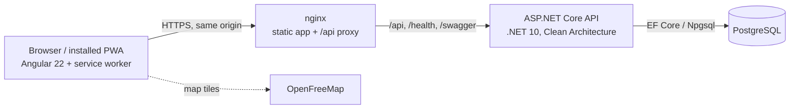

# ESN Gdańsk App: architecture (as-is)

This describes the system **as it is in the code today** (checked against `main` at v0.5.7). It records no decisions; those live in [../adr/](../adr). When code and this document disagree, the code is right, so fix the doc.

## One-page overview

The ESN Gdańsk App is a mobile-first PWA for incoming Erasmus students: **Events** (with a calendar), **Partners** (discount offers, with a map), **Info** articles, **News** highlights on **Home**, plus a role-gated **Admin panel** to manage all of it.

- **Frontend**: Angular 22 (standalone components, signals, zoneless), Angular Material, `maplibre-gl`, Angular service worker. Source: [frontend/src/app](../../frontend/src/app).
- **Backend**: ASP.NET Core Web API on .NET 10 in four projects (Domain, Application, Infrastructure, Api), MediatR + FluentValidation, EF Core + Npgsql, ASP.NET Identity + JWT. Source: [backend/src](../../backend/src).
- **Hosting**: Render free tier (Frankfurt), described by [render.yaml](../../render.yaml). Deploys start from GitHub Actions after a merge into `main`.

## Index

| Document | Contents |
|---|---|
| [system-context.md](system-context.md) | C4 context and container diagrams, external dependencies |
| [backend.md](backend.md) | Layers, request pipeline, public/admin split, auth, uploads, audit, flags/settings |
| [data-model.md](data-model.md) | ER diagram, entities, statuses, indexes, migrations |
| [frontend.md](frontend.md) | Route map, feature folders, core services, response cache, view transitions, admin panel |
| [deployment.md](deployment.md) | Local docker compose, CI, pre-push hook, release workflow, Render |
| [known-limitations.md](known-limitations.md) | Known limitations and tech debt, linked to issues |

## Where to find what

Backend paths are relative to [backend/src](../../backend/src) and frontend paths to [frontend/src/app](../../frontend/src/app).

| Feature | Public API | Admin API | Use cases (Application) | Entity (Domain) | Frontend |
|---|---|---|---|---|---|
| Events (+ calendar) | [`EventsController`](../../backend/src/EsnApp.Api/Controllers/EventsController.cs) `api/events` | [`AdminEventsController`](../../backend/src/EsnApp.Api/Controllers/AdminEventsController.cs) `api/admin/events` | [Application/Events](../../backend/src/EsnApp.Application/Events) | [`Event`](../../backend/src/EsnApp.Domain/Events/Event.cs) | [features/events](../../frontend/src/app/features/events), [events-api.ts](../../frontend/src/app/features/events/data-access/events-api.ts) |
| Partners (+ map) | [`PartnersController`](../../backend/src/EsnApp.Api/Controllers/PartnersController.cs) `api/partners` | [`AdminPartnersController`](../../backend/src/EsnApp.Api/Controllers/AdminPartnersController.cs) `api/admin/partners` | [Application/Discounts](../../backend/src/EsnApp.Application/Discounts) (`*Partner*`) | [`Partner`](../../backend/src/EsnApp.Domain/Discounts/Partner.cs) | [features/partners](../../frontend/src/app/features/partners), [partners-api.ts](../../frontend/src/app/features/partners/data-access/partners-api.ts), [partners-map.ts](../../frontend/src/app/features/partners/components/partners-map/partners-map.ts) |
| Offers (discounts of a partner) | [`DiscountsController`](../../backend/src/EsnApp.Api/Controllers/DiscountsController.cs) `api/discounts` | [`AdminDiscountsController`](../../backend/src/EsnApp.Api/Controllers/AdminDiscountsController.cs) `api/admin/discounts` | [Application/Discounts](../../backend/src/EsnApp.Application/Discounts) (`*Discount*`) | [`Discount`](../../backend/src/EsnApp.Domain/Discounts/Discount.cs) | partners feature + admin partner form (no `discounts` folder; `/discounts` redirects to `/partners`) |
| Info | [`InfoController`](../../backend/src/EsnApp.Api/Controllers/InfoController.cs) `api/info` | [`AdminInfoController`](../../backend/src/EsnApp.Api/Controllers/AdminInfoController.cs) `api/admin/info` | [Application/Info](../../backend/src/EsnApp.Application/Info) (admin in `Administration/`) | [`InfoArticle`](../../backend/src/EsnApp.Domain/Info/InfoArticle.cs) | [features/info](../../frontend/src/app/features/info), [info-api.ts](../../frontend/src/app/features/info/data-access/info-api.ts) |
| News | [`NewsController`](../../backend/src/EsnApp.Api/Controllers/NewsController.cs) `api/news` | [`AdminNewsController`](../../backend/src/EsnApp.Api/Controllers/AdminNewsController.cs) `api/admin/news` | [Application/News](../../backend/src/EsnApp.Application/News) | [`NewsItem`](../../backend/src/EsnApp.Domain/News/NewsItem.cs) | inside [features/home](../../frontend/src/app/features/home): [news-api.ts](../../frontend/src/app/features/home/data-access/news-api.ts), `pages/news-details` |
| Home | (uses events, news, partners, info) | n/a | n/a | n/a | [features/home](../../frontend/src/app/features/home) (root route `''`) |
| Auth / admin accounts | [`AuthController`](../../backend/src/EsnApp.Api/Controllers/AuthController.cs) `api/auth` | [`AdminUsersController`](../../backend/src/EsnApp.Api/Controllers/AdminUsersController.cs) `api/admin/admins` | [Application/Identity](../../backend/src/EsnApp.Application/Identity), [Infrastructure/Identity](../../backend/src/EsnApp.Infrastructure/Identity) | [`ApplicationUser`](../../backend/src/EsnApp.Infrastructure/Identity/ApplicationUser.cs) (Identity) | [features/auth](../../frontend/src/app/features/auth), [core/auth.service.ts](../../frontend/src/app/core/auth.service.ts) |
| Feature flags | [`FeaturesController`](../../backend/src/EsnApp.Api/Controllers/FeaturesController.cs) `api/features` | [`AdminFeaturesController`](../../backend/src/EsnApp.Api/Controllers/AdminFeaturesController.cs) `api/admin/features` | [Application/Features](../../backend/src/EsnApp.Application/Features) | [`FeatureFlag`](../../backend/src/EsnApp.Domain/Features/FeatureFlag.cs) | [core/feature-flags.ts](../../frontend/src/app/core/feature-flags.ts), admin Settings tab |
| Site settings (time zone) | [`SettingsController`](../../backend/src/EsnApp.Api/Controllers/SettingsController.cs) `api/settings` | [`AdminSettingsController`](../../backend/src/EsnApp.Api/Controllers/AdminSettingsController.cs) `api/admin/settings` | [Application/Settings](../../backend/src/EsnApp.Application/Settings) | [`SiteSetting`](../../backend/src/EsnApp.Domain/Settings/SiteSetting.cs) | [core/site-settings.ts](../../frontend/src/app/core/site-settings.ts), [shared/utils/time-zone.ts](../../frontend/src/app/shared/utils/time-zone.ts) |
| Version | [`VersionController`](../../backend/src/EsnApp.Api/Controllers/VersionController.cs) `api/version` | n/a | n/a | n/a | `/version.json` from nginx, admin version card |
| Admin panel (UI only) | n/a | all `api/admin/*` | n/a | n/a | [features/admin](../../frontend/src/app/features/admin), [admin-api.ts](../../frontend/src/app/features/admin/data-access/admin-api.ts) |

Persistence for every row above: [AppDbContext](../../backend/src/EsnApp.Infrastructure/Persistence/AppDbContext.cs), [Configurations/](../../backend/src/EsnApp.Infrastructure/Persistence/Configurations), [Repositories/](../../backend/src/EsnApp.Infrastructure/Persistence/Repositories), [Migrations/](../../backend/src/EsnApp.Infrastructure/Persistence/Migrations).

## Glossary

| Term | Meaning |
|---|---|
| **Partner** | A local business that gives ESN members discounts. It has a logo, address, optional coordinates (map pin), a status (`Draft`/`Active`/`Inactive`) and a display order. This is the concept users see. |
| **Discount / offer** | One offer that belongs to a Partner (`Discount.PartnerId`). The backend area and table are still called "Discounts", but in the UI they show up as a partner's **offers**, edited from the partner form in the admin panel. Public `GET /api/discounts` returns only offers of `Active` partners. |
| **Public vs admin API** | Public controllers are anonymous and GET-only. Every write lives under `api/admin/*` behind `[Authorize(Roles = "Admin")]`. |
| **Admin** | An ASP.NET Identity user with the `Admin` role. There is no self-registration and there are no student accounts yet. |
| **Status** | Publishing state per entity: Event `Draft/Published/Cancelled/Completed/Archived`; Info and News `Draft/Published`; Partner `Draft/Active/Inactive`. The public API shows only published items (events: `Published` and `Cancelled`; partners: `Active`). |
| **Display order** | Manual sort index for Partners, Info and News (`PUT .../order`). Changing only the order does not count as an edit in the audit fields. |
| **Feature flag** | A runtime boolean switch stored in `FeatureFlags` and keyed by name. Only the keys in [`FeatureFlagKeys`](../../backend/src/EsnApp.Application/Features/FeatureFlagKeys.cs) exist (today only `pastEventTag`). The frontend starts from the values in `environment.ts` and switches to the server values once they load. |
| **Site setting / site time zone** | A key/value row in `SiteSettings`. Today the only key is `timeZone` (an IANA id, default `Europe/Warsaw`). All dates are shown and entered in this zone, not in the browser's zone. |
| **Audit fields** | `CreatedAt/UpdatedAt` on every entity. On `CreatorTrackedEntity` also `CreatedBy*/UpdatedBy*`: snapshots of the admin's id and name, with no foreign key to the user. |
| **Same-origin proxy** | nginx serves the app and forwards `/api` to the API, so the browser never makes cross-origin calls ([ADR-002](../adr/002-same-origin-api-proxy.md)). |
| **Cold start** | Free Render services sleep after 15 minutes idle. The first request wakes them up, which takes about 50 s, and the frontend `retryInterceptor` covers that gap. |
