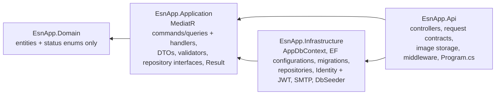
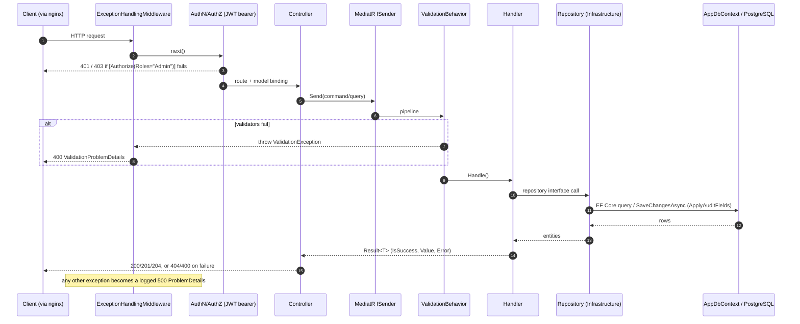
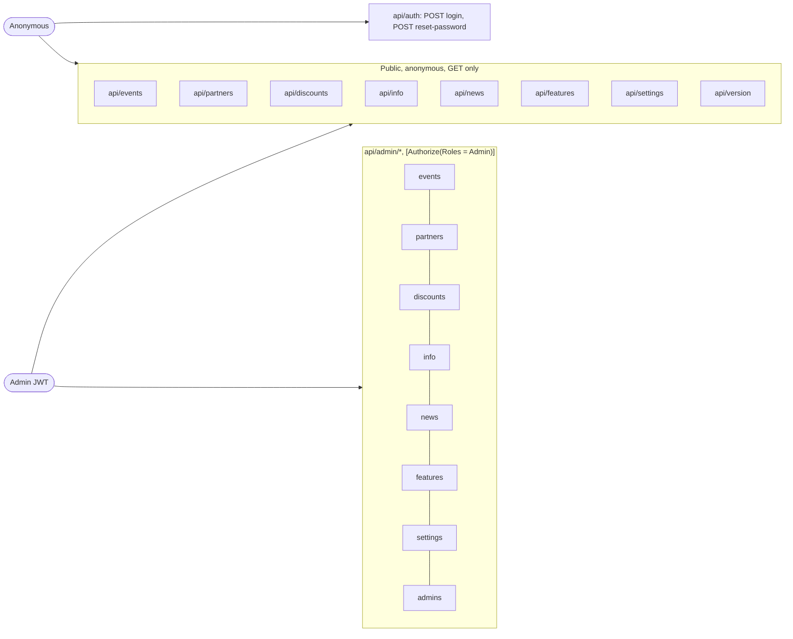
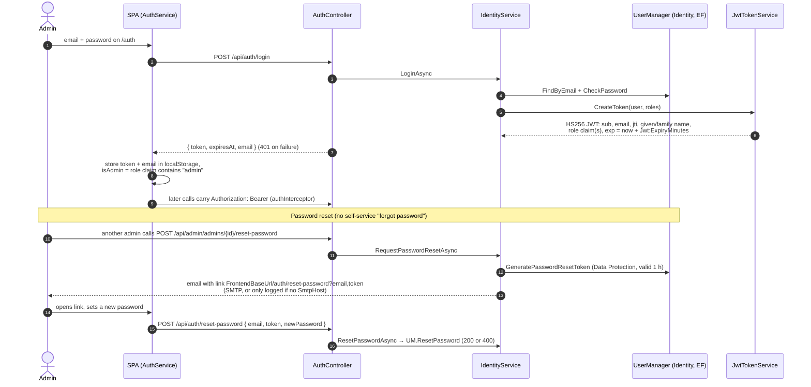
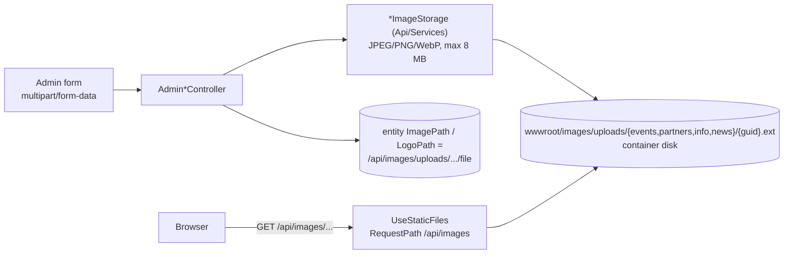

# Backend

[Back to index](README.md) · Source: [backend/](../../backend) · Solution: [EsnApp.sln](../../backend/EsnApp.sln)

## Clean Architecture layers

Dependencies point inward: Domain depends on nothing, and Application knows only Domain plus its own interfaces (`I*Repository`, `IIdentityService`, `IEmailSender`, `ICurrentUser`). Infrastructure implements those interfaces. Api wires everything together in [Program.cs](../../backend/src/EsnApp.Api/Program.cs) through [`AddApplication()`](../../backend/src/EsnApp.Application/DependencyInjection.cs) (MediatR, `ValidationBehavior`, validators) and [`AddInfrastructure(config)`](../../backend/src/EsnApp.Infrastructure/DependencyInjection.cs) (DbContext, Identity, JWT, repositories, email).

Application folders by area: `Events`, `Info`, `News`, `Discounts` (Partner + Discount), `Features`, `Settings`, `Identity`, `Common`. Info keeps its admin use cases in `Info/Administration/`, Features and Settings in `*/Administration/`. Events, News and Discounts use one folder per use case (`CreateEvent/`, `UpdateNewsItemStatus/`, ...).

Two details sit outside the pattern:
- The image storage classes live in Api ([Services/](../../backend/src/EsnApp.Api/Services)), and controllers call them before or after `sender.Send(...)`.
- `AdminUsersController` calls `IIdentityService` directly for list, delete and reset-password. Only create goes through MediatR (`CreateAdminRequest`).

## Request pipeline

- [`Result` / `Result<T>`](../../backend/src/EsnApp.Application/Common/Result.cs) carries only a success flag and an error string. Each controller decides the status code: usually `NotFound` for a failed lookup and `BadRequest(new { error })` for a failed command; `AuthController.Login` returns `401`.
- [`ValidationBehavior`](../../backend/src/EsnApp.Application/Common/Behaviors/ValidationBehavior.cs) runs every FluentValidation validator for the request. [`ExceptionHandlingMiddleware`](../../backend/src/EsnApp.Api/Middleware/ExceptionHandlingMiddleware.cs) maps `ValidationException` to 400 and anything else to 500.
- Image validation errors (`InvalidOperationException` from the storage classes) are caught in the admin controllers and returned as 400.
- `PagedResult<T>` ([Common/PagedResult.cs](../../backend/src/EsnApp.Application/Common/PagedResult.cs)) backs the paged event lists (public and admin); the other lists are not paged.

## Public (GET-only) vs `api/admin/*`

| Controller | Route | Endpoints |
|---|---|---|
| [EventsController](../../backend/src/EsnApp.Api/Controllers/EventsController.cs) | `api/events` | `GET` (paged list, filters), `GET months`, `GET {id}`. Returns `Published` and `Cancelled` events only. |
| [PartnersController](../../backend/src/EsnApp.Api/Controllers/PartnersController.cs) | `api/partners` | `GET` (`Active` partners only) |
| [DiscountsController](../../backend/src/EsnApp.Api/Controllers/DiscountsController.cs) | `api/discounts` | `GET` (offers of `Active` partners) |
| [InfoController](../../backend/src/EsnApp.Api/Controllers/InfoController.cs) | `api/info` | `GET`, `GET by-slug/{slug}` (`Published` only) |
| [NewsController](../../backend/src/EsnApp.Api/Controllers/NewsController.cs) | `api/news` | `GET`, `GET {id}` (`Published` only) |
| [FeaturesController](../../backend/src/EsnApp.Api/Controllers/FeaturesController.cs) | `api/features` | `GET` (key → bool map) |
| [SettingsController](../../backend/src/EsnApp.Api/Controllers/SettingsController.cs) | `api/settings` | `GET` (`{ timeZone }`) |
| [VersionController](../../backend/src/EsnApp.Api/Controllers/VersionController.cs) | `api/version` | `GET` (`VERSION` file, `RENDER_GIT_COMMIT`, process start time) |
| [AuthController](../../backend/src/EsnApp.Api/Controllers/AuthController.cs) | `api/auth` | `POST login`, `POST reset-password` (the only anonymous non-GET endpoints) |
| [AdminEventsController](../../backend/src/EsnApp.Api/Controllers/AdminEventsController.cs) | `api/admin/events` | `GET`, `GET {id}`, `POST` (multipart, image), `PUT {id}` (multipart), `PATCH {id}` (status), `DELETE {id}` |
| [AdminPartnersController](../../backend/src/EsnApp.Api/Controllers/AdminPartnersController.cs) | `api/admin/partners` | `GET`, `GET {id}`, `GET by-slug/{slug}`, `GET {id}/discounts`, `POST` / `PUT {id}` (multipart, logo), `PATCH {id}/status`, `PUT order`, `DELETE {id}` (cascades to offers) |
| [AdminDiscountsController](../../backend/src/EsnApp.Api/Controllers/AdminDiscountsController.cs) | `api/admin/discounts` | `GET` (includes offers of non-public partners), `POST`, `PUT {id}`, `DELETE {id}` |
| [AdminInfoController](../../backend/src/EsnApp.Api/Controllers/AdminInfoController.cs) | `api/admin/info` | `GET`, `GET {id}`, `POST` / `PUT {id}` (multipart), `PATCH {id}/status`, `PUT order`, `DELETE {id}` |
| [AdminNewsController](../../backend/src/EsnApp.Api/Controllers/AdminNewsController.cs) | `api/admin/news` | `GET`, `GET {id}`, `POST` / `PUT {id}` (multipart), `PATCH {id}/status`, `PUT order`, `DELETE {id}` |
| [AdminFeaturesController](../../backend/src/EsnApp.Api/Controllers/AdminFeaturesController.cs) | `api/admin/features` | `GET`, `PUT {key}` |
| [AdminSettingsController](../../backend/src/EsnApp.Api/Controllers/AdminSettingsController.cs) | `api/admin/settings` | `GET`, `PUT` |
| [AdminUsersController](../../backend/src/EsnApp.Api/Controllers/AdminUsersController.cs) | `api/admin/admins` | `GET` (list), `POST` (create admin), `DELETE {id}` (not yourself), `POST {id}/reset-password` (emails a reset link) |

[RouteGuardTests](../../backend/tests/EsnApp.Api.Tests/RouteGuardTests.cs) checks this split. Also exposed: `GET /health` (health checks), `/swagger` (Swagger UI, enabled in every environment) and `/api/images/**` (static uploaded files).

## Authentication and password reset

- JWT settings: `Jwt:Key/Issuer/Audience/ExpiryMinutes` ([JwtSettings.cs](../../backend/src/EsnApp.Infrastructure/Identity/JwtSettings.cs)). Issuer, audience, lifetime and signing key are all validated. There are no refresh tokens and no server-side revocation; logging out only clears localStorage.
- Identity options: unique email, password at least 8 characters, no symbol required ([DependencyInjection.cs](../../backend/src/EsnApp.Infrastructure/DependencyInjection.cs)).
- [DbSeeder](../../backend/src/EsnApp.Infrastructure/Persistence/DbSeeder.cs) creates the `Admin` role and, when `Seed:AdminEmail`/`Seed:AdminPassword` are set, an admin user in that role.

## Image uploads and storage

- There are four near-identical classes: [EventImageStorage](../../backend/src/EsnApp.Api/Services/EventImageStorage.cs), [PartnerImageStorage](../../backend/src/EsnApp.Api/Services/PartnerImageStorage.cs), [InfoImageStorage](../../backend/src/EsnApp.Api/Services/InfoImageStorage.cs) and [NewsImageStorage](../../backend/src/EsnApp.Api/Services/NewsImageStorage.cs). `Delete` removes only files under their own `/api/images/uploads/<area>/` prefix. Seeded items point at frontend assets under `/images/...`, so those are never deleted.
- **On Render the disk is ephemeral**: uploads disappear on every deploy or restart ([#24](https://github.com/ESN-App/ESN-App/issues/24)). Locally, compose mounts the named volume `uploads` at `/app/wwwroot/images/uploads`.

## Audit fields

[`AppDbContext.ApplyAuditFields()`](../../backend/src/EsnApp.Infrastructure/Persistence/AppDbContext.cs) runs inside `SaveChangesAsync`:

| Entity state | What is set |
|---|---|
| Added (`BaseEntity`) | `Id = Guid.NewGuid()` if empty, `CreatedAt = UtcNow`; for `CreatorTrackedEntity` also `UpdatedBy* = CreatedBy*` |
| Modified, any property other than `DisplayOrder` | `UpdatedAt = UtcNow`; `UpdatedById/Name` from [`ICurrentUser`](../../backend/src/EsnApp.Application/Identity/ICurrentUser.cs) when a user is present (the seeder keeps the last real editor) |
| Modified, `DisplayOrder` only (reorder) | nothing |

`CreatedById/CreatedByName` are set by the create handlers from `ICurrentUser` ([HttpContextCurrentUser](../../backend/src/EsnApp.Api/Services/HttpContextCurrentUser.cs) reads the JWT claims). The names are snapshots with **no FK** to `AspNetUsers`, so deleting an admin keeps the history. Covered by [AuditFieldsTests](../../backend/tests/EsnApp.Api.Tests/AuditFieldsTests.cs).

## Feature flags and site settings

| | Feature flags | Site settings |
|---|---|---|
| Table | `FeatureFlags` (PK `Key`, `Enabled`, `UpdatedAt`) | `SiteSettings` (PK `Key`, `Value` ≤ 500, `UpdatedAt`) |
| Allowed keys | [`FeatureFlagKeys.All`](../../backend/src/EsnApp.Application/Features/FeatureFlagKeys.cs): `pastEventTag` (temporary, see #33) | [`SiteSettingKeys`](../../backend/src/EsnApp.Application/Settings/SiteSettingKeys.cs): `timeZone` (IANA id, default `Europe/Warsaw`) |
| Seeded by | migration [AddFeatureFlags](../../backend/src/EsnApp.Infrastructure/Persistence/Migrations/20261106181004_AddFeatureFlags.cs) (once, never overwrites a toggle) | migration [AddSiteSettings](../../backend/src/EsnApp.Infrastructure/Persistence/Migrations/20261108124147_AddSiteSettings.cs); the code falls back to the default if the row is missing |
| Public read | `GET /api/features` | `GET /api/settings` |
| Admin write | `PUT /api/admin/features/{key}` | `PUT /api/admin/settings` |
| Frontend | [FeatureFlags](../../frontend/src/app/core/feature-flags.ts) signals, defaults from `environment.ts` | [SiteSettings](../../frontend/src/app/core/site-settings.ts) `timeZone` signal |

Adding a flag takes a key in `FeatureFlagKeys`, a migration that inserts its row, and a signal in the frontend `FeatureFlags`.

## Tests

- [EsnApp.Api.Tests](../../backend/tests/EsnApp.Api.Tests): `WebApplicationFactory<Program>` in environment `Testing`. Covers health, route/auth guards, audit fields, the Postgres connection-string parser and version.
- [EsnApp.Application.Tests](../../backend/tests/EsnApp.Application.Tests): handler unit tests per area (Events, Info, News, Discounts, Features, Settings, Identity, Common).
- End-to-end: [e2e/](../../e2e) Playwright against the full compose stack (see [deployment.md](deployment.md)).
