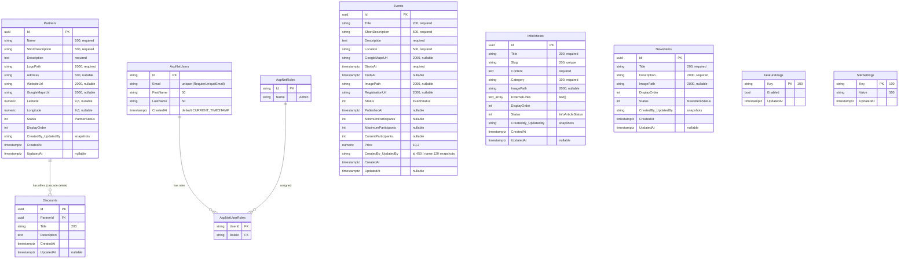

# Data model

[Back to index](README.md) · Sources: [Domain](../../backend/src/EsnApp.Domain), [AppDbContext](../../backend/src/EsnApp.Infrastructure/Persistence/AppDbContext.cs), [Configurations/](../../backend/src/EsnApp.Infrastructure/Persistence/Configurations), [model snapshot](../../backend/src/EsnApp.Infrastructure/Persistence/Migrations/AppDbContextModelSnapshot.cs)

## ER diagram

`CreatedBy_UpdatedBy` stands for four columns: `CreatedById`, `CreatedByName`, `UpdatedById` and `UpdatedByName`. They are **deliberately not foreign keys** to `AspNetUsers` (see [backend.md, Audit fields](backend.md#audit-fields)). The other Identity tables (`AspNetUserClaims`, `AspNetUserLogins`, `AspNetUserTokens`, `AspNetRoleClaims`) exist but the app does not use them directly.

## Base classes

| Class | Fields | Used by |
|---|---|---|
| [`BaseEntity`](../../backend/src/EsnApp.Domain/Common/BaseEntity.cs) | `Id` (Guid), `CreatedAt`, `UpdatedAt?` | `Discount` |
| [`CreatorTrackedEntity`](../../backend/src/EsnApp.Domain/Common/CreatorTrackedEntity.cs) : `BaseEntity` | + `CreatedById/Name`, `UpdatedById/Name` | `Event`, `Partner`, `InfoArticle`, `NewsItem` |
| (none, key = identity) | `Key`, `UpdatedAt` | `FeatureFlag`, `SiteSetting` |

## Status enums (stored as int)

| Enum | Values | Public visibility |
|---|---|---|
| [`EventStatus`](../../backend/src/EsnApp.Domain/Events/EventStatus.cs) | Draft 0, Published 1, Cancelled 2, Completed 3, Archived 4 | Published + Cancelled |
| [`PartnerStatus`](../../backend/src/EsnApp.Domain/Discounts/PartnerStatus.cs) | Draft 0, Active 1, Inactive 2 | Active (their offers too) |
| [`InfoArticleStatus`](../../backend/src/EsnApp.Domain/Info/InfoArticleStatus.cs) | Draft 0, Published 1 | Published |
| [`NewsItemStatus`](../../backend/src/EsnApp.Domain/News/NewsItemStatus.cs) | Draft 0, Published 1 | Published |

## Indexes

- `Events (Status, StartsAt)`
- `Partners (Status, DisplayOrder)`
- `InfoArticles (Slug)` unique; `InfoArticles (Status, Category, DisplayOrder)`
- `NewsItems (Status, DisplayOrder)`
- `Discounts (PartnerId)` (FK)

## Conventions

- `Uri` properties (`GoogleMapsUrl`, `WebsiteUrl`) are stored as strings through a value converter.
- All instants are `DateTimeOffset` (stored as `timestamptz`, UTC). Converting to the site time zone happens only in the frontend.
- The schema changes **only** through EF Core migrations in [Persistence/Migrations](../../backend/src/EsnApp.Infrastructure/Persistence/Migrations) (20 so far, from `InitialCreate` 2026-07-07 to `AddSiteSettings` 2026-11-08). [`DbSeeder.SeedAsync`](../../backend/src/EsnApp.Infrastructure/Persistence/DbSeeder.cs) calls `Database.MigrateAsync()` and then seeds the role, the admin and sample events/partners/news/info articles (info inline in the seeder) from [EventSeedData](../../backend/src/EsnApp.Infrastructure/Persistence/EventSeedData.cs), [PartnerSeedData](../../backend/src/EsnApp.Infrastructure/Persistence/PartnerSeedData.cs) and [NewsSeedData](../../backend/src/EsnApp.Infrastructure/Persistence/NewsSeedData.cs). Feature-flag and site-setting rows are seeded inside their migrations instead.
- The design-time factory for `dotnet ef` is [AppDbContextFactory](../../backend/src/EsnApp.Infrastructure/Persistence/AppDbContextFactory.cs).
