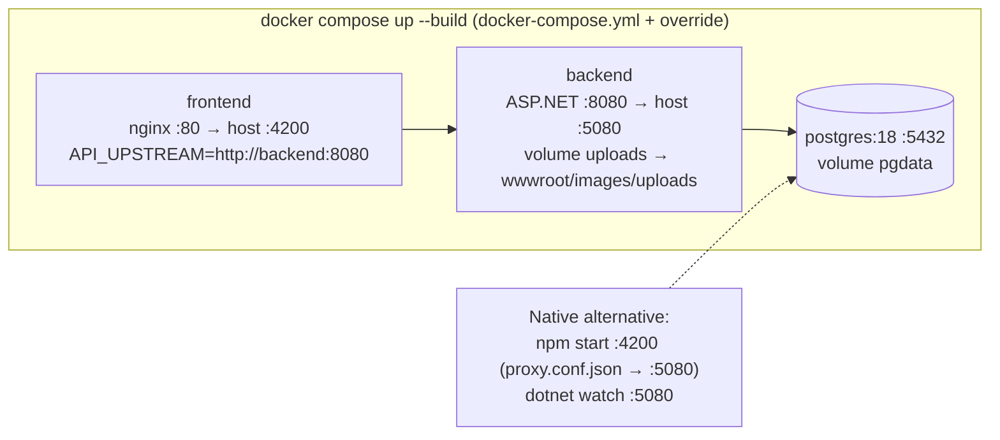
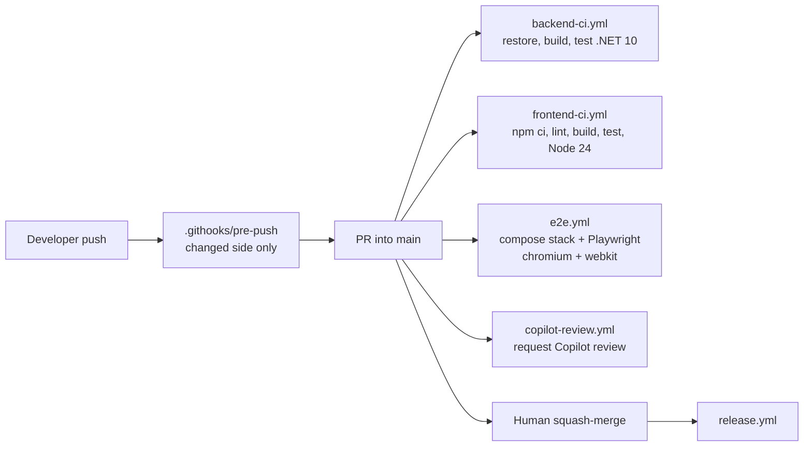
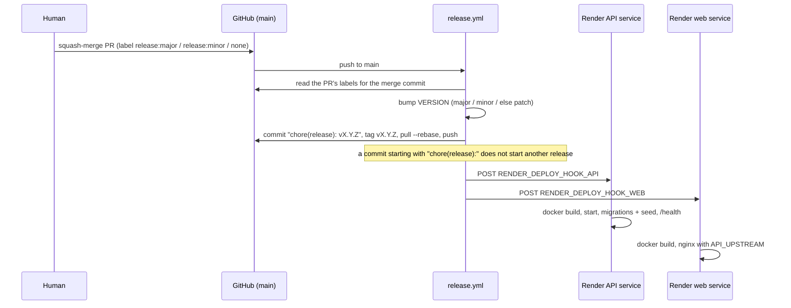

# Deployment and delivery

[Back to index](README.md)

## Local development

- [docker-compose.yml](../../docker-compose.yml) defines the services and dev defaults: JWT dev key, `admin@esngdansk.local` / `Admin123!`, `Database__ApplyMigrationsOnStartup=true`, empty SMTP. [docker-compose.override.yml](../../docker-compose.override.yml) publishes the ports. [.env.example](../../.env.example) documents every variable.
- `docker compose up -d --build backend` rebuilds only the API; postgres data stays.
- Images: [docker/backend.Dockerfile](../../docker/backend.Dockerfile) (SDK 10 build → aspnet 10 runtime, copies `VERSION`). [docker/frontend.Dockerfile](../../docker/frontend.Dockerfile) (node 24 build → nginx:alpine, bakes `VERSION` into `/version.json`, envsubst template).

## CI and checks

| Workflow | Trigger | What it does |
|---|---|---|
| [backend-ci.yml](../../.github/workflows/backend-ci.yml) | PR into `main` or `dev` | `dotnet restore/build/test` (Release) |
| [frontend-ci.yml](../../.github/workflows/frontend-ci.yml) | PR into `main` or `dev` | `npm ci`, lint, build, `npm test -- --watch=false` |
| [e2e.yml](../../.github/workflows/e2e.yml) | PR into `main` | `docker compose up -d --build`, waits for `:4200/health` through the proxy, runs Playwright tests from [e2e/](../../e2e) (public, student, admin, admin CRUD, forms), uploads the report on failure |
| [copilot-review.yml](../../.github/workflows/copilot-review.yml) | non-draft PR opened/reopened/ready | Asks Copilot for a review |
| [release.yml](../../.github/workflows/release.yml) | push to `main`, or manual | Bump, tag, deploy (below) |

Pre-push hook: [.githooks/pre-push](../../.githooks/pre-push), turned on by `npm install` in `frontend/` (the `prepare` script sets `core.hooksPath`). It diffs against `origin/main` and runs `dotnet test` when `backend/` changed and lint + test + build when `frontend/` changed. It skips the backend checks if the .NET 10 SDK is missing. Bypass once with `git push --no-verify`.

## Release and deploy

- `VERSION` (repo root, now `0.5.7`) is the single version source. The API reports it at `/api/version` and nginx at `/version.json`, together with `RENDER_GIT_COMMIT`.
- Both Render services have `autoDeployTrigger: "off"`, so deploys happen only through the hooks. `workflow_dispatch` redeploys without a bump. A missing hook secret produces a warning and skips that deploy.
- `main` is the production branch ([ADR-004](../adr/004-main-is-primary-again.md)).

## Render (production)

[render.yaml](../../render.yaml), all `plan: free`, region `frankfurt`, `branch: main`:

| Resource | Type | Key config |
|---|---|---|
| `esn-gdansk-db` | Render Postgres | db `esn_gdansk`, user `esn`; its connection string is injected as `ConnectionStrings__DefaultConnection` |
| `esn-gdansk-api` | Docker web | `ASPNETCORE_ENVIRONMENT=Production`, `PORT=8080`, `Jwt__Key` generated, `Database__ApplyMigrationsOnStartup=true`, `Seed__Admin*` (prompted), `Email__*`, `Email__FrontendBaseUrl=https://esn-gdansk-web.onrender.com`, health `/health` |
| `esn-gdansk-web` | Docker web | `PORT=10000`, `API_UPSTREAM=https://esn-gdansk-api.onrender.com`, health `/` |

Free-tier limits that shape the system:

| Limit | Effect | Mitigation in code |
|---|---|---|
| Services sleep after 15 min idle, about 50 s cold start | First visit is slow; API GETs fail until it wakes | `retryInterceptor` (about 51 s of retries), skeleton loaders |
| Outbound SMTP ports blocked | Reset emails cannot be sent | `SmtpEmailSender` logs the link when `Email__SmtpHost` is empty ([#25](https://github.com/ESN-App/ESN-App/issues/25)) |
| Ephemeral disk | Uploaded images are lost on deploy/restart | none yet ([#24](https://github.com/ESN-App/ESN-App/issues/24)) |
| Free Postgres expires 30 days after creation | Database disappears (created 2026-11-06 per the issue) | none yet ([#26](https://github.com/ESN-App/ESN-App/issues/26)) |
| No private network for free services | nginx proxies to the API's public URL | `proxy_set_header Host $proxy_host`, `proxy_ssl_server_name on` |
