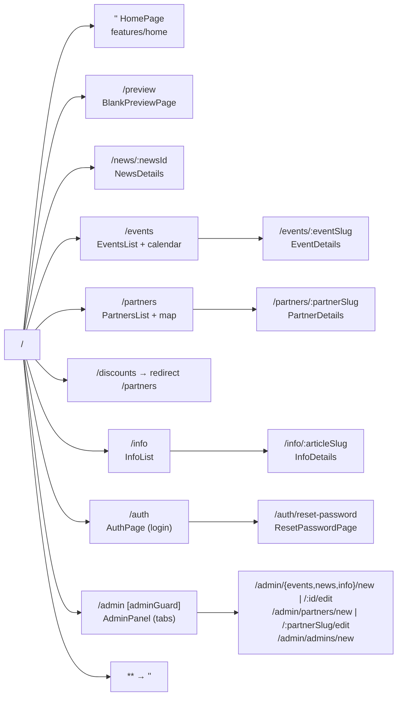
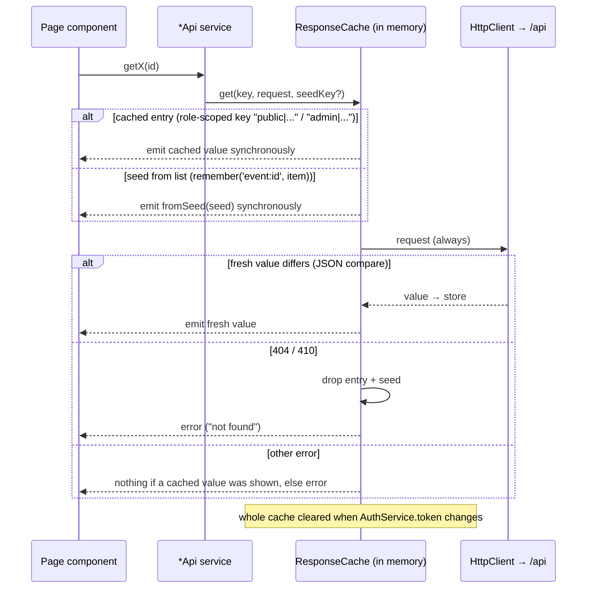
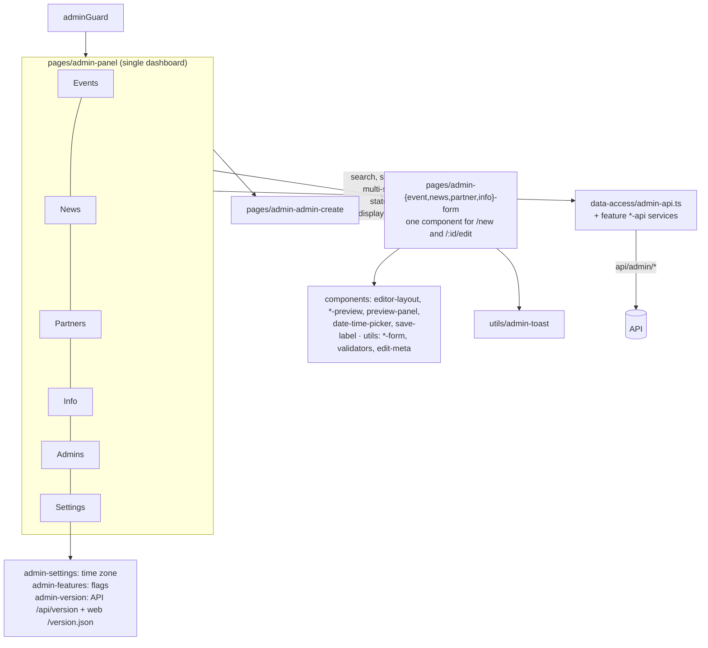

# Frontend

[Back to index](README.md) · Source: [frontend/src/app](../../frontend/src/app) · Bootstrap: [app.config.ts](../../frontend/src/app/app.config.ts), [app.routes.ts](../../frontend/src/app/app.routes.ts)

Angular 22: standalone components, signals, zoneless change detection, Angular Material, `maplibre-gl`. Every feature is lazy-loaded through `loadChildren`.

## Route map

Route files: [home.routes.ts](../../frontend/src/app/features/home/home.routes.ts), [events.routes.ts](../../frontend/src/app/features/events/events.routes.ts), [partners.routes.ts](../../frontend/src/app/features/partners/partners.routes.ts), [info.routes.ts](../../frontend/src/app/features/info/info.routes.ts), [auth.routes.ts](../../frontend/src/app/features/auth/auth.routes.ts), [admin.routes.ts](../../frontend/src/app/features/admin/admin.routes.ts). All `/auth` and `/admin` routes, and `/preview`, set `data.hideMobileNavigation: true`.

## Feature folders

| Folder | Contents |
|---|---|
| [features/home](../../frontend/src/app/features/home) | Home page (week calendar, highlights). **News lives here**: `data-access/news-api.ts`, `pages/news-details`, `components/news-*`. Home also injects `EventsApi`, `PartnersApi` and `InfoApi`. |
| [features/events](../../frontend/src/app/features/events) | List with a `MatCalendar` panel and a mobile date strip (in `events-list`), details page, utils (badges, day grouping, month, `.ics` export, map link, URL slug). |
| [features/partners](../../frontend/src/app/features/partners) | List, details, [partners-map.ts](../../frontend/src/app/features/partners/components/partners-map/partners-map.ts) (maplibre with the OpenFreeMap `liberty` style), offers helpers. `partners-api.ts` switches to `admin/partners` / `admin/discounts` when `isAdmin()`. |
| [features/info](../../frontend/src/app/features/info) | List and details by slug, read-time helper. |
| [features/auth](../../frontend/src/app/features/auth) | Login page and reset-password page. |
| [features/admin](../../frontend/src/app/features/admin) | Admin panel, see below. |
| [shared/](../../frontend/src/app/shared) | Badges, states (empty/error/skeleton), `appDate` pipe, motion directives (`appImageFade`, `appStaggerIn`, `appSlidingIndicator`), theme toggle, utils (`response-cache`, `time-zone`, `detail-transition`, password validators). |

## Core services ([core/](../../frontend/src/app/core))

| Piece | What it does |
|---|---|
| [AuthService](../../frontend/src/app/core/auth.service.ts) | Keeps the JWT and email in `localStorage` as signals. `isLoggedIn` checks `exp`; `isAdmin` is true when the `role` claim (or the long Microsoft role claim URI) contains `admin`. |
| [authInterceptor](../../frontend/src/app/core/auth.interceptor.ts) | Adds `Authorization: Bearer <token>` to every request when a token exists. |
| [retryInterceptor](../../frontend/src/app/core/retry.interceptor.ts) | GETs to `/api/` only: retries status 0/502/503/504 with backoff 1, 2, 4, 8, 16 and 20 s (about 51 s) to cover the Render cold start. |
| [authGuard](../../frontend/src/app/core/auth.guard.ts) / [adminGuard](../../frontend/src/app/core/admin.guard.ts) | `adminGuard` sends logged-out users to `/auth?returnUrl=/admin` and non-admins to `/`. This only shapes the UI; the API enforces security. |
| [FeatureFlags](../../frontend/src/app/core/feature-flags.ts) | One signal per known flag. Starts from `environment.features` and applies `GET /api/features`; unknown keys are ignored. |
| [SiteSettings](../../frontend/src/app/core/site-settings.ts) | `timeZone` signal (default `Europe/Warsaw`), loaded from `GET /api/settings` by an app initializer. |
| [AppUpdate](../../frontend/src/app/core/app-update.ts) | Service-worker updates: checks on start, when the tab becomes visible and every 30 min. A ready version loads on the next in-app navigation, or at once if the tab is hidden and not on an admin form. |
| [ThemeService](../../frontend/src/app/core/theme.service.ts) | Light/dark theme preference. |

### Dates and the site time zone

Instants come from the API in UTC. They are shown with the `appDate` pipe and [time-zone.ts](../../frontend/src/app/shared/utils/time-zone.ts) helpers (`Intl.DateTimeFormat` with the site zone), never with Angular's `date` pipe. Day grouping, month filters and the Today/Tomorrow badges use the site zone. The admin date-time picker turns wall time in the site zone into UTC.

## Response cache (stale-while-revalidate)

[ResponseCache](../../frontend/src/app/shared/utils/response-cache.ts) is used by `events-api`, `partners-api`, `info-api` and `news-api`.

Lists call `remember()` for every item, so the details page renders in the same frame and the shared-image morph can run. The cache is unbounded and lives until a reload (the code marks this as a `shortcut:`).

## View transitions

`provideRouter(..., withViewTransitions(...))` in [app.config.ts](../../frontend/src/app/app.config.ts):
- Same path, only query params changed (filters, selected day): adds `vt-instant`, so nothing animates.
- List ↔ details: [detail-transition.ts](../../frontend/src/app/shared/utils/detail-transition.ts) picks `forward`/`back` (browser Back counts as `back`) and morphs the image from `data-hero-source` to `data-hero-target` with a slide.
- Everything else gets the default cross-fade.
- Motion tokens (`--motion-*`, `--ease-*`) live in `styles.scss`; all animations respect `prefers-reduced-motion`.

## Service worker / PWA

[ngsw-config.json](../../frontend/ngsw-config.json): the `app` group (index, JS, CSS, manifest) is prefetched; the `assets` group (images, fonts) is loaded lazily and prefetched on update. No `dataGroups`, so the SW never caches API responses. The SW is registered only in production builds (`registerWhenStable:30000`).

## Admin panel

- Section ids: `events | news | partners | info | admins | settings` ([admin-panel.ts](../../frontend/src/app/features/admin/pages/admin-panel/admin-panel.ts)).
- The forms show a live preview built from the public detail views, plus "created/edited by" metadata (`edit-meta`). Partner offers (`Discount`) are edited inside the partner form.
- While an admin form is open, `AppUpdate` will not reload the page.
