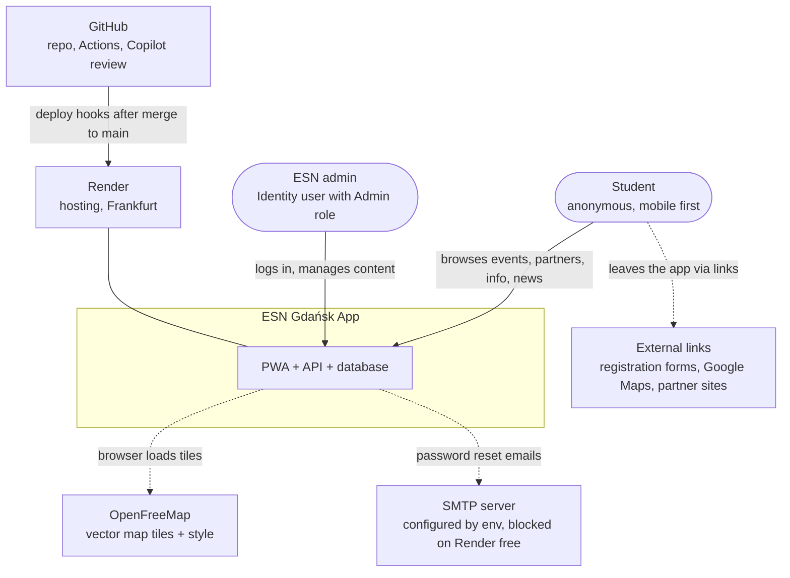
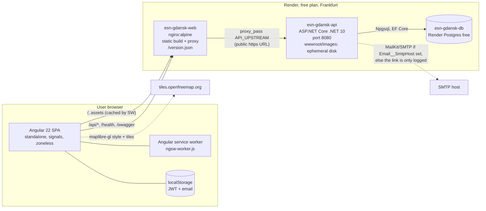

# System context and containers

[Back to index](README.md)

## Context (C4 level 1)

- Students never log in. All public content is anonymous and read-only.
- Admins log in at `/auth` and use `/admin`. Admin accounts are created only by other admins, or by the seeder from `Seed__Admin*` env vars.
- Event registration is an **external link** (`Event.RegistrationUrl`); the app has no registration of its own.

## Containers (C4 level 2)

| Container | Tech | Defined in | Notes |
|---|---|---|---|
| SPA + service worker | Angular 22, Angular Material, maplibre-gl, `@angular/service-worker` | [frontend/](../../frontend), [ngsw-config.json](../../frontend/ngsw-config.json) | The SW prefetches the app shell (JS/CSS/index) and caches images lazily. API responses are **not** cached by the SW; the in-memory `ResponseCache` does that instead ([frontend.md](frontend.md)). |
| nginx web | `nginx:alpine` with an envsubst template | [docker/frontend.Dockerfile](../../docker/frontend.Dockerfile), [docker/nginx.conf.template](../../docker/nginx.conf.template) | Proxies `/api/`, `/health` and `/swagger` to `${API_UPSTREAM}`. Sends `no-cache` for `index.html`, `ngsw-worker.js`, `ngsw.json` and the manifest, and `/version.json` is generated inline. Falls back to `index.html` for SPA routes. |
| API | ASP.NET Core, .NET 10 | [docker/backend.Dockerfile](../../docker/backend.Dockerfile), [Program.cs](../../backend/src/EsnApp.Api/Program.cs) | Also serves uploaded images as static files under `/api/images`. Applies migrations and seeds data on startup when `Database:ApplyMigrationsOnStartup=true` (set on Render and in compose). |
| Database | PostgreSQL (18 locally; Render-managed in prod) | [docker-compose.yml](../../docker-compose.yml), [render.yaml](../../render.yaml) | Render hands over a `postgresql://` URI, which [PostgresConnectionString](../../backend/src/EsnApp.Infrastructure/Persistence/PostgresConnectionString.cs) converts for Npgsql. |

### Why same-origin

The production build uses `apiBaseUrl: ''` ([environment.ts](../../frontend/src/environments)), so every call goes to `/api/...` on the web origin. CORS is enabled **only in Development** (`Cors:AllowedOrigins`, default `http://localhost:4200`). In local `npm start` the Angular dev server proxies `/api` and `/health` to `localhost:5080` ([proxy.conf.json](../../frontend/proxy.conf.json)). See [ADR-002](../adr/002-same-origin-api-proxy.md).

On Render the free web service cannot reach the API over the private network, so `API_UPSTREAM` is the API's **public** URL (`https://esn-gdansk-api.onrender.com`). The API can therefore also be reached directly.
