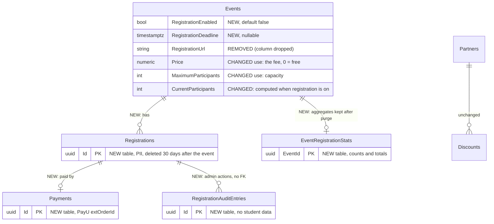

# Target data model (next phase, placeholder)

[Back to target index](README.md) · As-is: [data-model.md](../data-model.md) · Full design: [ADR-005 "Data model sketch"](../../adr/005-event-registration-and-payu-payments.md)

The platform phase changes **no entity**. One deploy-time setting changes: sample data is seeded only when `Seed:SampleData=true` (H1, #123, PR #136), so production gets migrations and the admin account only.

The registration and payment phase (ADR-005) adds the tables below. This page only marks what is new, changed or removed. Columns and rules live in ADR-005.

Unchanged: `Partners`, `Discounts`, `InfoArticles`, `NewsItems`, `FeatureFlags`, `SiteSettings`, the Identity tables.

Open in ADR-005: whether non-PII `Payments` rows are kept for accounting (accountant's answer, #116).
