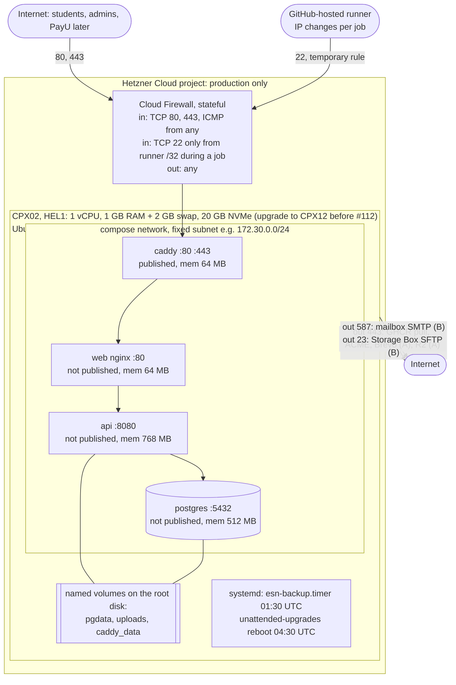
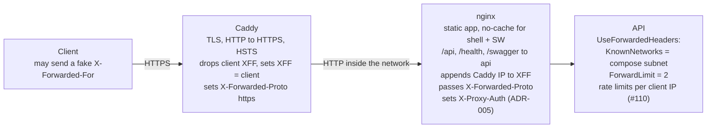
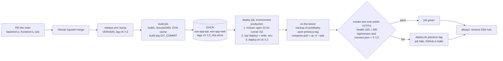
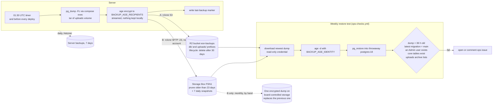
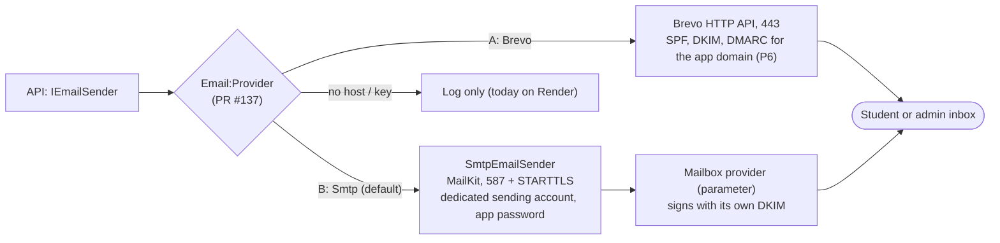

# Target deployment: Hetzner, CI/CD, backups, monitoring

[Back to target index](README.md) · Decision: [ADR-006](../../adr/006-hosting-on-hetzner-cloud.md) sections 1–5 · As-is: [deployment.md](../deployment.md)

ADR-006 already specifies the server baseline, the compose services and the workflows. This page shows how they fit together and marks where Variants **A** and **B** differ. Runbooks go to `docs/operations/production.md` (task H5, #127).

## Server and network

- Data stays on the **root disk** (named volumes), because Hetzner server backups do not include attached Volumes (ADR-006).
- Only Caddy publishes ports. Postgres and the API are reachable only inside the compose network.
- Outbound ports 25 and 465 are blocked by Hetzner on all cloud servers; **587 is open** without a request ([Hetzner FAQ](https://docs.hetzner.com/cloud/servers/faq/)). Variant B depends on that.
- Storage Box SFTP with OpenSSH keys uses port **23** (port 22 wants RFC 4716 keys, per the [Storage Box docs](https://docs.hetzner.com/storage/storage-box/general/)).

## Request path and the proxy chain

Same origin per [ADR-002](../../adr/002-same-origin-api-proxy.md): the browser only talks to the app domain. The API needs no CORS in production. #110 logs the raw header once on the temporary hostname to confirm the chain.

## Secrets

The source of truth is GitHub Environments. The deploy job writes `/opt/esn/.env` (mode 600) on every deploy, so a rotation is: change the value in GitHub, then redeploy. Nothing secret is baked into the public images. The age **private** key is never on the server.

| Secret / variable | Where | A | B |
|---|---|---|---|
| `HCLOUD_TOKEN`, `PROD_SSH_PRIVATE_KEY`, `PROD_SSH_KNOWN_HOSTS` | `production` | yes | yes |
| `POSTGRES_PASSWORD`, `JWT_KEY`, `SEED_ADMIN_EMAIL`, `SEED_ADMIN_PASSWORD`, `API_PROXY_SECRET` | `production` | yes | yes |
| vars `PROD_HOST`, `APP_DOMAIN`, `TEMP_DOMAIN`, `HCLOUD_FIREWALL`, `BACKUP_AGE_RECIPIENTS`, `EMAIL_FROM_ADDRESS` | `production` | yes | yes |
| `BREVO_API_KEY` | `production` | yes | no |
| `EMAIL_SMTP_HOST`, `EMAIL_SMTP_PORT` (587), `EMAIL_SMTP_USERNAME`, `EMAIL_SMTP_PASSWORD` (app password of the sending account) | `production` | no | yes |
| `R2_ACCESS_KEY_ID`, `R2_SECRET_ACCESS_KEY`, var `R2_ENDPOINT` | `production` | yes | no |
| `STORAGEBOX_RW_SSH_KEY`, vars `STORAGEBOX_HOST`, `STORAGEBOX_RW_USER`, `STORAGEBOX_KNOWN_HOSTS` | `production` | no | yes |
| `R2_READ_ACCESS_KEY_ID`, `R2_READ_SECRET_ACCESS_KEY` | `backup-restore` | yes | no |
| `STORAGEBOX_RO_SSH_KEY`, var `STORAGEBOX_RO_USER` | `backup-restore` | no | yes |
| `BACKUP_AGE_IDENTITY` (age private key; second copy in the association's password manager) | `backup-restore` | yes | yes |
| PayU keys (next phase, ADR-005) | `production` | later | later |

Secret names in B are proposals; H5 (#127) fixes them in `.env.production.example`.

## CI/CD pipeline

- `workflow_dispatch` with a `tag` input redeploys any earlier tag without a bump (manual rollback).
- The weekly rebuild tags images `vX.Y.Z-bYYYYMMDD`, so release tags stay immutable.
- **Migration rule:** a release's migrations must keep the previous release working (expand, then contract later). Otherwise the image rollback in the diagram cannot work, and the fallback is restoring the pre-deploy dump.
- The smoke test hits `/health`, which does not check the database today (gap G4). Add a DB check before H8 so a broken connection string fails the deploy.
- All SSH jobs (deploy, host check) share one concurrency group so firewall rules do not collide; the daily host check deletes leftover SSH rules.

## Backup and restore

| | RPO | RTO (est.) | Used for |
|---|---|---|---|
| Hetzner server backup | ≤ 24 h | minutes | Broken server, bad OS update |
| Nightly dump off-site (R2 or Storage Box) | ≤ 24 h | 2–4 h (rebuild with `provision.sh` + restore) | Lost server, compromised server, bad migration |
| Pre-deploy dump | the deploy moment | 1 h | Destructive migration |
| B only: monthly manual copy | ≤ 1 month | 4–8 h | Hetzner account lost or suspended |

The restore test runs on a GitHub-hosted runner in ADR-006. Once ADR-005 ships, that means GitHub processes student PII (gap G3); the suggested change is to run the restore on the server and send only the results.

## Monitoring and alerting

| What | A | B | Alert channel |
|---|---|---|---|
| Site up: `/health` and `/` | UptimeRobot, every 5 min | `uptime-check` job in `ops-checks.yml`, cron about every 15 min (off the full hour, which is busiest), alert after 2 failures in a row | A: UptimeRobot e-mail. B: `ops` issue, which GitHub e-mails to repo watchers (at least 2 volunteers watch the repo) |
| Deploy failed or rolled back | release.yml | same | GitHub failure e-mail |
| Backup fresh, disk < 80%, containers healthy, no leftover SSH rule | daily `host-check` | same, plus: the last `uptime-check` run is less than 1 h old | `ops` issue |
| Restore works | weekly `restore-test` | same | `ops` issue |
| Schedules still enabled (60-day rule) | monthly invoice review (P2) | same; more important in B | person |
| Host events (maintenance, abuse) | Hetzner account e-mails | same | association mailbox |
| TLS renewal | Caddy, automatic; the uptime check fails on an expired cert | same | as site up |

## E-mail path

- Today the only e-mail is the admin password reset. ADR-005 adds no e-mail in v1 (the status page is the confirmation), so volumes stay far below any cap until confirmations are added.
- In B, PR #137 is not needed. Merging it is harmless (the default stays SMTP), but leaving it unmerged keeps code nobody runs out of the app. Keep the branch as the exit ramp.
- In B, the sending account should not keep sent mail, or should auto-delete it after 30 days, once e-mails carry student data (gap G8).
