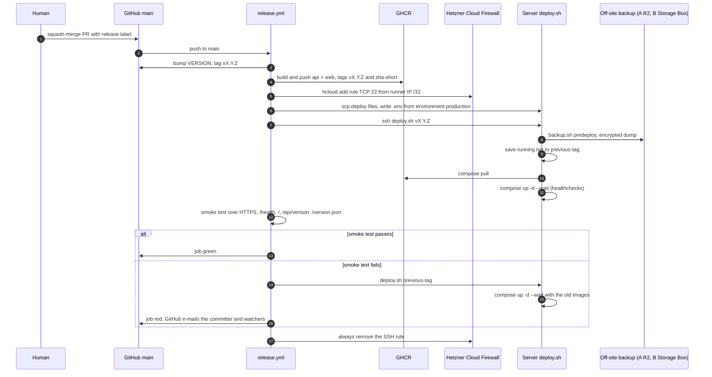
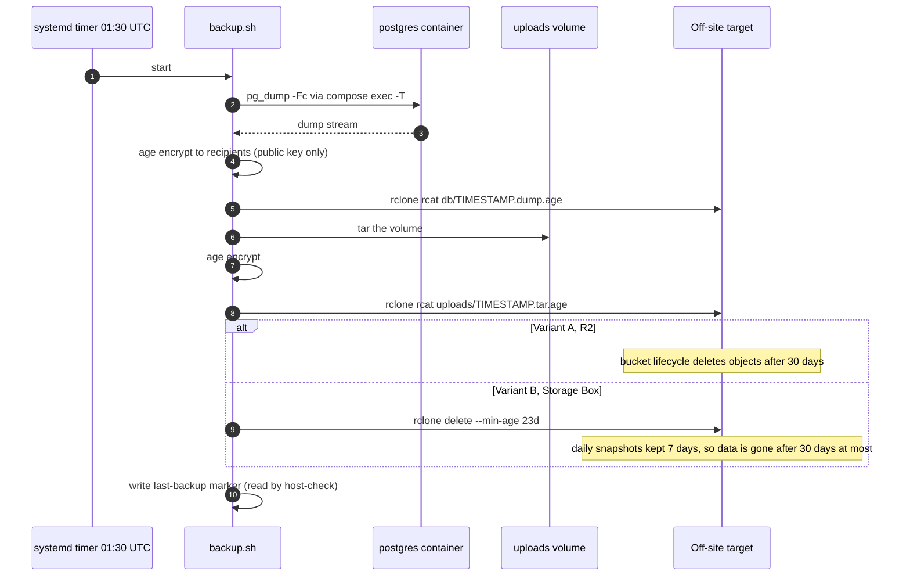
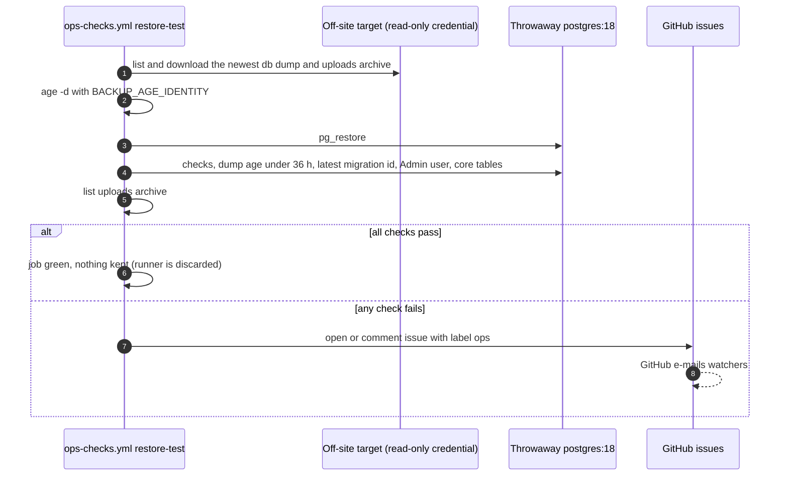
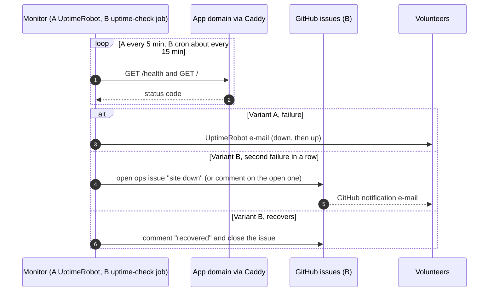
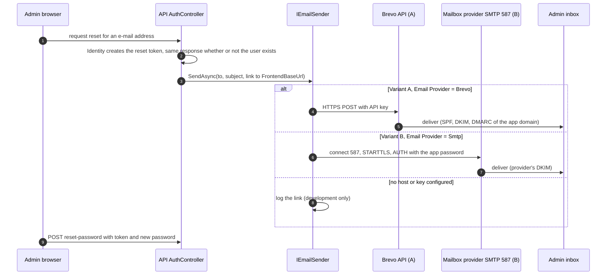
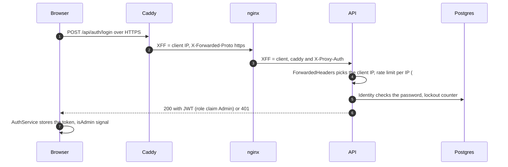

# Target flows

[Back to target index](README.md)

Platform flows first. They are the scope of this version. Registration and payment flows are short placeholders at the end that link to ADR-005.

## Deploy and rollback

Manual rollback: run `release.yml` with `workflow_dispatch` and `tag = vX.Y.W`. If the bad release ran a destructive migration, restore the pre-deploy dump (runbook) before redeploying the older tag.

## Nightly backup

## Weekly restore test

As in ADR-006 (on a GitHub runner). Gap G3 suggests running the same steps on the server instead.

## Health monitoring and alerting

In B, the daily `host-check` also fails if the newest `uptime-check` run is older than 1 hour, which catches a disabled or stalled schedule within a day.

## Password-reset e-mail

The request is the existing `POST /api/auth/reset-password` flow. Only the last hop differs between the variants.

## Admin login

Unchanged from today, shown because it crosses the new proxy chain and ADR-005 adds a lockout and rate limit to it (#110).

## Next phase: registration and payments

Not designed further here. The sequences and states are in ADR-005:

| Flow | Where |
|---|---|
| Guest sign-up, PayU order, redirect, notify webhook and pull sync, 10-minute hold | [ADR-005 "Sequence: sign-up to paid"](../../adr/005-event-registration-and-payu-payments.md) and its state diagram |
| PII purge 30 days after the event, aggregate stats kept | [ADR-005 "GDPR and data retention"](../../adr/005-event-registration-and-payu-payments.md), task T6 (#114) |
| Admin cancel, bulk cancel, mark paid or refunded | ADR-005 Target design, T4 (#112), T10 (#118) |

Platform facts those flows rely on, delivered by this phase: the fixed proxy chain and subnet (for #110), no cold starts (for the 10-minute hold and PayU notify), a persistent database with backups (for #112), and the 30-day backup window (for the privacy notice).
