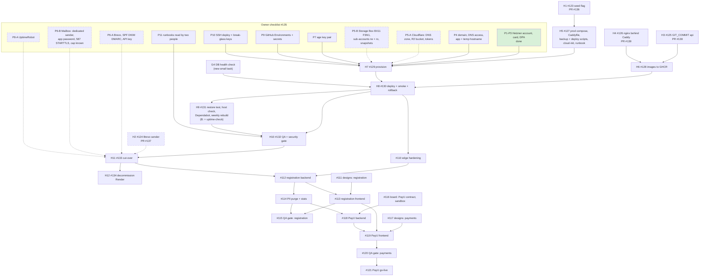

# Roadmap: from Render to the target

[Back to target index](README.md) · Task details and acceptance criteria: [ADR-006 section 7](../../adr/006-hosting-on-hetzner-cloud.md) (H1–H12), [ADR-005 "Implementation plan"](../../adr/005-event-registration-and-payu-payments.md) (steps 0–13) · Owner checklist: #135

## Phases

| Phase | Outcome | Tasks | Done when |
|---|---|---|---|
| 1. Platform code | Images and scripts ready; Render still serves production | H1 #123, H2 #124 (A only), H3 #125, H4 #126, H5 #127, H6 #128 | `hetzner` merged into `main`, images in GHCR |
| 2. Provision | Server, off-site target, GitHub Environments exist | owner actions #135, H7 #129 | Server answers on 80/443 only on `TEMP_DOMAIN` |
| 3. Deploy and verify | Automatic deploys, backups and restore tests on the temporary hostname | H8 #130, H9 #131, H10 #132 | QA and security gate green |
| 4. Cut-over | App domain on Hetzner, Render hooks removed; closes #24, #25, #26 | H11 #133, then H12 #134 after 1–2 weeks | Render deleted |
| 5. Registration (next phase) | Free events with our own form, PII purge | #110, #111, #112, #113, #114, #115 | ADR-005 step 7 gate green |
| 6. Payments (next phase) | PayU sandbox, then production | #116, #117, #118, #119, #120, #121 | One real payment refunded and marked |
| Later | Not planned | #22 (accounts, notifications), #99 (stats), refunds API, staging | |

## Task dependency graph

Solid arrows are hard dependencies. `P` boxes are owner actions from #135. Dashed boxes exist only in one variant. Item numbers are GitHub issues.

Variant A uses `P5-A`, `P6-A`, `P8-A` and H2. Variant B uses `P5-B` and `P6-B`, and H2 is dropped. Dependencies of #110–#121 follow the ADR-005 plan (steps 2–12); #110 can start measuring once H8 runs on the temporary hostname, and #112 needs H11 because guest PII must not land on the Render free database.

## Critical path

**Platform:** H1 → H5 → **H7 (waits for owner actions P4, P5, P7, P9, P10)** → H8 → H9 → H10 → H11 → H12.

- Code is not the bottleneck: H1, H3, H4 and (A) H2 already have PRs (#136–#139), and H5/H6 are independent of the owner.
- **The owner actions gate H7.** Start P4 (domain and DNS access) now in either variant: it is needed for TLS and the temporary hostname, and the registrar is still unknown.
- G4 (DB health check) is small and should land before H8, otherwise the smoke test cannot catch a broken database.

**Server size:** production starts on CPX02 (1 GB). **Upgrade to CPX12 (2 GB, €9.99 HEL1) is a mandatory step before #112** (rescale keeping the disk, a few minutes of downtime, runbook from H5); earlier if the host check shows RAM > 85% or sustained swap, or an OOM kill appears (ADR-006).

**Next phase:** H11 → CPX12 upgrade → #112 → #113 → #115, then #118 → #119 → #120 → #121. #116 (PayU contract) has the longest lead time outside the team, so the board can start it in parallel with phase 1.

## Owner actions (both variants)

| When | Action | Issue |
|---|---|---|
| Now | Decide Variant A or B (then an ADR amends ADR-006) | this PR |
| Now | P4: name the registrar and the mailbox provider, get DNS access, pick app + temporary hostnames, confirm TTL 300 is possible | #135 |
| Before H7 | P5, P7, P9, P10 for the chosen variant | #135 |
| Before H10 | P11: two people read the runbooks | #135 |
| Before H11 | P6 (e-mail) and, in A, P8 (UptimeRobot) | #135 |
| H11, H12 | DNS switch, then delete Render | #133, #134 |
| Monthly | Invoice review, check that scheduled workflows still run; in B also the manual dump copy | P2 |
| Parallel | PayU contract, sandbox, terms, accountant | #116 |

## What changes if Variant B is chosen

ADR-006 tasks and issues:

| Item | Change in B |
|---|---|
| ADR-006 | New ADR "Minimal external dependencies" amends sections 1, 2, 4 and the risks table: R2 → Storage Box, Brevo → mailbox SMTP, Cloudflare DNS → registrar, UptimeRobot → `uptime-check` job. ADR-006 stays Accepted for everything else |
| H2 #124 / PR #137 | Not needed. Close #124 as "not planned (Variant B)"; keep PR #137 unmerged as the exit ramp. The e-mail part of #25 is done by configuration in H7/H11 |
| H5 #127 | `backup.sh` uses an rclone **SFTP** remote (port 23, rw sub-account) and prunes files older than 23 days; `.env.production.example` gets `EMAIL_SMTP_*` and `STORAGEBOX_*` instead of `BREVO_*` and `R2_*`; runbook adds the monthly manual copy and the Storage Box snapshot restore |
| H7 #129 | Provision the Storage Box (FSN1), two sub-accounts (server rw, restore read-only), automatic daily snapshots kept 7; no Cloudflare; temporary DNS record at the registrar |
| H8 #130 | No change |
| H9 #131 | Restore test downloads over SFTP with the read-only sub-account; **adds the `uptime-check` job** (cron about every 15 min, alert after 2 failures, auto-close on recovery); host check also alerts if the newest uptime run is older than 1 h |
| H10 #132 | Also check: a real reset e-mail arrives through the mailbox over 587, SPF/DKIM pass in the received headers, Storage Box files and snapshots exist, a forced uptime failure opens an `ops` issue |
| H11 #133 | DNS switch at the registrar; no UptimeRobot step. Still closes #24, #25, #26 |
| H12 #134 | No change |
| Release bumps | Without #137 the `hetzner` → `main` merge is `release:patch` unless another part is a feature |

Owner checklist #135:

| Item | Variant A (today) | Variant B |
|---|---|---|
| P4 | Domain + move DNS to Cloudflare | Domain + DNS **stays at the registrar**; confirm it allows TTL 300 and A/AAAA records |
| P5 | Cloudflare account, R2 bucket with 30-day lifecycle, two tokens | **Storage Box BX11 in FSN1** in the existing Hetzner account, sub-accounts rw + read-only, daily snapshots kept 7 |
| P6 | Brevo account, SPF/DKIM/DMARC, API key | **Dedicated sending account** on the association's mailbox (for example `no-reply@`), app password, confirmed SMTP 587 + STARTTLS, known daily cap, sent mail not kept (or auto-deleted after 30 days); on Microsoft 365, SMTP AUTH kept enabled for that account |
| P8 | UptimeRobot account and alerts | **Removed.** Instead, at least 2 volunteers watch the repo (notifications for issues), and the `ops` label exists |
| P3 | Privacy notice lists Hetzner, Brevo, Cloudflare | Lists Hetzner and the mailbox provider (plus GitHub, see gap G3) |
| new P12 | n/a | Monthly: download the newest encrypted dump to board-controlled storage and delete the previous copy |
| P1, P2, P7, P9, P10, P11 | unchanged | unchanged (P9 with the B secret names from [deployment.md](deployment.md#secrets)) |
