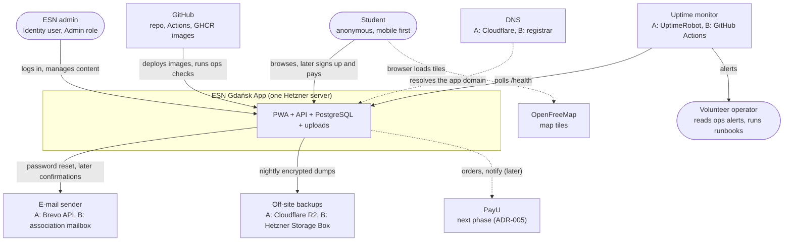
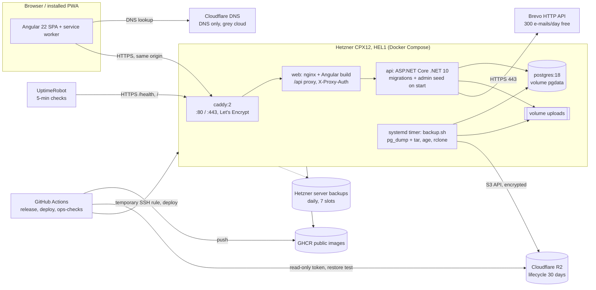
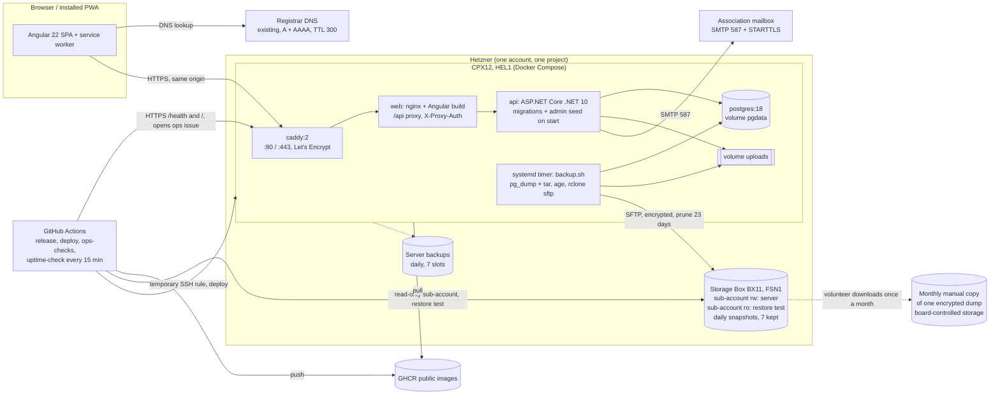

# Target system: context, containers, dependencies

[Back to target index](README.md) · As-is: [system-context.md](../system-context.md)

## Context (C4 level 1), both variants

The context is the same in both variants: students and admins use one HTTPS origin, and the app depends on a few outside services. Only the outside boxes differ, and they are shown in the container diagrams below.

## Containers (C4 level 2), Variant A: full

## Containers (C4 level 2), Variant B: minimal

The box inside the VM is identical. Only the edges to the outside change.

Why the Storage Box and not Hetzner Object Storage for Variant B:

| | Storage Box BX11 (chosen for B) | Object Storage |
|---|---|---|
| Price (net) | **€3.20/month**, 1 TB, unlimited traffic, no minimum term ([BX11](https://www.hetzner.com/storage/storage-box/bx11/)) | **€6.49/month** base, 1 TB storage + 1 TB egress included ([Object Storage](https://www.hetzner.com/storage/object-storage/)) |
| Protocol | SFTP, rsync, BorgBackup, Restic, rclone. **No S3** | S3 API (same `rclone` remote type as R2, smallest change to ADR-006 scripts) |
| Locations | FSN1, HEL1 | FSN1, NBG1, HEL1 |
| Least privilege | Sub-accounts limited to their own directory; a directory can be **read-only** for a sub-account ([docs](https://docs.hetzner.com/storage/storage-box/general/)) | Per-bucket S3 credentials (fine-grained scoping not checked) |
| Protection if the server is taken over | The server's SFTP credential can delete files, but **not snapshots** (snapshots are managed only in the Hetzner Console/API, and that token is not on the server) | Object Lock (WORM) is supported, which is the stronger guard |
| Retention for the 30-day PII rule | No lifecycle rules: `backup.sh` prunes files older than 23 days (`rclone delete --min-age 23d`), plus 7 daily snapshots = 30 days at most | Native object expiry after 30 days, but Object Lock keeps data at least as long as the lock period |

The Storage Box wins on price and has an equivalent guard (snapshots). Object Storage is the fallback if the S3 API is preferred, or if Storage Box SFTP access from GitHub runners turns out to be restricted (not checked).

## Dependency comparison

Prices are net, from the vendor pages (checked 2026-11-20), with gross = net × 1.23 (Polish VAT) and 4.25 PLN/EUR (est.). The domain fee is the same in both variants and is not counted.

### Variant A: full

| Service | What for | Account owner | Cost | Free-tier limits that matter |
|---|---|---|---|---|
| Hetzner Cloud | CPX12 server (HEL1), server backups, Cloud Firewall | Association (P1 done) | €9.99 + €2.00 backups | n/a |
| GitHub | Repo, Actions (CI/CD, ops checks), GHCR | ESN-App org | €0 (public repo) | Scheduled runs can be delayed or dropped, and are disabled after 60 days without activity ([docs](https://docs.github.com/en/actions/reference/workflows-and-actions/events-that-trigger-workflows)) |
| Domain registrar | Domain | Association (unknown, **parameter**) | domain fee | n/a |
| Cloudflare | DNS zone (moved from the registrar), R2 bucket for backups | Association, new account (P5) | €0 | R2: 10 GB-month, 1 M Class A, 10 M Class B ops; may need a card (unverified) |
| Brevo | Transactional e-mail API | Association, new account (P6) | €0 | 300 e-mails/day (from the research, not rechecked) |
| UptimeRobot | `/health` and `/` every 5 min | Association, new account (P8) | €0 | 50 monitors, 5 min (new accounts possibly 10, unverified) |
| Let's Encrypt (via Caddy) | TLS certificates | none (ACME, optional contact e-mail) | €0 | Rate limits irrelevant at one hostname |
| PayU | Payments | Association (next phase) | per transaction | n/a |
| **Total** | 6 accounts + PayU later | | **€11.99 net ≈ €14.75 gross ≈ 63 PLN** | |

### Variant B: minimal

| Service | What for | Account owner | Cost | Limits that matter |
|---|---|---|---|---|
| Hetzner Cloud | CPX12 server, server backups, Cloud Firewall | Association (P1 done) | €9.99 + €2.00 | n/a |
| Hetzner Storage Box BX11 (FSN1) | Off-site encrypted dumps, read-only sub-account for the restore test | Same Hetzner account | €3.20 (setup fee: page says one applies, amount not stated; unverified) | 10 manual + 10 automatic snapshot slots |
| GitHub | Repo, Actions, GHCR, **uptime check** (cron about every 15 min, opens an `ops` issue, GitHub e-mails watchers) | ESN-App org | €0 | Same schedule limits as A, now also for uptime |
| Domain registrar | Domain **and DNS** | Association (**parameter**) | domain fee | Lowest TTL it allows (300 s needed for the cut-over) and API access unknown |
| Association mailbox | Password reset (later confirmations) via SMTP 587 | Association (provider unknown, **parameter**) | €0 extra | Provider's daily cap and auth rules (see below) |
| Let's Encrypt (via Caddy) | TLS | none | €0 | n/a |
| PayU | Payments | Association (next phase) | per transaction | n/a |
| **Total** | 4 accounts (2 already exist) + PayU later | | **€15.19 net ≈ €18.68 gross ≈ 79 PLN** (with Object Storage instead: €18.48 net ≈ €22.73 gross) | |

### Trade-offs

| Topic | Variant A | Variant B |
|---|---|---|
| Reliability of the app | Same server, same compose: no difference | Same |
| Backup independence | Off-site copy at another company (Cloudflare). A Hetzner account suspension leaves R2 intact | **Single vendor**: server, server backups and Storage Box all sit in one Hetzner account. A suspended or closed account, or a billing failure, takes them all. **Mitigation:** each month a volunteer downloads one encrypted dump to board-controlled storage and deletes the previous one (keeps the 30-day PII limit: the copy is replaced at least every 30 days), and the age key stays outside Hetzner (password manager). RPO for this worst case: up to 1 month |
| E-mail deliverability | Brevo with SPF, DKIM, DMARC on our domain (P6); good, but shared IPs | Mail from a real mailbox through its own provider is usually well authenticated already; the provider's reputation applies (est.) |
| E-mail limits | 300/day free | Provider-specific. Typical caps (unverified for our provider): Google Workspace about 2,000/day, Microsoft 365 about 10,000 recipients/day and 30 messages/min. Microsoft is switching off SMTP AUTH Basic by default for existing tenants at the end of December 2026 (admins can turn it back on), with final removal to be announced for H2 2027 ([Exchange team](https://techcommunity.microsoft.com/blog/exchange/updated-exchange-online-smtp-auth-basic-authentication-deprecation-timeline/4489835)). On Microsoft 365, B therefore needs either the setting kept on, or Brevo |
| E-mail credentials | API key, scoped to sending | A mailbox password: use a **dedicated sending account** with an app password, never a person's mailbox, because a leaked password could also read mail |
| E-mail from Hetzner | Port 443, never blocked | Hetzner blocks 25 and 465 on all cloud servers; **587 is not blocked and needs no request** ([Hetzner FAQ](https://docs.hetzner.com/cloud/servers/faq/)). `SmtpEmailSender` uses STARTTLS, so 587 fits |
| Monitoring punctuality | External, every 5 min, independent of GitHub | Cron every 15 min. Runs can be late or dropped under load, and schedules stop after 60 days without repo activity. Detection time: about 15–45 min (est.). Alert only after 2 failed runs in a row to avoid noise from dropped runs |
| Monitoring independence | UptimeRobot also notices when GitHub is down | If GitHub Actions is down, nobody watches (accepted: rare, and GitHub has its own status alerts) |
| GDPR sub-processors for student PII | Hetzner, Brevo (recipient address and content), GitHub (restore test, gap G3); Cloudflare holds only encrypted dumps | Hetzner, the mailbox provider (already the association's processor), GitHub (G3). Two fewer new contracts |
| Cut-over DNS | Cloudflare: TTL 300, instant changes, API | Registrar: depends on its panel (minimum TTL unknown) |
| Code changes | Brevo sender (PR #137) | None for e-mail; backup script uses an SFTP remote; new uptime-check job |
| Ops effort (est.) | 1–2 h/month + 6 accounts with 2FA and two members each | 1–2 h/month + 15 min monthly manual dump copy; 4 accounts |
| Reversibility | Easy to drop services later | Easy to add Brevo or UptimeRobot later (config only, PR #137 already exists) |
