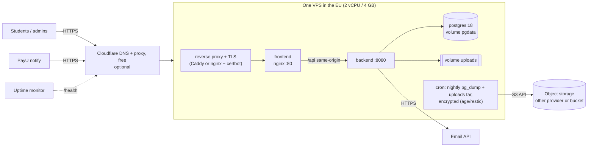
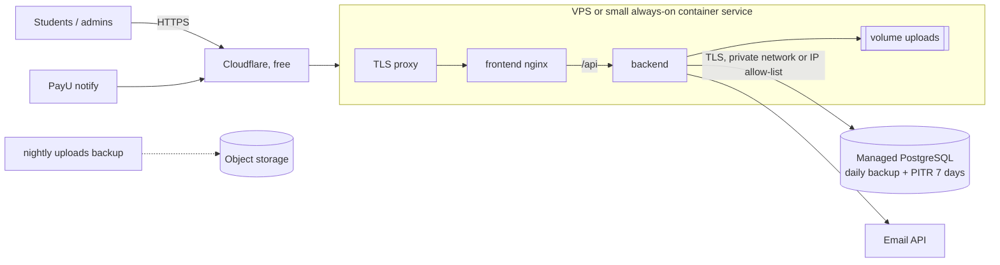
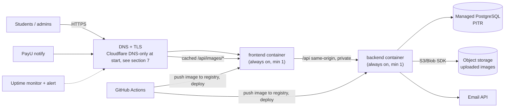
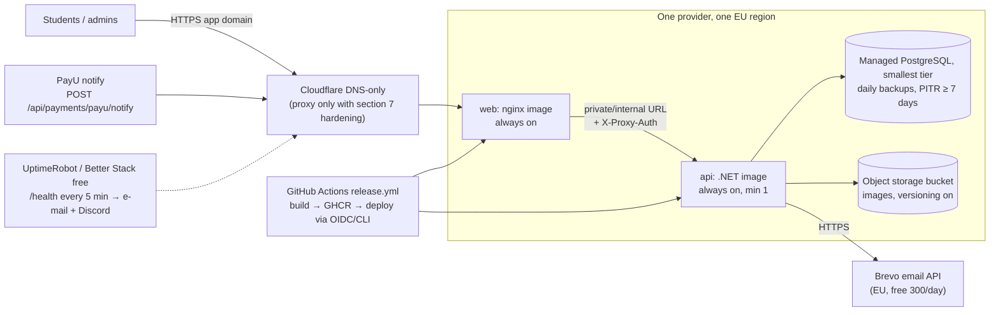
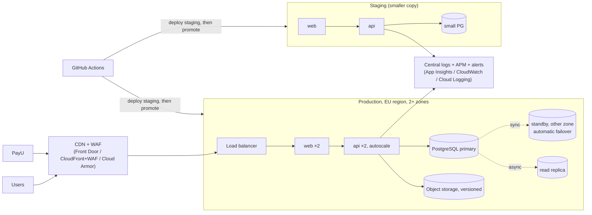
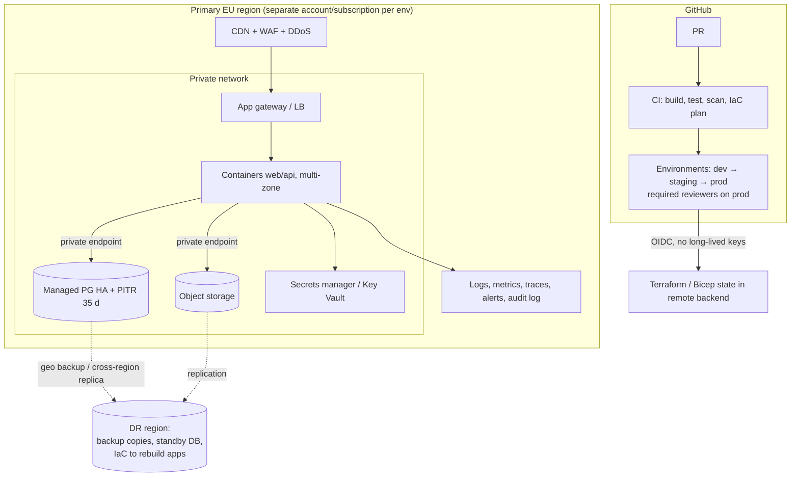
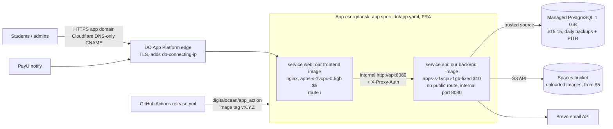

# Hosting after Render: requirements, target tiers and provider comparison

Status: research only. **Decided:** the owner chose **Hetzner T0** (one Hetzner Cloud server, everything in Docker Compose), priority lowest price; see [ADR-006](../adr/006-hosting-on-hetzner-cloud.md).
Date: 2026-11-20. Refs #24 (uploads lost on deploy), #25 (SMTP blocked), #26 (free DB expires), ADR-005 draft (PR #109, guest registrations + PayU webhooks).

Prices are list prices without VAT, read on 2026-11-20 from the sources in section 13. **(est.)** marks my own arithmetic or a third-party figure; **(unverified)** marks something I could not confirm on an official page. Confirm every price in the provider's calculator before signing up. 1 month = 730 h.

## 1. Summary

Revised after the `skeptic` review (section 10). Prices below are **gross** (+23% VAT, assumed because the association is not an active VAT payer; to be confirmed with the accountant), converted at **1 USD ≈ 3.95 PLN and 1 EUR ≈ 4.25 PLN (est., mid-November 2026)**. Provider choice is based on cost **without** any grant; credits are a bonus.

- **Top pick: DigitalOcean App Platform + Managed PostgreSQL (Frankfurt)**, about **$43 gross ≈ 170 PLN/month** (section 8). It is the closest thing to Render: deploys from GitHub Actions with an app spec in the repo, rollback in one click, built-in logs and alerts, no server to patch. It needs one code change first, storing images in Spaces, because the App Platform filesystem is ephemeral (#24).
- **Budget pick: DigitalOcean Droplet T1** (the skeptic's proposal): our compose minus postgres on a 2 GB Droplet, Managed PostgreSQL 1 GB, Droplet backups, images on a volume. About **$36 gross ≈ 143 PLN/month**. No code change for #24, but a volunteer owns SSH, OS updates and Docker.
- **Cheapest: Hetzner T0**: everything in compose on one server, nightly encrypted `pg_dump` off-site. About **€9–16 gross ≈ 37–68 PLN/month**. The owner decided to start on CPX02 (1 GB): €5.49 + 20% backups ≈ €8.11 gross ≈ 34 PLN/month, upgrading to CPX12 before #112 (ADR-006). Its real risk is an untested restore, not the price.
- **Edge:** Cloudflare **DNS-only** at the start. A CDN is not needed at ~1,000 visits/day (5,000 at peaks), and free Bot Fight Mode or an unlocked origin would break the ADR-005 assumptions (section 7).
- **Azure** only if the owner wants it and the setup is written in Bicep in the repo, with a runbook and two or more owners. The nonprofit grant ($2,000/year) is a bonus. It is not a reason to choose Azure, because it must be renewed by hand every year and silently falls back to pay-as-you-go on the card on file.
- **Low-cost / free options** (section 9): Cloud Run + Cloud SQL with min 1 is the only managed, cold-start-free option cheaper than App Platform (~126–160 PLN gross), at the price of GCP complexity. Free tiers (Neon, Supabase, Oracle Always Free) are for demo/staging only. Scale-to-zero (Cloud Run ~2–5 s, ACA ~5–15 s, est.) does not break the ADR-005 holds or PayU, but it contradicts "no sleeping services" and needs the owner's OK.
- **Not recommended:** scale-to-zero for the API once PayU is live (section 9.4). GitHub Student Pack credits are a student's personal credits, so they are not for production.

## 2. What exists today

- [render.yaml](../../render.yaml): Render free plan, Frankfurt. Free Postgres `esn-gdansk-db`, `esn-gdansk-api` (Docker, [docker/backend.Dockerfile](../../docker/backend.Dockerfile), `/health`) and `esn-gdansk-web` (Docker, nginx from [docker/nginx.conf.template](../../docker/nginx.conf.template), proxies `/api`, `/health` and `/swagger` to `API_UPSTREAM`, ADR-002). Details are in [docs/architecture/deployment.md](../architecture/deployment.md).
- Deploys: [.github/workflows/release.yml](../../.github/workflows/release.yml) bumps `VERSION`, tags, then POSTs the two Render deploy hooks. Render builds the images itself, so no registry is involved.
- Images: four `*ImageStorage` services in `backend/src/EsnApp.Api/Services/` write uploads to `wwwroot/images/uploads/...` on local disk, served as `/api/images/uploads/...`. On Render this disk is ephemeral (#24). The local `docker-compose.yml` already mounts a named `uploads` volume.
- Email: `SmtpEmailSender`. Render free blocks SMTP ports (#25).
- Render coupling in code: `VersionController` reads `RENDER_GIT_COMMIT`, nginx serves it in `/version.json`, and `ConnectionStrings__DefaultConnection` accepts Render's `postgresql://` URI.
- **Known production bug:** `Program.cs` runs `DbSeeder.SeedAsync` whenever `Database:ApplyMigrationsOnStartup` is true, and render.yaml sets it to `true`. So production gets the sample data, not only the migrations and the admin. The new production must run migrations and the admin seed **without** sample data. That needs a small backend change, a separate flag such as `Seed:SampleData` that defaults to false (see section 11).
- Data: production holds only mock/sample data, so **nothing is migrated**. The new environment starts empty.

## 3. Requirements

### 3.1 Functional (what the hosting must run)

| # | Requirement |
|---|---|
| F1 | Run the two existing Docker images unchanged: `frontend` (nginx + Angular build, same-origin `/api` proxy, ADR-002) and `backend` (.NET 10, port 8080, `/health`). |
| F2 | PostgreSQL (we use 18 locally; managed offers may lag, and 16/17 are fine for EF Core/Npgsql). Schema only through EF Core migrations applied on startup or as a release step. |
| F3 | Persistent storage for admin-uploaded images that survives deploys (#24): a disk volume (T0/T1) or object storage (T2+; needs an `IImageStorage` implementation for S3/Blob). |
| F4 | Outbound email for password reset and, with ADR-005, registration confirmations, through an **HTTP email API** (#25). SMTP is a fallback only. |
| F5 | Receive PayU notifications (`POST`, anonymous, signed) at any time, with no sleeping service (ADR-005). |
| F6 | Correct client IP for rate limits and PayU `customerIp`: a known, fixed number of trusted proxy hops; the API not reachable around nginx (or protected by the `X-Proxy-Auth` header from ADR-005). |
| F7 | Custom domain with TLS for the web app (for example `app.esngdansk.pl`, owner to confirm). The API needs no public hostname of its own if the platform allows private networking. |
| F8 | Deploy from GitHub Actions on merge to `main` (release.yml), one-click/one-command rollback to the previous version, and `GET /api/version` showing the deployed version and commit. |

### 3.2 Non-functional

| Attribute | Target (suggestion) | Why |
|---|---|---|
| Availability | 99.5% monthly (≈3.6 h downtime), no SLA purchase needed | Student chapter; PayU retries notifications for 72 h (ADR-005) |
| Cold start | None: first request < 1 s after idle | ADR-005 sign-up POST is not retried; first-visit UX |
| RPO (data loss) | ≤ 24 h at T0 (nightly dump); ≤ 5 min at T1+ (managed PITR) | Registrations + payment status are money records |
| RTO (time to restore) | ≤ 4 h (T0), ≤ 1 h (T1+) | A volunteer must be able to do it from a runbook |
| Backups | Automated daily, ≥ 7 days retention, stored off the server, encrypted; **restore test once per semester** (restore into a scratch DB and run the app against it) | A backup that was never restored is not a backup |
| Region / GDPR | EU region (Frankfurt/Warsaw/Amsterdam etc.), provider DPA signed, data and backups in the EU | Guest PII (name, e-mail, phone), ADR-005 |
| TLS / domain | Managed certificates, HTTPS only, HSTS | |
| Secrets | Platform secret store or GitHub environment secrets; never in the repo; rotate the leaked Render-era values | Existing convention |
| Observability | Container logs kept ≥ 7 days, `/health` uptime check every 5 min with e-mail/Discord alert, error log search | Volunteers learn about outages from a monitor, not from students |
| Performance | p95 API < 300 ms at ~1,000 visits/day (5,000 at peaks); 2 GB RAM for API + nginx + Postgres on one host (4 GB comfortable) | Load is tiny; any tier here is sized for 10× |
| Staging | Optional. PR previews are not needed; the e2e workflow already runs the compose stack in CI | Cost |
| Cost ceiling | Owner to set. Suggested: ≤ $40/month out of pocket, or ≈ $0 with credits | Non-profit |
| Ops effort | ≤ 2 h/month routine for volunteers (updates, checking the monitor, the semester restore test) | Small rotating team |
| Bus factor | ≥ 2 people with admin access; accounts owned by the association's e-mail, not a personal one; a runbook in `docs/` | Student turnover |
| Exit / portability | Keep the Docker images and plain Postgres as the contract; no proprietary runtime APIs in app code (S3-compatible storage API, standard SQL); IaC or a documented manual setup | Leaving Render must stay cheap next time too |

## 4. Tiers

All tiers run the same two images. The diagrams name generic components; section 5 maps them to each provider.

### T0: cheapest, one VPS with everything in Docker Compose

- Deploy: GitHub Actions builds the images, pushes them to GHCR, then SSHes in and runs `docker compose pull && up -d`. Rollback = redeploy the previous tag.
- Fixes #24 (volume), #25 (email API over HTTPS), #26 (own Postgres), and removes cold starts.
- Risks: the main one is an **untested restore**, so script the restore and drill it once per semester. One machine, so a disk/host failure means restore from last night's dump (RPO 24 h). A volunteer must patch the OS and the Postgres image. Provider snapshot backups (+20% on Hetzner/DO) add a second safety net.

### T1: cheapest + managed PostgreSQL

- What changes vs T0: the database (the only stateful part that matters for money) gets provider backups, PITR, minor-version patching and monitoring. RPO drops to minutes.

### T2: medium, containers + managed Postgres + object storage + CDN + email API + monitoring

- Needs one code change: an object-storage implementation of the image storage, which replaces the four local-disk writers (#24).
- The server becomes stateless: redeploys, rollbacks and moving to another provider are image swaps.

### T3: proposed balance for this team

T2, minus anything that needs regular care, plus a written runbook:

- Single region, single instance per service, no staging (CI e2e covers the stack). A semester restore test into a temporary database is the one recurring chore.
- Cloudflare stays DNS-only at the start (section 7). If it is proxied later, it adds a hop, and the origin must be locked before `CF-Connecting-IP` can be trusted.

### T4: rich ("na bogato")

### T5: "by the book" (cloud reference architecture)

T5 is listed for completeness. For ~1,000 visits/day (5,000 at peaks) it is over-engineered: it costs hundreds of dollars a month and needs someone who knows the cloud platform well.

## 5. Providers

### 5.1 Service mapping per tier

| Provider | T0 | T1 | T2 / T3 | T4 | T5 |
|---|---|---|---|---|---|
| **Azure** (Germany West Central, Poland Central, West Europe) | B-series VM | App Service B1 + PG Flexible B1ms | App Service Linux B1 (both containers on one plan, Always On) or Container Apps (min replicas 1) + PG Flexible B1ms + Blob | Container Apps + PG Flexible General Purpose with zone-redundant HA + Front Door + App Insights | Landing zone, Bicep/Terraform, VNet + private endpoints, Key Vault, geo-redundant backup |
| **AWS** (eu-central-1 Frankfurt, eu-central-2 Zurich, eu-west-1) | Lightsail instance | Lightsail instance + Lightsail managed DB, or EC2 + RDS | Lightsail containers/instance or App Runner + RDS db.t4g.micro + S3 + SES | ECS Fargate + ALB + RDS Multi-AZ + read replica + CloudFront/WAF + CloudWatch | Organizations multi-account, VPC private subnets, Secrets Manager, AWS Backup cross-region |
| **GCP** (europe-west3 Frankfurt, europe-central2 Warsaw, europe-west1) | Compute Engine e2-small (the always-free e2-micro is US-only) | Cloud Run (min instances 1) + Cloud SQL | Cloud Run + Cloud SQL + GCS | Cloud Run multi-region + Cloud SQL HA + LB + Cloud Armor | Shared VPC, Secret Manager, Cloud SQL cross-region replica |
| **DigitalOcean** (FRA1, AMS3) | Droplet | Droplet + Managed PostgreSQL | App Platform (2 containers) or Droplet + Managed PG + Spaces (built-in CDN) | App Platform + Managed PG with standby node + read-only node | VPC, Terraform provider; no second managed region failover (DIY) |
| **Hetzner** (Falkenstein, Nuremberg, Helsinki) | Cloud server (CX/CPX/CAX) + backups | No first-party managed PG [5]; options: self-run PG on a second server, or a third-party managed PG (Ubicloud on Hetzner, unverified) | Cloud server + Hetzner Object Storage + self-run or third-party PG | Load balancer + 2 servers + Patroni (self-run) | Terraform `hcloud` provider; no managed secrets, no managed DB, so DIY |
| **Budget VPS** (Hostinger, OVHcloud, Contabo) | VPS (KVM) | OVHcloud only: Public Cloud Databases for PostgreSQL (unverified price) | VPS + external object storage/managed PG | not a fit | not a fit |

### 5.2 Monthly cost per tier (USD unless €; without VAT)

Assumptions: 2 GB RAM is enough for one host running everything; DB < 10 GB; images < 5 GB; egress < 200 GB/month **(est.: 5,000 visits × ~1 MB uncached on a peak day, PWA shell cached by the service worker, images cached by Cloudflare)**. Cloudflare free, Brevo free and UptimeRobot free cost $0 in every tier.

| Tier | Azure | AWS | GCP | DigitalOcean | Hetzner | Hostinger / OVH / Contabo |
|---|---|---|---|---|---|---|
| **T0** | ~$20 (B-series VM + disk, est.) | **$12** Lightsail 2 GB (+$1 bucket) [7] | ~$15–20 (e2-small, est.) | **$12** + $2.40 weekly backups + $5 Spaces ≈ **$19** [3][4] | **€5.49–5.99** server [1][2] + 20% backups + €4.99–6.49 Object Storage [6] ≈ **€8–13** | OVH VPS-1 **$4.54** (daily backup incl.) [10]; Contabo **€4.40–5.50** (24-month term) [11]; Hostinger KVM 2 **$8.99** (24-month prepay, renews $14.99) [9]; + free/cheap off-site backup bucket ≈ **$5–15** |
| **T1** | App Service B1 $13.15 + PG B1ms $14.53 + 32 GB storage $4.38 ≈ **$32** [17] | Lightsail 1 GB $7 + Lightsail DB $15 ≈ **$22** [7]; or EC2 + RDS t4g.micro $13.87 + storage ≈ $25 [8] | Cloud Run min 1 (~$5–15, est.) + Cloud SQL db-f1-micro $9–16 (third-party figures disagree [18]) ≈ **$20–35 (est.)** | Droplet 1–2 GB $6–12 + Managed PG $15.15 ≈ **$21–27** [3][4] | n/a first-party; self-run PG on a second CX ≈ €11–12 (not managed) | OVH VPS + OVH managed PG (unverified) |
| **T2** | T1 + Blob (<$1) ≈ **$33** | T1 + S3/bucket $1–3 + SES (~$0.10/1,000 mails, unverified) ≈ **$25–30** | ≈ **$22–37 (est.)** | App Platform 2 × $5–12 + PG $15.15 + Spaces $5 ≈ **$30–45**, or Droplet variant ≈ **$32** [4][15] | server + Object Storage + third-party PG ≈ **€25–35 (est.)** | VPS + external PG ≈ $25 (est.) |
| **T3** | **≈ $33**, ≈ $0 with the nonprofit grant | ≈ $25–30 | ≈ $25–40 (est.) | **≈ $32** (one-time credit could cover year 1) | ≈ €15–20 self-run PG + Object Storage (more ops) | not recommended |
| **T4** | Container Apps ~$30–60 + PG D2ds_v5 HA ≈ $310 (2 × 2 vCores × $0.106/h) + Front Door + App Insights + staging ≈ **$450–550 (est.)** [17] | Fargate ~$35 + ALB ~$20 + RDS t4g.small Multi-AZ ≈ $54 + replica $27 + WAF/CloudFront/CloudWatch ~$20 + staging ~$40 ≈ **$200–250 (est.)** [8] | ≈ **$200–300 (est.)** | App Platform ~$24 + PG 2 GB with standby ~$60 + staging ~$25 ≈ **$110–130 (est.)** [4] | ≈ €40–60 hardware, but HA Postgres is self-built (high ops) | n/a |
| **T5** | ≈ **$600–900 (est.)** | ≈ **$400–800 (est.)** | ≈ **$400–800 (est.)** | ≈ $200 (partial; no managed DR) | n/a | n/a |

Baseline for comparison (the "keep what we have" option): Render paid plans, 2 × Starter + Basic Postgres ≈ $20/month (ADR-005 figures, **unverified**) plus a persistent disk. The owner has already chosen to leave Render, so I do not explore it further.

### 5.3 Provider notes

| Provider | Cold start | GitHub Actions / IaC | Managed PG | Egress | Lock-in / GDPR |
|---|---|---|---|---|---|
| Azure | App Service Basic with **Always On** does not sleep. Container Apps scales to zero unless min replicas ≥ 1; idle replicas bill at a reduced rate ($3e-6 per vCPU-s and per GiB-s idle vs $2.4e-5 per vCPU-s active) [17] | Excellent: `azure/login` with OIDC, `azure/webapps-deploy` / `containerapps-deploy`, Bicep and Terraform. Basic has no deployment slots, so rollback = redeploy the previous image tag | Flexible Server: automated backups with PITR (7–35 days), Burstable tiers have **no HA**; backup storage up to the provisioned size is included (unverified); PG 18 availability unverified | First 100 GB/month free (unverified) | Medium (App Service config, Blob SDK). US parent: EU Data Boundary, DPA |
| AWS | Lightsail/EC2/ECS never sleep. App Runner can pause (unverified) | Excellent: `aws-actions/configure-aws-credentials` with OIDC, ECS deploy actions, CDK/Terraform | RDS: PITR up to 35 days, Multi-AZ ≈ 2× price [8]; Lightsail DB has HA at 2× [7] | 100 GB/month free, then ~$0.09/GB (unverified); public IPv4 billed separately on EC2/RDS | Medium. US parent, EU regions, DPA |
| GCP | Cloud Run scales to zero by default: **set min instances 1** or PayU/first visits wait seconds (.NET cold start, est. 2–5 s) | Excellent: `google-github-actions/auth` (Workload Identity Federation) + `deploy-cloudrun` | Cloud SQL: automated backups, PITR, HA ≈ 2×; shared-core tiers are not covered by the SLA (unverified) | Premium tier egress pricier (unverified) | Medium. US parent, EU regions |
| DigitalOcean | Droplets and App Platform instances do not sleep | Good: `digitalocean/action-doctl`, App Platform app spec in the repo, Terraform provider, DOCR registry | Managed PG: daily backups + PITR (7 days, unverified on the pricing page), standby nodes optional, 1 GB plan $15.15 [4] | Droplets include 500 GB–2 TB transfer [3] | Low (plain Docker + PG + S3-compatible Spaces). US parent, EU regions |
| Hetzner | VPS never sleeps | DIY: SSH + compose from Actions, `hcloud` CLI and Terraform provider. No container platform | **None first-party** [5]: we own backups/PITR (pgBackRest or WAL-G to Object Storage) | Generous included traffic in EU (exact figure unverified after the 2026 changes) | Lowest (plain VPS). German company, EU only. **Prices rose twice in 2026 and cost-optimized plans were often out of stock** [2] |
| Hostinger | VPS never sleeps | DIY via SSH; Hostinger has a VPS API (unverified) | none | included | Low. Lithuanian company; data-centre list for VPS unverified. Low intro prices need 24-month prepay; renewals are ~1.7× higher [9] |
| OVHcloud | VPS never sleeps | DIY via SSH; OVH API + Terraform provider | Public Cloud Databases for PostgreSQL (price unverified) | Unmetered traffic on VPS [10] | Low. French company, EU data centres incl. Warsaw (unverified for VPS) |
| Contabo | VPS never sleeps | DIY via SSH | none | included | Low. German company; known for oversold CPU and slow support (community reports, unverified). Setup fee on monthly contracts [11] |

### 5.4 Non-profit and student credits

| Program | What | Can Stowarzyszenie ESN Gdańsk (KRS 0000783383) qualify? |
|---|---|---|
| Microsoft for Nonprofits, Azure grant | **$2,000 Azure credit per year, renewable while eligible**; unused credit does not roll over [12] | Likely. Validation runs through TechSoup's network (TechSoup Polska for Poland). Registered associations usually qualify, but our eligibility is **unverified**. Microsoft's Polish country rules must be checked. This grant covers T3 on Azure many times over |
| AWS Nonprofit Credit Program (TechSoup) | $1,000 credit per fiscal year (Jul–Jun) since 2021, with an admin fee [13] | **Unverified** for Poland: the AWS page lists US designations, the TechSoup global pages say "many countries". Ask TechSoup Polska |
| Google for Nonprofits, Google Cloud credits | Third-party sources say up to $2,000/year (unverified); Poland is on Google's list of countries with "additional eligibility requirements" [16] | **Unverified.** Google for Nonprofits itself is open to Polish charitable organisations, but Cloud credits are not guaranteed |
| DigitalOcean for Nonprofits (ex Hub for Good) | Up to **$2,500 one-time** credit, expires 1 year after approval; validation through Percent [14] | Likely ("501(c)(3) or global equivalent, social enterprise or unregistered initiative"), **unverified** for us. One-time only |
| GitHub Student Developer Pack | DigitalOcean $200 for 1 year (DO's own page says $100), Azure for Students $100 [15] | Personal credits of one verified student, **not the association**. Fine for a test environment, wrong for production (account ownership, bus factor, it ends when the student graduates) |

## 6. Comparison matrix and recommendation

Cost = monthly list price (section 5.2). Ops effort = routine volunteer hours per month **(est.)**. Robustness: 1 = single box with nightly dump, 5 = multi-zone HA with DR.

| Tier | Cheapest provider | Cost/month | Ops effort | Robustness | Fixes #24/#25/#26 + no cold start |
|---|---|---|---|---|---|
| T0 | OVH / Contabo / Hetzner | $5–13 | 2–4 h (OS, Docker, PG image updates, backup checks) | 1 | yes |
| T1 | DigitalOcean / AWS Lightsail | $21–32 | 1–2 h | 2 | yes |
| T2 | AWS Lightsail / DigitalOcean / Azure | $25–45 | ~1 h | 3 | yes |
| **T3** | **Azure (with grant) / DigitalOcean** | **~$33, ~$0 with grant** | **~1 h** | **3** | **yes** |
| T4 | DigitalOcean / AWS | $110–550 | 3–5 h | 4 | yes |
| T5 | AWS / GCP / Azure | $400–900 | 8+ h, needs a cloud specialist | 5 | yes |

**Recommendation:** see section 8 for the final head-to-head. In short: T3 shape on **DigitalOcean App Platform**, with the **DO Droplet T1** as budget pick and **Hetzner T0** as the cheapest option.

Why a managed database and not T0 as default: once ADR-005 ships, the database holds payment state and guest PII. Managed PITR and patching cost about $15/month more and remove the riskiest volunteer chore. The restore is the part a volunteer team is least likely to have tested. Why not T4: at ~1,000 visits/day (5,000 at peaks), HA buys nothing that PayU's 72-hour retries and a 1-hour RTO don't already cover.

What would change my mind: (a) a ceiling under ~70 PLN/month → Hetzner T0 with a scripted restore test; (b) the owner rules out US-parent providers for GDPR → Hetzner T0/T1 or OVH; (c) the owner prefers Azure and two volunteers commit to Bicep + runbook → Azure App Service B1 + PG Flexible B1ms (~$33 net ≈ 160 PLN gross, ~$0 while the grant lasts).

## 7. Edge configuration (ADR-005 constraints)

The ADR-005 hardening (fixed `ForwardLimit` counted from the right, `X-Proxy-Auth` from nginx, rate limits per client IP, PayU notifications at any time) only works if **every request reaches the app through a known chain of proxies** and nothing on the edge challenges PayU.

- **Start with Cloudflare DNS-only** (grey cloud). It needs no edge rules, and the hop count is the platform's own. At ~1,000 visits/day the CDN is not needed; images are small and the PWA caches the shell.
- **If Cloudflare proxying is turned on later**, all of these are required:
  - Lock the origin, so only Cloudflare can reach it: on a VPS, a firewall that allows only the published Cloudflare IP ranges on 80/443, or a Cloudflare Tunnel (no open ports), or Authenticated Origin Pulls (mTLS). Otherwise anyone can call the Droplet IP or `*.azurewebsites.net` directly with a forged `X-Forwarded-For`, and the fixed `ForwardLimit` then picks an attacker-supplied entry.
  - SSL mode **Full (strict)** with a valid origin certificate.
  - **Bot Fight Mode off.** On the free plan it runs outside the ruleset engine and cannot be skipped with WAF custom rules, so it can challenge PayU's server-to-server POSTs [20]. Super Bot Fight Mode (skippable) needs a paid plan.
  - The API takes the client IP from `CF-Connecting-IP`, and only on requests that came through the locked origin.
- **Re-measure the hop count on the new host** (log the raw `X-Forwarded-For` and platform headers once in the PayU sandbox) before enabling rate limits, as ADR-005 already requires for Render.
- **App Platform specifics:** DigitalOcean's edge adds `do-connecting-ip` with the client IP and documents `X-Forwarded-For` as the ingress server's address [21]. The API should read `do-connecting-ip`. Whether the edge **overwrites** a client-supplied `do-connecting-ip` is **unverified**; test it before trusting the header. Do not put a proxied Cloudflare zone in front of App Platform, because it already sits behind a CDN edge (a DNS-only CNAME is the usual custom-domain setup, unverified).

## 8. DigitalOcean App Platform vs DO Droplet T1 vs Hetzner T0

DO prices are from the official pricing pages [3][4][15][22]. The overview page [22] lists Spaces "from $5/month" and Volumes "from $10/month" without per-GiB detail. The Spaces bundle contents (storage and transfer included in $5) could not be read there and are **unverified**.

### 8.1 App Platform: how our app maps onto it

- **Is our nginx still needed?** App Platform could serve the Angular build as a free static-site component and route `/api` to the API with an ingress rule. Our nginx, however, also sets the `no-cache` headers for `index.html` and the service-worker files (needed so new deploys reach users), serves `/version.json` and adds `X-Proxy-Auth`. Recommendation: **keep the existing frontend image as a $5 service** at the start. It needs no image change and keeps ADR-002 as it is, and the API gets no public route, so nobody can bypass nginx. Moving to a static-site component (saves $5) is a later option, only once its cache headers and SPA fallback on a custom domain are verified (a community report says catch-all routes failed on a custom domain, unverified).
- **API size:** 512 MiB is tight for .NET 10 + EF Core. Use 1 GiB (`apps-s-1vcpu-1gb-fixed` $10, or `apps-s-1vcpu-1gb` $12) [15].
- **Database:** Managed PostgreSQL 1 GiB $15.15 [4] attached to the app (connection string injected as an env var). The $7 dev database is not for production (backups/PITR for it unverified).
- **Images:** the container filesystem is ephemeral, as on Render, so **Spaces is mandatory** here. It needs one backend PR: an S3 implementation behind the image-storage services. Spaces is S3-compatible, so the same code also works on Hetzner, AWS and others.
- **Always on:** paid service containers do not sleep (no idle/sleep setting is documented [15]).
- **Deploys and rollback:** the app spec lives in the repo (`.do/app.yaml`). release.yml builds both images, pushes them to GHCR or DOCR, then runs `digitalocean/app_action` (or `doctl apps update --spec` + `create-deployment`). Rollback is "Rollback" on a previous deployment in the console (unverified wording), or redeploying the previous tag. Logs: live logs and log forwarding are built in; retention is unverified.
- **Migrations:** they keep running on API startup (with the seeder split from section 11). An App Platform pre-deploy job is possible later.

### 8.2 Head-to-head

| | **A. DO App Platform + Managed PG** | **B. DO Droplet T1 (skeptic)** | **C. Hetzner T0** |
|---|---|---|---|
| Parts | web $5 + api $10–12 + PG 1 GiB $15.15 + Spaces $5 | Droplet 2 GiB $12 + weekly backups $2.40 + PG 1 GiB $15.15; images on a volume | CX23/CPX €5.49–5.99 + backups 20% + off-site bucket (Hetzner Object Storage €4.99–6.49) |
| Net / month | **$35.15–37.15** | **$29.55** | **€7.5–13** |
| Gross / month (+23%) | **$43–46 ≈ 170–180 PLN** | **$36 ≈ 143 PLN** | **€9–16 ≈ 37–68 PLN** |
| Code changes before cut-over | seeder split, email API, **Spaces image storage** | seeder split, email API | seeder split, email API |
| Ops effort / month (est.) | ~0.5 h (alerts, semester PITR restore test into a fork) | ~1–1.5 h (unattended-upgrades, Docker/compose updates, disk, restore test) | ~2–4 h (all of B + Postgres updates, backup script, `pg_dump` restore drills) |
| Bus factor | Best: console + app spec in repo; anyone added to the DO team can deploy/rollback | Medium: SSH keys, server layout, a runbook | Weakest: everything on one box, the restore depends on our own scripts |
| release.yml change | build → push image → `digitalocean/app_action` with tag; DO API token secret | build → GHCR → SSH `docker compose pull && up -d`; SSH key secret | same as B |
| Rollback | one click / redeploy previous tag | redeploy previous tag over SSH | same as B |
| RPO / RTO | minutes / < 1 h (PITR) | DB minutes / < 1 h; images from the last weekly backup | ≤ 24 h / ≤ 4 h |
| Client IP (ADR-005) | `do-connecting-ip` (overwrite unverified); API internal only | direct: Caddy/nginx sees the client; DB firewalled | direct |
| Exit cost | low: same images; app spec is DO-specific | lowest: plain compose | lowest |

**Final recommendation: A (DO App Platform + Managed PostgreSQL).** The owner's goals are integration, easy deploys/rollbacks and logs/monitoring with the least volunteer care, and A meets them for about 30–35 PLN/month more than B. A also removes SSH and OS patching from the bus-factor problem. The Spaces image-storage PR is real work, but it fixes #24 properly and makes any later move an image swap.
**Choose B** if that PR cannot land before the move, or if the ceiling is ~150 PLN/month gross. **Choose C** only below ~70 PLN/month, and only with a scripted restore test on a calendar. In any case, apply for the DO nonprofit credit (up to $2,500 one-time [14]) as a bonus.

## 9. Low-cost and free options

Added at the owner's request. The same assumptions apply: ~1,000 visits/day, mostly daytime; gross = net + 23% VAT; 1 USD ≈ 3.95 PLN, 1 EUR ≈ 4.25 PLN (est.); 1 month = 730 h = 2,628,000 s. Container sizes: **web** (nginx) 0.25 vCPU / 0.5 GiB, **api** 0.25 / 0.5 GiB (tight for .NET) or 0.5 / 1 GiB (recommended). The Azure calculator [24] is interactive and could not be read by the tool, so Azure figures use the official retail price API [17] and the billing docs [25].

### 9.1 Serverless rates (verified where marked)

| Platform | Active rate | Idle rate (min ≥ 1, no request in flight) | Free grant per month | Scale-to-zero billing |
|---|---|---|---|---|
| **Azure Container Apps**, Consumption, Germany West Central [17][25] | $0.000024 / vCPU-s, $0.000003 / GiB-s | $0.000003 / vCPU-s, $0.000003 / GiB-s (replica idle = no HTTP request, < 0.01 vCPU, < 1,000 B/s network) | 180,000 vCPU-s, 360,000 GiB-s, 2 M requests per subscription; no environment management fee for consumption-only environments [25] | With min 0, **every running replica is billed at the active rate** ("scaled above the minimum replica count") [25] |
| **Google Cloud Run**, Tier 1 (europe-west1; Warsaw europe-central2 and Frankfurt are Tier 2, ~1.2–1.4× higher, unverified) [26] | Request-based: $0.000024 / vCPU-s (memory ~$0.0000025 / GiB-s, unverified); instance-based: $0.000018 / vCPU-s, $0.000002 / GiB-s | Idle min instance (request-based): $0.0000025 / vCPU-s (memory idle rate unverified) | Request-based 180,000 vCPU-s + 360,000 GiB-s + 2 M requests; instance-based 240,000 vCPU-s (third-party copy of the official table, unverified) | Request-based billing charges **only while a request is processed** (plus startup) |
| **Scaleway Serverless Containers**, fr-par / pl-waw (public product catalogue API) [27] | €0.00001 / vCPU-s, €0.000002 / GB-s | No idle discount found: min-scale instances bill at the same rate (unverified) | 200,000 vCPU-s + 400,000 GB-s per account [28] | Billed while an instance runs (scale-down delay unverified) |

### 9.2 Cost workings (est.)

- **ACA min 1, mostly idle.** Two 0.25/0.5 replicas use 1.314 M vCPU-s + 2.628 M GiB-s. Minus the grant, that is 1.134 M × $0.000003 + 2.268 M × $0.000003 ≈ **$10.2**. With api at 0.5/1 it is 1.971 M vCPU-s + 3.942 M GiB-s, minus the grant ≈ **$16.1**. Active minutes add ~$1–2 (whether the grant offsets idle usage first is unverified).
- **ACA min 0 is not cheaper here.** At daytime traffic a replica stays up ~14 h/day, billed at the 8× active vCPU rate: (0.75 vCPU × 1.512 M s − 180 k) × $0.000024 + (1.5 GiB × 1.512 M s − 360 k) × $0.000003 ≈ **$28**. Scale-to-zero only pays off with long quiet gaps.
- **Cloud Run min 1** (request-based, idle rates): web 0.25/0.5 ≈ $4.9, api 0.5/1 ≈ $9.9, plus active time ≈ **$15 Tier 1, ~$20 Tier 2 (est.)**.
- **Cloud Run min 0** (request-based): 1,000 visits × ~10 API calls × 100 ms billed granularity ≈ 30,000 s/month of 0.5 vCPU, far below the free grant, so compute ≈ **$0**. Internet egress of ~30 GB/month ≈ **$3–5 (est., rate unverified)**.
- **Scaleway Serverless min 1:** web (0.25 vCPU, 0.5 GB) €9.2 + api (0.5 vCPU, 1 GB) €18.4, minus the free tier €2.8 ≈ **€24.8**. **Min 0** at ~14 h/day ≈ **€10–15 (est.)**.
- **Databases:**
  - Azure PG Flexible B1ms + 32 GB ≈ **$18.9** [17]; the Azure free account's 12-month B1ms allowance is unverified.
  - Cloud SQL db-f1-micro **$9–16 + ~$2 storage** (sources disagree [18]).
  - Scaleway **DB-DEV-S** (Warsaw available): node €0.0136/h + management €0.002/h ≈ €11.4 + 10 GB BSSD (€0.000136 per GB-hour) ≈ €1 ≈ **€12.4** [27].
  - **Neon free $0** [29].
- **Scaleway Instances** (catalogue [27]): STARDUST1-S €0.0006/h (≈ €0.44/month, 1 vCPU/1 GB, listed only in fr-par-1, often out of stock, unverified), DEV1-S (2 vCPU/2 GB) €0.008976/h ≈ **€6.55**, PLAY2-PICO €0.01428/h ≈ €10.4. A zonal flexible IPv4 is €0.005 per IP-hour ≈ **€3.65/month** (unit read as per hour). Transactional Email: €0.00025 per mail (free monthly quota unverified). Warsaw (`pl-waw`) exists for instances, databases and serverless.

### 9.3 Free resources

| Resource | Current limits | Fit for us |
|---|---|---|
| **Neon free** [29] | 100 CU-hours per project/month, autosuspend after 5 min (cannot be turned off; wake in a few hundred ms), 1 GB storage per project (20 GB across projects), **restore window 6 h**, 5 GB egress; when CU-hours or egress run out, **compute is suspended until the next billing period**. EU region (AWS Frankfurt) unverified. Launch plan: pay as you go, 7-day restore, "typical ~$15/month" | **Not for production.** At 0.25 CU, 100 CU-h ≈ 400 awake hours, and daytime traffic keeps the DB awake ~14 h/day ≈ 430 h, so it could stop mid-month. 6 h of PITR is too short for payment records. Fine for a demo/staging DB |
| **Supabase free** [30] | Paused after **7 days of low activity**, 500 MB DB, 5 GB egress, 2 projects | No: a paused DB during the semester break means an outage, and Supabase is more than plain Postgres |
| **Oracle Cloud Always Free** [31] | Ampere A1 ARM VM; officially 4 OCPU / 24 GB, but there are 2026 reports of an unannounced cut to ~2 OCPU / 12 GB and of instances disabled on enforcement (secondary sources). **Idle reclaim:** instances with p95 CPU < 20% over 7 days may be stopped (our app is always "idle" by this rule). Frankfurt A1 capacity often unavailable (forum reports) | **No for production** (reclaim + unannounced changes); needs arm64 images. Only as a throwaway demo |
| **Cloudflare R2** [32] | 10 GB-month storage, 1 M Class A + 10 M Class B ops, **free egress** | Yes: images (S3 API) or off-site backups for T0 |
| **Brevo** [19] | 300 e-mails/day with API, EU servers | Yes (#25) |
| **UptimeRobot** [33] | 50 monitors, 5-min checks. Commercial use is allowed per UptimeRobot's own help pages; third-party posts claim otherwise, and new accounts may get only 10 monitors (unverified) | Yes; Better Stack free as a fallback |

### 9.4 Cold start with scale-to-zero (est., not measured)

Render free needs ~50 s because the whole free instance is spun up. On real serverless platforms our cold start is the image start plus .NET startup plus the startup migration check and admin seed (one DB round trip each), plus nginx if the web service is also cold.

| Platform | Est. cold start for our API | Notes |
|---|---|---|
| Cloud Run (startup CPU boost) | **~2–5 s** | Idle instances are kept for a while before scale-down (duration unverified); a 5-min uptime ping often keeps one warm at ~$0 |
| Azure Container Apps | **~5–15 s** | KEDA activation + replica scheduling; image cached per node is not guaranteed |
| Scaleway Serverless Containers | **~3–10 s** | |
| + Neon free (if used) | +0.3–1 s | DB wakes from autosuspend |

These are estimates. **Measure before deciding**: deploy the current images, leave them idle for 30 min, then time `GET /api/events` and `POST` a sandbox registration 10 times (p50/p95).

Impact on ADR-005 v1 (registrations + PayU):

- **First visitor:** a 2–5 s wait with skeleton loaders. `retryInterceptor` already covers GETs. Acceptable; 15 s on ACA is noticeable.
- **Sign-up POST** is not retried by the frontend, but on these platforms the request is **held until the instance is ready**, not rejected (unlike Render free, where 50 s exceeded proxy timeouts). With a cold start under 10 s it succeeds.
- **PayU notify:** PayU retries on failure (ADR-005: retries over 72 h), and the status-page pull covers a student who comes back first. A few seconds of delay is harmless. PayU's notification timeout is **unverified**.
- **10-minute seat hold:** expiry is evaluated on read (ADR-005), and the retention purge runs on startup or when the admin list opens. No scheduler depends on an always-on process, so scale-to-zero does not break holds. A cold start only eats a few seconds of the student's 10 minutes.
- **Admin UX:** the first admin action after a quiet period is slower; otherwise no impact.

**Verdict:** scale-to-zero is **technically acceptable for v1 on Cloud Run** if the measured p95 cold start of the whole chain is ≤ 5 s. It does contradict the owner's "no sleeping services" requirement (section 3.2), so it needs the owner's explicit OK. Use it at most for the **web** service or for the period before PayU goes live, and put the API on **min 1** once payments are live. On ACA, min 0 costs more than min 1 at our traffic, so use min 1 there anyway.

### 9.5 Combos

Net and gross per month (est.). "Cold start" = app cold start after idle; it must be "none" for the owner's requirement.

| # | Combo | Net | Gross ≈ PLN | Ops / month | Cold start | Lock-in | Main risk |
|---|---|---|---|---|---|---|---|
| 1 | ACA min 1 (web + api 0.25/0.5) + Neon free | ~$10 | ~49 | ~1 h (2 vendors) | none (DB wake < 1 s) | low–medium | Neon CU-hour cap suspends the DB mid-month; 6 h PITR |
| 2 | ACA min 1 (web 0.25/0.5 + api 0.5/1) + Azure PG B1ms + Blob | ~$35 | ~172 | ~1 h | none | medium | Azure complexity (needs Bicep + 2 owners); no cheaper than App Platform |
| 3 | ACA min 0 + Azure PG B1ms | ~$35–47 | ~170–230 | ~1 h | 5–15 s | medium | Costs more than min 1 at our traffic |
| 4 | Cloud Run min 1 (europe-west1) + Cloud SQL f1-micro + GCS | ~$26–33 | ~126–160 | ~1 h | none | medium | GCP IAM/Cloud SQL connector setup; shared-core SQL outside SLA (unverified) |
| 5 | Cloud Run min 1 + Neon free | ~$15 | ~73 | ~1 h | none (DB wake) | low–medium | Neon cap/PITR as #1 |
| 6 | Cloud Run min 0 + Cloud SQL f1-micro | ~$14–23 | ~68–112 | ~1 h | 2–5 s | medium | Cold start must be measured; owner OK needed |
| 7 | Cloud Run min 0 + Neon free | ~$3–5 | ~15–25 | ~1 h | 2–5 s + DB wake | low–medium | Double cold start; Neon cap; not for payment data |
| 8 | Scaleway Serverless min 1 + DB-DEV-S (Warsaw) + Object Storage | ~€37 | ~195 | ~1 h | none | low–medium (EU company) | No idle discount, so more than App Platform |
| 9 | Scaleway Serverless min 0 + DB-DEV-S | ~€22–27 | ~115–141 | ~1 h | 3–10 s | low–medium | Cold start; smaller ecosystem/docs |
| 10 | Scaleway DEV1-S + compose (Warsaw) + backups to Object Storage | ~€10.3 | ~54 | 2–4 h | none | lowest | Same as Hetzner T0 (self-run PG, restore drills) |
| 11 | Oracle Always Free A1 + compose + R2 | €0 | 0 | 3–5 h | none | lowest | Idle reclaim, unannounced limit cuts, ARM images, capacity |
| 12 | Hetzner smallest (CX23/CAX11) + compose + R2 backups | ~€6–7 | ~31–37 | 2–4 h | none | lowest | Untested restore; plan availability |
| ref | DO App Platform + Managed PG (section 8) | ~$35–37 | ~170–180 | ~0.5 h | none | low | Spaces PR needed |
| ref | DO Droplet T1 (section 8) | ~$29.55 | ~143 | ~1–1.5 h | none | lowest | SSH/OS care |

### 9.6 Does anything beat App Platform?

- **On cost with the same "no cold start" rule and managed PITR:** only **Cloud Run min 1 + Cloud SQL (#4)**, by ~20–50 PLN/month. That saving comes with GCP's IAM, Workload Identity, Cloud SQL connector and billing setup: the same complexity caveat the skeptic raised for Azure (IaC in the repo, two owners). The skeptic's other points also apply here: no grant as a basis, the association's card, a budget alert. In my view that does not beat App Platform's lower ops for a volunteer team.
- **Much cheaper options all trade away a requirement:** Neon free (DB cap, 6 h PITR), scale-to-zero (cold start, owner OK needed), or self-run Postgres (Hetzner/Scaleway/Oracle, restore drills).
- **Updated recommendation:** unchanged top pick, **DO App Platform + Managed PostgreSQL**. Budget: **DO Droplet T1**. Cheapest acceptable: **Hetzner T0 (#12)** or **Scaleway DEV1-S in Warsaw (#10)** if an EU-company provider is preferred.
- **New low-cost option:** **Cloud Run (#4, or #6 before PayU goes live)**, only if the owner wants a managed setup under ~110–160 PLN and two volunteers commit to Terraform + runbook. Free tiers (Neon, Supabase, Oracle) are for demo/staging only.

## 10. Review: objections and responses

Review by `skeptic` on PR #122: accept with changes.

| # | Objection | Response |
|---|---|---|
| 1 | Cloudflare free Bot Fight Mode can't be skipped and would challenge PayU notify; an unlocked origin lets a fixed `ForwardLimit` pick an attacker-supplied `X-Forwarded-For` | **Accept.** Added section 7. Cloudflare starts DNS-only. Proxying later requires a locked origin (IP list / Tunnel / Authenticated Origin Pulls), Full (strict) TLS and Bot Fight Mode off, and the hop count is re-measured on the new host |
| 2 | The Azure grant is renewed by hand every year (30-day window, compliance incl. M365); a lapse silently bills pay-as-you-go to the card on the billing profile, often a private card | **Accept.** Providers are now ranked by cost without grants, and credits are a bonus. For any provider: the association's card (not a private one), a $1 budget alert, and a board calendar reminder for renewals (open question 4) |
| 3 | Azure is complex for volunteers (Entra tenant, subscription, RBAC, billing profile, two App Services, a public API hostname) | **Accept.** The default is DigitalOcean. Azure only with Bicep in the repo, a runbook and two or more owners |
| 4 | Prices are net; an association without active VAT pays 23% | **Accept.** Gross PLN figures are in sections 1 and 8, and the VAT treatment is to be confirmed with the accountant. The tier tables in section 5 stay net (list prices) for comparability |
| 5 | YAGNI: object storage on a Droplet; compose already has an uploads volume plus Droplet backups | **Accept for VPS/Droplet (B, C):** images stay on a volume. **Not applicable to App Platform (A):** its filesystem is ephemeral, so Spaces is required there and is counted in A's cost and effort |
| 6 | Load is ~1,000 visits/day, not 5,000; T0's real risk is an untested restore | **Accept.** The baseline is 1,000/day with 5,000 at peaks. T0/C now names the restore test as its main risk and requires a scripted drill |
| – | Skeptic's alternative: DO Droplet T1 ≈ $30 net / $37 gross | **Rejected as the top pick, kept as budget pick (B).** Reason: the owner asked for an App Platform comparison and prioritises deploy/rollback/log integration and low volunteer ops, where A is stronger for ~30–35 PLN/month more. B remains the answer if the Spaces PR or the budget is the constraint |

## 11. Cut-over / fresh setup outline (no data migration)

Production holds only mock data, so the new environment **starts empty**: migrations + admin seed, sample data only for a demo. No dump/restore, no image copy, no data-move downtime.

1. **Prerequisite code changes (separate PRs, before cut-over):**
   - backend: split seeding. `Database:ApplyMigrationsOnStartup` applies migrations and seeds the admin only; sample data behind a new flag (for example `Seed:SampleData`, default `false`, `true` only in Development/compose and e2e). Fixes the known prod bug.
   - backend: HTTP email sender (Brevo API) behind the existing sender interface (#25).
   - backend (T2+): object-storage image storage replacing the four local-disk writers (#24). T0/T1 use a volume instead.
   - backend + docker: rename `RENDER_GIT_COMMIT` to a neutral `GIT_COMMIT` (build arg / env), in `VersionController` and `nginx.conf.template`.
   - docker: `docker-compose.prod.yml` (T0/T1 only): no published DB port, restart policies, image tags from GHCR, TLS proxy, backup job.
2. **Provision** (IaC or a documented console runbook under `docs/`): account owned by the association's e-mail with ≥ 2 admins, region, DB, storage bucket, container services, budget alert at the ceiling.
3. **Secrets:** generate new `Jwt__Key`, admin seed password, DB password, email API key, `API_PROXY_SECRET`; store them in the platform secret store / GitHub environment `production`. Do not reuse the Render values.
4. **release.yml:** replace the two Render deploy-hook steps with: build both images → push to GHCR tagged `vX.Y.Z` + SHA → deploy (Azure `webapps-deploy` with OIDC / `doctl` / SSH + `compose pull`) → wait for `/health` → check that `/api/version` returns the new version. Keep `workflow_dispatch` for a redeploy, with an input for redeploying an older tag (rollback).
5. **Smoke test** on the provider's default URL: home, events, partners map, admin login, image upload survives a redeploy, password-reset e-mail arrives, `/api/version`, client IP logged correctly (one request through Cloudflare).
6. **Switch DNS:** point the app domain at the new service (Cloudflare DNS-only, low TTL set a day before; see section 7 before turning on proxying), and update `Email__FrontendBaseUrl` and the PayU `notifyUrl`/`continueUrl` (if PayU is live by then).
7. **Watch** for 1–2 weeks (uptime monitor, logs, the first backup + a restore test).
8. **Decommission Render:** delete the services and the DB, remove the deploy-hook secrets, delete `render.yaml`, and update `docs/architecture/deployment.md`, `CLAUDE.md` (Deployment) and `.env.example`.

**Rollback:** until step 8, point DNS back at Render (the old `onrender.com` URLs keep working, minutes with low TTL). After step 8, rollback means redeploying the previous image tag on the new platform.
**Downtime estimate:** none planned. DNS switch only; students on stale DNS keep hitting Render for up to the TTL (est. < 1 h). Effort estimate **(est.)**: 2–4 volunteer days including the prerequisite PRs, plus 1 day for T0 server hardening if T0 is chosen.

**Repo changes summary:** remove `render.yaml`; add `docker-compose.prod.yml` (T0/T1) or IaC (`infra/` with Bicep/Terraform or an App Platform spec, T2+); change `release.yml` (registry + deploy step instead of hooks); add a backup workflow or cron (T0); add an ADR (hosting) that supersedes the Render parts of ADR-004's deployment notes; add a runbook `docs/operations/` (deploy, rollback, restore test, secret rotation).

## 12. Open questions for the owner

1. **Budget ceiling** per month, gross, out of pocket? (Recommended: ≤ 180 PLN, which allows App Platform; 150 PLN → Droplet T1; 70 PLN → Hetzner T0.) Is the association a VAT payer (accountant)?
2. **Who administers** the hosting account and can be on call (≥ 2 people)? Is anyone willing to look after a Linux server (decides App Platform vs Droplet vs Hetzner)?
3. **Domain:** does the association own `esngdansk.pl` (or another domain), who manages its DNS, and may we move DNS to Cloudflare (free)? Which subdomain for the app?
4. **Credits and billing:** may we apply for the DigitalOcean (and optionally Microsoft/AWS) nonprofit credits in the association's name, and who signs (board member, KRS data, TechSoup Polska validation)? Which association card pays, and who owns the yearly renewal reminder and the budget alert?
5. **US-parent providers OK** for guest PII under GDPR (with EU region + DPA), or EU-only companies (Hetzner/OVH)?
6. Is a **staging environment** wanted (≈ +$15–30/month), or is the CI e2e stack enough?

## 13. Sources

1. Hetzner Cloud overview (starting prices: Regular Performance from €5.49, Cost-Optimized from €5.99): https://www.hetzner.com/cloud/
2. Hetzner price adjustment 2026 (CAX11 €4.49 → €5.99 from 15 June 2026): https://docs.hetzner.com/general/infrastructure-and-availability/price-adjustment/ ; availability of cost-optimized plans (third party): https://www.bitdoze.com/hetzner-cloud-cost-optimized-plans/
3. DigitalOcean Droplet pricing (Basic $4/$6/$12/$18; backups 20% weekly / 30% daily): https://www.digitalocean.com/pricing/droplets
4. DigitalOcean Managed Databases pricing (PostgreSQL 1 GiB $15.15/month): https://www.digitalocean.com/pricing/managed-databases
5. Hetzner has no first-party managed Postgres (third-party comparison, Nov 2026): https://encore.dev/articles/hetzner-vs-digitalocean
6. Hetzner Object Storage (base price incl. 1 TB storage + 1 TB egress; €4.99 at launch, later snippet €6.49): https://www.hetzner.com/storage/object-storage/
7. AWS Lightsail pricing (instances $5/$7/$12; managed DB $15, HA $30; buckets from $1; containers Nano $7): https://aws.amazon.com/lightsail/pricing/
8. AWS RDS price list API, eu-central-1, effective 2026-11-01 (db.t4g.micro PostgreSQL Single-AZ $0.019/h, db.t4g.small $0.037/h): https://pricing.us-east-1.amazonaws.com/offers/v1.0/aws/AmazonRDS/current/eu-central-1/index.csv ; RDS pricing page: https://aws.amazon.com/rds/postgresql/pricing/
9. Hostinger VPS pricing (KVM 1 $6.49 → $11.99 renewal, KVM 2 $8.99 → $14.99, 24-month term): https://www.hostinger.com/pricing/vps-hosting
10. OVHcloud VPS (VPS-1 from $4.54, daily backup included, unlimited traffic): https://www.ovhcloud.com/en/vps/
11. Contabo Cloud VPS (from €4.40/month on a 24-month term, setup fee on monthly contracts): https://contabo.com/en/vps/
12. Microsoft for Nonprofits offers and FAQ ($2,000 Azure credit per year, TechSoup validation): https://www.microsoft.com/nonprofits/offers-for-nonprofits , https://www.microsoft.com/nonprofits/faq
13. TechSoup, AWS credits program changes ($1,000 per fiscal year from July 2021): https://blog.techsoup.org/en-us/posts/what-you-need-to-know-about-changes-to-techsoups-aws-credits-program ; AWS Nonprofit Credit Program: https://aws.amazon.com/government-education/nonprofits/nonprofit-credit-program/
14. DigitalOcean for Nonprofits & Social Enterprises (up to $2,500 one-time credit): https://www.digitalocean.com/blog/driving-impact-do-for-nonprofits-social-enterprises , https://www.digitalocean.com/impact/nonprofits
15. DigitalOcean App Platform pricing (shared container from $5, dev DB $7, $0 static sites): https://www.digitalocean.com/pricing/app-platform ; GitHub Student Developer Pack: https://education.github.com/pack ; DO for GitHub students: https://www.digitalocean.com/github-students
16. Google Cloud credits, nonprofit eligibility (Poland: additional requirements): https://support.google.com/google-cloud-higher-ed/answer/14822135 ; Google for Nonprofits eligibility (PL): https://www.google.com/intl/pl/nonprofits/eligibility/
17. Azure Retail Prices API, germanywestcentral, read 2026-11-20: PG Flexible B1ms $0.0199/h, storage $0.137/GB-month, backup LRS $0.103/GB-month, GP Ddsv5 $0.106 per vCore-hour; App Service Linux B1 $0.01802/h; Container Apps active vCPU $0.000024/s, idle vCPU and GiB $0.000003/s, environment management $0.10/h (applies to dedicated/workload-profile plans, unverified for consumption-only); Blob Hot LRS ~$0.0196/GB-month. Free monthly Container Apps grant 180,000 vCPU-s / 360,000 GiB-s / 2 M requests (pricing page). https://prices.azure.com/api/retail/prices , https://azure.microsoft.com/en-us/pricing/details/container-apps/
18. Cloud SQL db-f1-micro Frankfurt, third-party figures that disagree ($9/month vs $0.0216/h): https://www.bytebase.com/dbcost/cloudsql/instance/db-f1-micro/ , https://sparecores.com/database/gcp/db-f1-micro ; official page (prices not readable by the tool): https://cloud.google.com/sql/pricing , https://cloud.google.com/run/pricing
19. Email APIs: Brevo free plan 300 e-mails/day with API, EU servers: https://www.brevo.com/features/email-api/ ; Resend free tier 3,000/month, 100/day (via Brevo's comparison, unverified): https://www.brevo.com/resend/
20. Cloudflare Bot Fight Mode on the free plan cannot be skipped with WAF custom rules: https://developers.cloudflare.com/bots/get-started/free/ , https://developers.cloudflare.com/waf/feature-interoperability
21. DigitalOcean, client IP on App Platform (`do-connecting-ip`; `X-Forwarded-For` is the ingress server): https://docs.digitalocean.com/support/where-can-i-find-the-client-ip-address-of-a-request-connecting-to-my-app/
22. DigitalOcean pricing overview (Spaces from $5/month, Volumes from $10/month, Droplet backups 20% weekly / 30% daily or usage-based from $0.01/GiB, App Platform 3 static sites free, Databases from $15/month; per-GiB Spaces/Volumes details not readable there): https://www.digitalocean.com/pricing#storage ; App Platform sizes ($5 512 MiB, $10 1 GiB fixed, $12 1 GiB, $25 2 GiB; outbound overage $0.02/GiB): https://docs.digitalocean.com/products/app-platform/details/pricing/
23. Exchange rates (est., early/mid November 2026, USD/PLN ~3.9–4.0): https://www.currency.me.uk/convert/usd/pln?amount=1
24. Azure pricing calculator (interactive, not readable by the tool; figures taken from [17] instead): https://azure.microsoft.com/en-us/pricing/calculator/
25. Azure Container Apps billing (free grants, idle conditions, min 0 replicas billed at the active rate, no management fee for consumption-only): https://learn.microsoft.com/en-us/azure/container-apps/billing ; pricing page: https://azure.microsoft.com/en-us/pricing/details/container-apps/
26. Cloud Run pricing (rates quoted from the official table via search snippets; tier of each EU region unverified): https://cloud.google.com/run/pricing
27. Scaleway public product catalogue API, read 2026-11-20 (Serverless Containers, Instances, Managed Database DB-DEV-S, IPv4, Transactional Email, pl-waw and fr-par): https://api.scaleway.com/product-catalog/v2alpha1/public-catalog/products ; Scaleway pricing pages returned HTTP 403 to the tool; trial page (not readable): https://www.scaleway.com/en/signup-trial/
28. Scaleway Serverless Containers FAQ (free tier 400,000 GB-s and 200,000 vCPU-s per account per month): https://www.scaleway.com/en/docs/serverless-containers/faq/
29. Neon pricing (free: 100 CU-h, 5-min autosuspend, 6 h history; Launch: 7 days): https://neon.com/pricing
30. Supabase project pausing (free projects paused after 7 days of low activity): https://supabase.com/docs/guides/platform/project-pausing
31. Oracle Always Free resources (idle reclaim rule): https://docs.oracle.com/en-us/iaas/Content/FreeTier/resourceref.htm ; reported 2026 limit cut (secondary): https://infoq.com/news/2026/07/oracle-cloud-free-tier-limits/
32. Cloudflare R2 pricing (10 GB-month, 1 M Class A, 10 M Class B, free egress): https://developers.cloudflare.com/r2/pricing/
33. UptimeRobot free plan (50 monitors, 5-min checks, commercial use allowed per its help centre): https://help.uptimerobot.com/en/articles/11604710-who-is-uptimerobot-s-free-plan-for
