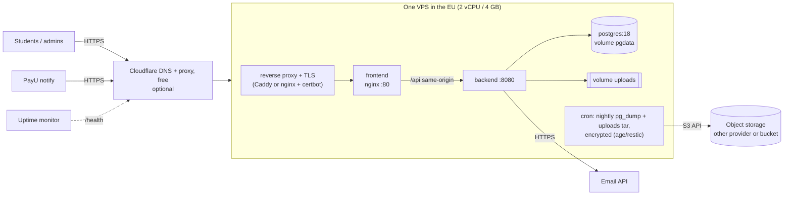
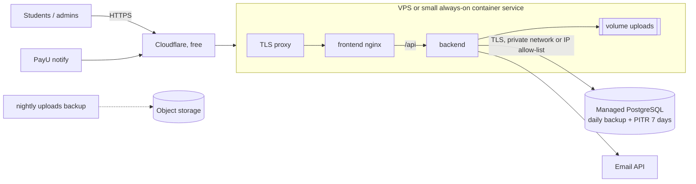
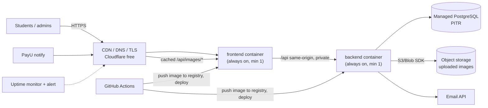
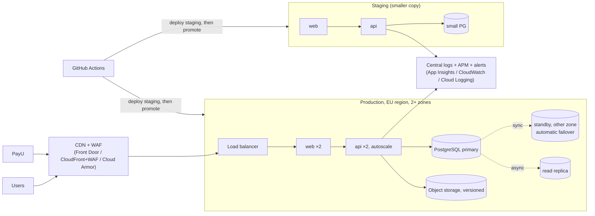
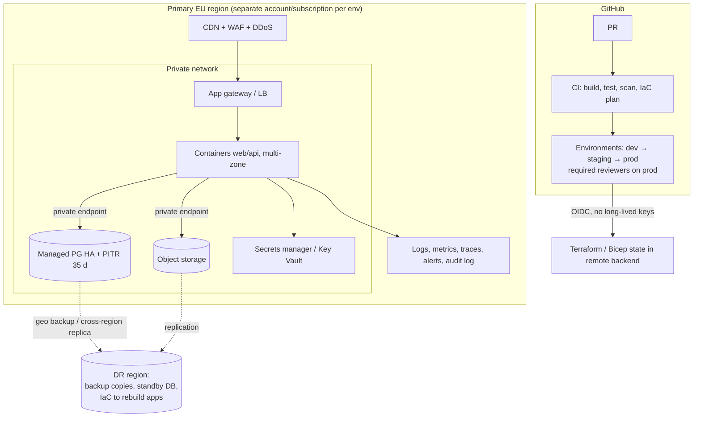

# Hosting after Render: requirements, target tiers and provider comparison

Status: research only. No decision yet; an ADR is written once the owner picks a tier and a provider.
Date: 2026-11-20. Refs #24 (uploads lost on deploy), #25 (SMTP blocked), #26 (free DB expires), ADR-005 draft (PR #109, guest registrations + PayU webhooks).

Prices are list prices without VAT, read on 2026-11-20 from the sources in section 9. **(est.)** marks my own arithmetic or a third-party figure; **(unverified)** marks something I could not confirm on an official page. Confirm every price in the provider's calculator before signing up. 1 month = 730 h.

## 1. Summary

- **Top pick (T3):** one small managed setup in an EU region: the two existing Docker images on an always-on container service, a **managed PostgreSQL** with daily backups and 7+ days of point-in-time restore (PITR), object storage for uploaded images, Cloudflare (free) in front for DNS/TLS/CDN, an HTTP email API (Brevo free tier) and a free uptime monitor. About **$32–35/month** on Azure or DigitalOcean.
  - **Azure** if the Microsoft nonprofit grant ($2,000 Azure credit per year, renewable [12]) is approved: the bill is then about $0, and it renews every year.
  - **DigitalOcean** (Frankfurt) if the grant is refused or the team finds Azure too heavy. It is the simplest console and CLI of the managed options. A one-time nonprofit credit of up to $2,500 [14] would cover the first year.
- **Budget pick (T0):** one **Hetzner** VPS in Germany running our existing `docker compose` (nginx, API, Postgres, uploads volume) with nightly encrypted `pg_dump` to object storage, about **€8–13/month**. This fixes #24/#25/#26 and the cold starts with almost no code change, but a volunteer then owns OS updates, Postgres and restore tests.
- **What would change it:** no nonprofit credits and a hard ceiling under ~$15/month → T0. Nobody willing to SSH into a server → T3 managed, never T0. More than about 2,000 payments per semester, or a legal requirement for HA → T4.
- **Not recommended:** scale-to-zero platforms (Cloud Run, Container Apps) at default settings, because PayU webhooks and the first visitor would hit cold starts again. Use them only with min instances ≥ 1. Also not recommended: GitHub Student Pack credits for production. They belong to one student's personal account, which is a bus-factor and ownership problem.

## 2. What exists today

- [render.yaml](../../render.yaml): Render free plan, Frankfurt. Free Postgres `esn-gdansk-db`, `esn-gdansk-api` (Docker, [docker/backend.Dockerfile](../../docker/backend.Dockerfile), `/health`) and `esn-gdansk-web` (Docker, nginx from [docker/nginx.conf.template](../../docker/nginx.conf.template), proxies `/api`, `/health` and `/swagger` to `API_UPSTREAM`, ADR-002). Details are in [docs/architecture/deployment.md](../architecture/deployment.md).
- Deploys: [.github/workflows/release.yml](../../.github/workflows/release.yml) bumps `VERSION`, tags, then POSTs the two Render deploy hooks. Render builds the images itself, so no registry is involved.
- Images: four `*ImageStorage` services in `backend/src/EsnApp.Api/Services/` write uploads to `wwwroot/images/uploads/...` on local disk, served as `/api/images/uploads/...`. On Render this disk is ephemeral (#24). The local `docker-compose.yml` already mounts a named `uploads` volume.
- Email: `SmtpEmailSender`. Render free blocks SMTP ports (#25).
- Render coupling in code: `VersionController` reads `RENDER_GIT_COMMIT`, nginx serves it in `/version.json`, and `ConnectionStrings__DefaultConnection` accepts Render's `postgresql://` URI.
- **Known production bug:** `Program.cs` runs `DbSeeder.SeedAsync` whenever `Database:ApplyMigrationsOnStartup` is true, and render.yaml sets it to `true`. So production gets the sample data, not only the migrations and the admin. The new production must run migrations and the admin seed **without** sample data. That needs a small backend change, a separate flag such as `Seed:SampleData` that defaults to false (see section 7).
- Data: production holds only mock/sample data, so **nothing is migrated**. The new environment starts empty.

## 3. Requirements

### 3.1 Functional (what the hosting must run)

| # | Requirement |
|---|---|
| F1 | Run the two existing Docker images unchanged: `frontend` (nginx + Angular build, same-origin `/api` proxy, ADR-002) and `backend` (.NET 10, port 8080, `/health`). |
| F2 | PostgreSQL (we use 18 locally; managed offers may lag, and 16/17 are fine for EF Core/Npgsql). Schema only through EF Core migrations applied on startup or as a release step. |
| F3 | Persistent storage for admin-uploaded images that survives deploys (#24): a disk volume (T0/T1) or object storage (T2+; needs an `IImageStorage` implementation for S3/Blob). |
| F4 | Outbound email for password reset and, with ADR-005, registration confirmations, through an **HTTP email API** (#25). SMTP is a fallback only. |
| F5 | Receive PayU notifications (`POST`, anonymous, signed) at any time, with no sleeping service (ADR-005). |
| F6 | Correct client IP for rate limits and PayU `customerIp`: a known, fixed number of trusted proxy hops; the API not reachable around nginx (or protected by the `X-Proxy-Auth` header from ADR-005). |
| F7 | Custom domain with TLS for the web app (for example `app.esngdansk.pl`, owner to confirm). The API needs no public hostname of its own if the platform allows private networking. |
| F8 | Deploy from GitHub Actions on merge to `main` (release.yml), one-click/one-command rollback to the previous version, and `GET /api/version` showing the deployed version and commit. |

### 3.2 Non-functional

| Attribute | Target (suggestion) | Why |
|---|---|---|
| Availability | 99.5% monthly (≈3.6 h downtime), no SLA purchase needed | Student chapter; PayU retries notifications for 72 h (ADR-005) |
| Cold start | None: first request < 1 s after idle | ADR-005 sign-up POST is not retried; first-visit UX |
| RPO (data loss) | ≤ 24 h at T0 (nightly dump); ≤ 5 min at T1+ (managed PITR) | Registrations + payment status are money records |
| RTO (time to restore) | ≤ 4 h (T0), ≤ 1 h (T1+) | A volunteer must be able to do it from a runbook |
| Backups | Automated daily, ≥ 7 days retention, stored off the server, encrypted; **restore test once per semester** (restore into a scratch DB and run the app against it) | A backup that was never restored is not a backup |
| Region / GDPR | EU region (Frankfurt/Warsaw/Amsterdam etc.), provider DPA signed, data and backups in the EU | Guest PII (name, e-mail, phone), ADR-005 |
| TLS / domain | Managed certificates, HTTPS only, HSTS | |
| Secrets | Platform secret store or GitHub environment secrets; never in the repo; rotate the leaked Render-era values | Existing convention |
| Observability | Container logs kept ≥ 7 days, `/health` uptime check every 5 min with e-mail/Discord alert, error log search | Volunteers learn about outages from a monitor, not from students |
| Performance | p95 API < 300 ms at ~5,000 visits/day; 2 GB RAM for API + nginx + Postgres on one host (4 GB comfortable) | Load is tiny; any tier here is sized for 10× |
| Staging | Optional. PR previews are not needed; the e2e workflow already runs the compose stack in CI | Cost |
| Cost ceiling | Owner to set. Suggested: ≤ $40/month out of pocket, or ≈ $0 with credits | Non-profit |
| Ops effort | ≤ 2 h/month routine for volunteers (updates, checking the monitor, the semester restore test) | Small rotating team |
| Bus factor | ≥ 2 people with admin access; accounts owned by the association's e-mail, not a personal one; a runbook in `docs/` | Student turnover |
| Exit / portability | Keep the Docker images and plain Postgres as the contract; no proprietary runtime APIs in app code (S3-compatible storage API, standard SQL); IaC or a documented manual setup | Leaving Render must stay cheap next time too |

## 4. Tiers

All tiers run the same two images. The diagrams name generic components; section 5 maps them to each provider.

### T0: cheapest, one VPS with everything in Docker Compose

- Deploy: GitHub Actions builds the images, pushes them to GHCR, then SSHes in and runs `docker compose pull && up -d`. Rollback = redeploy the previous tag.
- Fixes #24 (volume), #25 (email API over HTTPS), #26 (own Postgres), and removes cold starts.
- Risks: one machine, so a disk/host failure means restore from last night's dump (RPO 24 h). A volunteer must patch the OS and the Postgres image. Provider snapshot backups (+20% on Hetzner/DO) add a second safety net.

### T1: cheapest + managed PostgreSQL

- What changes vs T0: the database (the only stateful part that matters for money) gets provider backups, PITR, minor-version patching and monitoring. RPO drops to minutes.

### T2: medium, containers + managed Postgres + object storage + CDN + email API + monitoring

- Needs one code change: an object-storage implementation of the image storage, which replaces the four local-disk writers (#24).
- The server becomes stateless: redeploys, rollbacks and moving to another provider are image swaps.

### T3: proposed balance for this team

T2, minus anything that needs regular care, plus a written runbook:

- Single region, single instance per service, no staging (CI e2e covers the stack). A semester restore test into a temporary database is the one recurring chore.
- Cloudflare in front adds one proxy hop. The client IP comes from `CF-Connecting-IP` or a fixed `ForwardLimit`, measured once (ADR-005).

### T4: rich ("na bogato")

### T5: "by the book" (cloud reference architecture)

T5 is listed for completeness. For ~5,000 visits/day it is over-engineered: it costs hundreds of dollars a month and needs someone who knows the cloud platform well.

## 5. Providers

### 5.1 Service mapping per tier

| Provider | T0 | T1 | T2 / T3 | T4 | T5 |
|---|---|---|---|---|---|
| **Azure** (Germany West Central, Poland Central, West Europe) | B-series VM | App Service B1 + PG Flexible B1ms | App Service Linux B1 (both containers on one plan, Always On) or Container Apps (min replicas 1) + PG Flexible B1ms + Blob | Container Apps + PG Flexible General Purpose with zone-redundant HA + Front Door + App Insights | Landing zone, Bicep/Terraform, VNet + private endpoints, Key Vault, geo-redundant backup |
| **AWS** (eu-central-1 Frankfurt, eu-central-2 Zurich, eu-west-1) | Lightsail instance | Lightsail instance + Lightsail managed DB, or EC2 + RDS | Lightsail containers/instance or App Runner + RDS db.t4g.micro + S3 + SES | ECS Fargate + ALB + RDS Multi-AZ + read replica + CloudFront/WAF + CloudWatch | Organizations multi-account, VPC private subnets, Secrets Manager, AWS Backup cross-region |
| **GCP** (europe-west3 Frankfurt, europe-central2 Warsaw, europe-west1) | Compute Engine e2-small (the always-free e2-micro is US-only) | Cloud Run (min instances 1) + Cloud SQL | Cloud Run + Cloud SQL + GCS | Cloud Run multi-region + Cloud SQL HA + LB + Cloud Armor | Shared VPC, Secret Manager, Cloud SQL cross-region replica |
| **DigitalOcean** (FRA1, AMS3) | Droplet | Droplet + Managed PostgreSQL | App Platform (2 containers) or Droplet + Managed PG + Spaces (built-in CDN) | App Platform + Managed PG with standby node + read-only node | VPC, Terraform provider; no second managed region failover (DIY) |
| **Hetzner** (Falkenstein, Nuremberg, Helsinki) | Cloud server (CX/CPX/CAX) + backups | No first-party managed PG [5]; options: self-run PG on a second server, or a third-party managed PG (Ubicloud on Hetzner, unverified) | Cloud server + Hetzner Object Storage + self-run or third-party PG | Load balancer + 2 servers + Patroni (self-run) | Terraform `hcloud` provider; no managed secrets, no managed DB, so DIY |
| **Budget VPS** (Hostinger, OVHcloud, Contabo) | VPS (KVM) | OVHcloud only: Public Cloud Databases for PostgreSQL (unverified price) | VPS + external object storage/managed PG | not a fit | not a fit |

### 5.2 Monthly cost per tier (USD unless €; without VAT)

Assumptions: 2 GB RAM is enough for one host running everything; DB < 10 GB; images < 5 GB; egress < 200 GB/month **(est.: 5,000 visits × ~1 MB uncached at peak, PWA shell cached by the service worker, images cached by Cloudflare)**. Cloudflare free, Brevo free and UptimeRobot free cost $0 in every tier.

| Tier | Azure | AWS | GCP | DigitalOcean | Hetzner | Hostinger / OVH / Contabo |
|---|---|---|---|---|---|---|
| **T0** | ~$20 (B-series VM + disk, est.) | **$12** Lightsail 2 GB (+$1 bucket) [7] | ~$15–20 (e2-small, est.) | **$12** + $2.40 weekly backups + $5 Spaces ≈ **$19** [3][4] | **€5.49–5.99** server [1][2] + 20% backups + €4.99–6.49 Object Storage [6] ≈ **€8–13** | OVH VPS-1 **$4.54** (daily backup incl.) [10]; Contabo **€4.40–5.50** (24-month term) [11]; Hostinger KVM 2 **$8.99** (24-month prepay, renews $14.99) [9]; + free/cheap off-site backup bucket ≈ **$5–15** |
| **T1** | App Service B1 $13.15 + PG B1ms $14.53 + 32 GB storage $4.38 ≈ **$32** [17] | Lightsail 1 GB $7 + Lightsail DB $15 ≈ **$22** [7]; or EC2 + RDS t4g.micro $13.87 + storage ≈ $25 [8] | Cloud Run min 1 (~$5–15, est.) + Cloud SQL db-f1-micro $9–16 (third-party figures disagree [18]) ≈ **$20–35 (est.)** | Droplet 1–2 GB $6–12 + Managed PG $15.15 ≈ **$21–27** [3][4] | n/a first-party; self-run PG on a second CX ≈ €11–12 (not managed) | OVH VPS + OVH managed PG (unverified) |
| **T2** | T1 + Blob (<$1) ≈ **$33** | T1 + S3/bucket $1–3 + SES (~$0.10/1,000 mails, unverified) ≈ **$25–30** | ≈ **$22–37 (est.)** | App Platform 2 × $5–12 + PG $15.15 + Spaces $5 ≈ **$30–45**, or Droplet variant ≈ **$32** [4][15] | server + Object Storage + third-party PG ≈ **€25–35 (est.)** | VPS + external PG ≈ $25 (est.) |
| **T3** | **≈ $33**, ≈ $0 with the nonprofit grant | ≈ $25–30 | ≈ $25–40 (est.) | **≈ $32** (one-time credit could cover year 1) | ≈ €15–20 self-run PG + Object Storage (more ops) | not recommended |
| **T4** | Container Apps ~$30–60 + PG D2ds_v5 HA ≈ $310 (2 × 2 vCores × $0.106/h) + Front Door + App Insights + staging ≈ **$450–550 (est.)** [17] | Fargate ~$35 + ALB ~$20 + RDS t4g.small Multi-AZ ≈ $54 + replica $27 + WAF/CloudFront/CloudWatch ~$20 + staging ~$40 ≈ **$200–250 (est.)** [8] | ≈ **$200–300 (est.)** | App Platform ~$24 + PG 2 GB with standby ~$60 + staging ~$25 ≈ **$110–130 (est.)** [4] | ≈ €40–60 hardware, but HA Postgres is self-built (high ops) | n/a |
| **T5** | ≈ **$600–900 (est.)** | ≈ **$400–800 (est.)** | ≈ **$400–800 (est.)** | ≈ $200 (partial; no managed DR) | n/a | n/a |

Baseline for comparison (the "keep what we have" option): Render paid plans, 2 × Starter + Basic Postgres ≈ $20/month (ADR-005 figures, **unverified**) plus a persistent disk. The owner has already chosen to leave Render, so I do not explore it further.

### 5.3 Provider notes

| Provider | Cold start | GitHub Actions / IaC | Managed PG | Egress | Lock-in / GDPR |
|---|---|---|---|---|---|
| Azure | App Service Basic with **Always On** does not sleep. Container Apps scales to zero unless min replicas ≥ 1; idle replicas bill at a reduced rate ($3e-6 per vCPU-s and per GiB-s idle vs $2.4e-5 per vCPU-s active) [17] | Excellent: `azure/login` with OIDC, `azure/webapps-deploy` / `containerapps-deploy`, Bicep and Terraform. Basic has no deployment slots, so rollback = redeploy the previous image tag | Flexible Server: automated backups with PITR (7–35 days), Burstable tiers have **no HA**; backup storage up to the provisioned size is included (unverified); PG 18 availability unverified | First 100 GB/month free (unverified) | Medium (App Service config, Blob SDK). US parent: EU Data Boundary, DPA |
| AWS | Lightsail/EC2/ECS never sleep. App Runner can pause (unverified) | Excellent: `aws-actions/configure-aws-credentials` with OIDC, ECS deploy actions, CDK/Terraform | RDS: PITR up to 35 days, Multi-AZ ≈ 2× price [8]; Lightsail DB has HA at 2× [7] | 100 GB/month free, then ~$0.09/GB (unverified); public IPv4 billed separately on EC2/RDS | Medium. US parent, EU regions, DPA |
| GCP | Cloud Run scales to zero by default: **set min instances 1** or PayU/first visits wait seconds (.NET cold start, est. 2–5 s) | Excellent: `google-github-actions/auth` (Workload Identity Federation) + `deploy-cloudrun` | Cloud SQL: automated backups, PITR, HA ≈ 2×; shared-core tiers are not covered by the SLA (unverified) | Premium tier egress pricier (unverified) | Medium. US parent, EU regions |
| DigitalOcean | Droplets and App Platform instances do not sleep | Good: `digitalocean/action-doctl`, App Platform app spec in the repo, Terraform provider, DOCR registry | Managed PG: daily backups + PITR (7 days, unverified on the pricing page), standby nodes optional, 1 GB plan $15.15 [4] | Droplets include 500 GB–2 TB transfer [3] | Low (plain Docker + PG + S3-compatible Spaces). US parent, EU regions |
| Hetzner | VPS never sleeps | DIY: SSH + compose from Actions, `hcloud` CLI and Terraform provider. No container platform | **None first-party** [5]: we own backups/PITR (pgBackRest or WAL-G to Object Storage) | Generous included traffic in EU (exact figure unverified after the 2026 changes) | Lowest (plain VPS). German company, EU only. **Prices rose twice in 2026 and cost-optimized plans were often out of stock** [2] |
| Hostinger | VPS never sleeps | DIY via SSH; Hostinger has a VPS API (unverified) | none | included | Low. Lithuanian company; data-centre list for VPS unverified. Low intro prices need 24-month prepay; renewals are ~1.7× higher [9] |
| OVHcloud | VPS never sleeps | DIY via SSH; OVH API + Terraform provider | Public Cloud Databases for PostgreSQL (price unverified) | Unmetered traffic on VPS [10] | Low. French company, EU data centres incl. Warsaw (unverified for VPS) |
| Contabo | VPS never sleeps | DIY via SSH | none | included | Low. German company; known for oversold CPU and slow support (community reports, unverified). Setup fee on monthly contracts [11] |

### 5.4 Non-profit and student credits

| Program | What | Can Stowarzyszenie ESN Gdańsk (KRS 0000783383) qualify? |
|---|---|---|
| Microsoft for Nonprofits, Azure grant | **$2,000 Azure credit per year, renewable while eligible**; unused credit does not roll over [12] | Likely. Validation runs through TechSoup's network (TechSoup Polska for Poland). Registered associations usually qualify, but our eligibility is **unverified**. Microsoft's Polish country rules must be checked. This grant covers T3 on Azure many times over |
| AWS Nonprofit Credit Program (TechSoup) | $1,000 credit per fiscal year (Jul–Jun) since 2021, with an admin fee [13] | **Unverified** for Poland: the AWS page lists US designations, the TechSoup global pages say "many countries". Ask TechSoup Polska |
| Google for Nonprofits, Google Cloud credits | Third-party sources say up to $2,000/year (unverified); Poland is on Google's list of countries with "additional eligibility requirements" [16] | **Unverified.** Google for Nonprofits itself is open to Polish charitable organisations, but Cloud credits are not guaranteed |
| DigitalOcean for Nonprofits (ex Hub for Good) | Up to **$2,500 one-time** credit, expires 1 year after approval; validation through Percent [14] | Likely ("501(c)(3) or global equivalent, social enterprise or unregistered initiative"), **unverified** for us. One-time only |
| GitHub Student Developer Pack | DigitalOcean $200 for 1 year (DO's own page says $100), Azure for Students $100 [15] | Personal credits of one verified student, **not the association**. Fine for a test environment, wrong for production (account ownership, bus factor, it ends when the student graduates) |

## 6. Comparison matrix and recommendation

Cost = monthly list price (section 5.2). Ops effort = routine volunteer hours per month **(est.)**. Robustness: 1 = single box with nightly dump, 5 = multi-zone HA with DR.

| Tier | Cheapest provider | Cost/month | Ops effort | Robustness | Fixes #24/#25/#26 + no cold start |
|---|---|---|---|---|---|
| T0 | OVH / Contabo / Hetzner | $5–13 | 2–4 h (OS, Docker, PG image updates, backup checks) | 1 | yes |
| T1 | DigitalOcean / AWS Lightsail | $21–32 | 1–2 h | 2 | yes |
| T2 | AWS Lightsail / DigitalOcean / Azure | $25–45 | ~1 h | 3 | yes |
| **T3** | **Azure (with grant) / DigitalOcean** | **~$33, ~$0 with grant** | **~1 h** | **3** | **yes** |
| T4 | DigitalOcean / AWS | $110–550 | 3–5 h | 4 | yes |
| T5 | AWS / GCP / Azure | $400–900 | 8+ h, needs a cloud specialist | 5 | yes |

**Recommendation: T3.**

1. Apply for the **Microsoft nonprofit grant** first (free, a few weeks). If approved → **T3 on Azure**: App Service Linux B1 plan hosting both containers (Always On), PostgreSQL Flexible Server B1ms (PITR 7 days or more) and a Blob container, in Poland Central or Germany West Central. Effective cost ≈ $0, and ~$33/month if the grant ever stops.
2. If the grant is refused or slow → **T3 on DigitalOcean Frankfurt**: Droplet 2 GB with compose, or App Platform for the two images, plus Managed PostgreSQL 1 GB and Spaces. Apply for the DO nonprofit credit for year 1.
3. **Budget pick, T0 on Hetzner**, if the ceiling is < $15/month and at least two volunteers are comfortable with Linux: compose on one server, nightly encrypted `pg_dump` + uploads to Hetzner Object Storage, provider backups on, semester restore test.

Why T3 and not T0: once ADR-005 ships, the database holds payment state and guest PII. Managed PITR, patching and encrypted storage cost about $20/month more and remove the riskiest volunteer chore (Postgres backups/restore). Why not T4: HA for 5,000 visits/day buys nothing that PayU's 72-hour retries and a 1-hour RTO don't already cover.

What would change my mind: (a) a grant on another provider (AWS/GCP) → same T3 shape there; (b) the owner rules out US-parent providers for GDPR → Hetzner T0/T1 or OVH; (c) nobody can review Azure IAM/billing → DigitalOcean.

## 7. Cut-over / fresh setup outline (no data migration)

Production holds only mock data, so the new environment **starts empty**: migrations + admin seed, sample data only for a demo. No dump/restore, no image copy, no data-move downtime.

1. **Prerequisite code changes (separate PRs, before cut-over):**
   - backend: split seeding. `Database:ApplyMigrationsOnStartup` applies migrations and seeds the admin only; sample data behind a new flag (for example `Seed:SampleData`, default `false`, `true` only in Development/compose and e2e). Fixes the known prod bug.
   - backend: HTTP email sender (Brevo API) behind the existing sender interface (#25).
   - backend (T2+): object-storage image storage replacing the four local-disk writers (#24). T0/T1 use a volume instead.
   - backend + docker: rename `RENDER_GIT_COMMIT` to a neutral `GIT_COMMIT` (build arg / env), in `VersionController` and `nginx.conf.template`.
   - docker: `docker-compose.prod.yml` (T0/T1 only): no published DB port, restart policies, image tags from GHCR, TLS proxy, backup job.
2. **Provision** (IaC or a documented console runbook under `docs/`): account owned by the association's e-mail with ≥ 2 admins, region, DB, storage bucket, container services, budget alert at the ceiling.
3. **Secrets:** generate new `Jwt__Key`, admin seed password, DB password, email API key, `API_PROXY_SECRET`; store them in the platform secret store / GitHub environment `production`. Do not reuse the Render values.
4. **release.yml:** replace the two Render deploy-hook steps with: build both images → push to GHCR tagged `vX.Y.Z` + SHA → deploy (Azure `webapps-deploy` with OIDC / `doctl` / SSH + `compose pull`) → wait for `/health` → check that `/api/version` returns the new version. Keep `workflow_dispatch` for a redeploy, with an input for redeploying an older tag (rollback).
5. **Smoke test** on the provider's default URL: home, events, partners map, admin login, image upload survives a redeploy, password-reset e-mail arrives, `/api/version`, client IP logged correctly (one request through Cloudflare).
6. **Switch DNS:** point the app domain at the new service (Cloudflare proxied, low TTL set a day before), and update `Email__FrontendBaseUrl` and the PayU `notifyUrl`/`continueUrl` (if PayU is live by then).
7. **Watch** for 1–2 weeks (uptime monitor, logs, the first backup + a restore test).
8. **Decommission Render:** delete the services and the DB, remove the deploy-hook secrets, delete `render.yaml`, and update `docs/architecture/deployment.md`, `CLAUDE.md` (Deployment) and `.env.example`.

**Rollback:** until step 8, point DNS back at Render (the old `onrender.com` URLs keep working, minutes with low TTL). After step 8, rollback means redeploying the previous image tag on the new platform.
**Downtime estimate:** none planned. DNS switch only; students on stale DNS keep hitting Render for up to the TTL (est. < 1 h). Effort estimate **(est.)**: 2–4 volunteer days including the prerequisite PRs, plus 1 day for T0 server hardening if T0 is chosen.

**Repo changes summary:** remove `render.yaml`; add `docker-compose.prod.yml` (T0/T1) or IaC (`infra/` with Bicep/Terraform or an App Platform spec, T2+); change `release.yml` (registry + deploy step instead of hooks); add a backup workflow or cron (T0); add an ADR (hosting) that supersedes the Render parts of ADR-004's deployment notes; add a runbook `docs/operations/` (deploy, rollback, restore test, secret rotation).

## 8. Open questions for the owner

1. **Budget ceiling** per month out of pocket? (Recommended: ≤ $40, target $0 with credits.)
2. **Who administers** the hosting account and can be on call (≥ 2 people)? Is anyone willing to look after a Linux server (decides T0 vs T3)?
3. **Domain:** does the association own `esngdansk.pl` (or another domain), who manages its DNS, and may we move DNS to Cloudflare (free)? Which subdomain for the app?
4. **Credits:** may we apply for the Microsoft nonprofit grant (and DigitalOcean/AWS) in the association's name, and who signs (board member, KRS data, TechSoup Polska validation)?
5. **US-parent providers OK** for guest PII under GDPR (with EU region + DPA), or EU-only companies (Hetzner/OVH)?
6. Is a **staging environment** wanted (≈ +$15–30/month), or is the CI e2e stack enough?

## 9. Sources

1. Hetzner Cloud overview (starting prices: Regular Performance from €5.49, Cost-Optimized from €5.99): https://www.hetzner.com/cloud/
2. Hetzner price adjustment 2026 (CAX11 €4.49 → €5.99 from 15 June 2026): https://docs.hetzner.com/general/infrastructure-and-availability/price-adjustment/ ; availability of cost-optimized plans (third party): https://www.bitdoze.com/hetzner-cloud-cost-optimized-plans/
3. DigitalOcean Droplet pricing (Basic $4/$6/$12/$18; backups 20% weekly / 30% daily): https://www.digitalocean.com/pricing/droplets
4. DigitalOcean Managed Databases pricing (PostgreSQL 1 GiB $15.15/month): https://www.digitalocean.com/pricing/managed-databases
5. Hetzner has no first-party managed Postgres (third-party comparison, Nov 2026): https://encore.dev/articles/hetzner-vs-digitalocean
6. Hetzner Object Storage (base price incl. 1 TB storage + 1 TB egress; €4.99 at launch, later snippet €6.49): https://www.hetzner.com/storage/object-storage/
7. AWS Lightsail pricing (instances $5/$7/$12; managed DB $15, HA $30; buckets from $1; containers Nano $7): https://aws.amazon.com/lightsail/pricing/
8. AWS RDS price list API, eu-central-1, effective 2026-11-01 (db.t4g.micro PostgreSQL Single-AZ $0.019/h, db.t4g.small $0.037/h): https://pricing.us-east-1.amazonaws.com/offers/v1.0/aws/AmazonRDS/current/eu-central-1/index.csv ; RDS pricing page: https://aws.amazon.com/rds/postgresql/pricing/
9. Hostinger VPS pricing (KVM 1 $6.49 → $11.99 renewal, KVM 2 $8.99 → $14.99, 24-month term): https://www.hostinger.com/pricing/vps-hosting
10. OVHcloud VPS (VPS-1 from $4.54, daily backup included, unlimited traffic): https://www.ovhcloud.com/en/vps/
11. Contabo Cloud VPS (from €4.40/month on a 24-month term, setup fee on monthly contracts): https://contabo.com/en/vps/
12. Microsoft for Nonprofits offers and FAQ ($2,000 Azure credit per year, TechSoup validation): https://www.microsoft.com/nonprofits/offers-for-nonprofits , https://www.microsoft.com/nonprofits/faq
13. TechSoup, AWS credits program changes ($1,000 per fiscal year from July 2021): https://blog.techsoup.org/en-us/posts/what-you-need-to-know-about-changes-to-techsoups-aws-credits-program ; AWS Nonprofit Credit Program: https://aws.amazon.com/government-education/nonprofits/nonprofit-credit-program/
14. DigitalOcean for Nonprofits & Social Enterprises (up to $2,500 one-time credit): https://www.digitalocean.com/blog/driving-impact-do-for-nonprofits-social-enterprises , https://www.digitalocean.com/impact/nonprofits
15. DigitalOcean App Platform pricing (shared container from $5, dev DB $7, $0 static sites): https://www.digitalocean.com/pricing/app-platform ; GitHub Student Developer Pack: https://education.github.com/pack ; DO for GitHub students: https://www.digitalocean.com/github-students
16. Google Cloud credits, nonprofit eligibility (Poland: additional requirements): https://support.google.com/google-cloud-higher-ed/answer/14822135 ; Google for Nonprofits eligibility (PL): https://www.google.com/intl/pl/nonprofits/eligibility/
17. Azure Retail Prices API, germanywestcentral, read 2026-11-20: PG Flexible B1ms $0.0199/h, storage $0.137/GB-month, backup LRS $0.103/GB-month, GP Ddsv5 $0.106 per vCore-hour; App Service Linux B1 $0.01802/h; Container Apps active vCPU $0.000024/s, idle vCPU and GiB $0.000003/s, environment management $0.10/h (applies to dedicated/workload-profile plans, unverified for consumption-only); Blob Hot LRS ~$0.0196/GB-month. Free monthly Container Apps grant 180,000 vCPU-s / 360,000 GiB-s / 2 M requests (pricing page). https://prices.azure.com/api/retail/prices , https://azure.microsoft.com/en-us/pricing/details/container-apps/
18. Cloud SQL db-f1-micro Frankfurt, third-party figures that disagree ($9/month vs $0.0216/h): https://www.bytebase.com/dbcost/cloudsql/instance/db-f1-micro/ , https://sparecores.com/database/gcp/db-f1-micro ; official page (prices not readable by the tool): https://cloud.google.com/sql/pricing , https://cloud.google.com/run/pricing
19. Email APIs: Brevo free plan 300 e-mails/day with API, EU servers: https://www.brevo.com/features/email-api/ ; Resend free tier 3,000/month, 100/day (via Brevo's comparison, unverified): https://www.brevo.com/resend/
