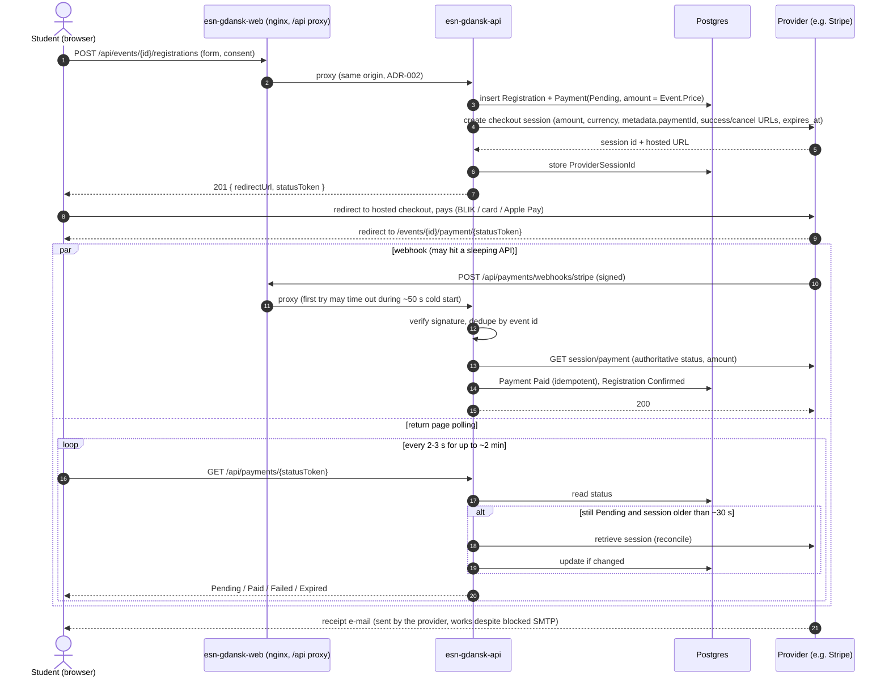
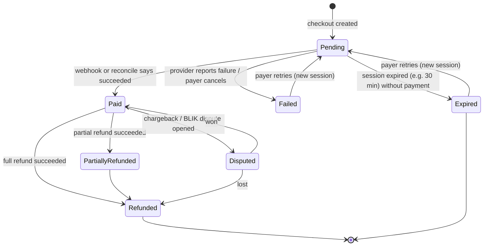
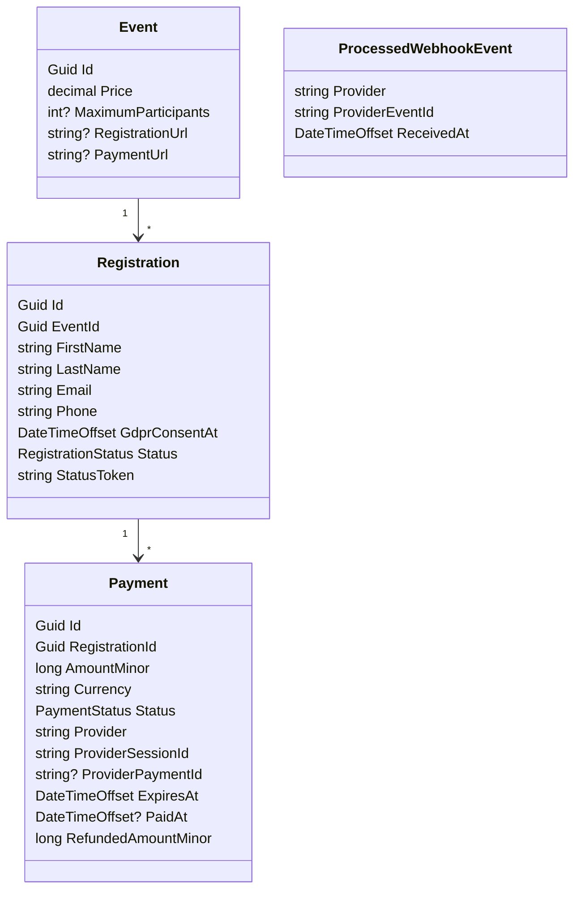

# Online payments for event tickets: provider research

Status: research only (issue #106, depends on #105). No decision yet; the ADR is written once the owner/board picks an option.
Date: 2026-11-19. Facts were checked on official pages where they could be reached; anything marked **(unverified)** comes from third-party sources or could not be confirmed. Every fee should be confirmed in the provider's current price list or contract before the board decides.

## 1. Summary and recommendation

Context: ESN Gdańsk (Polish *stowarzyszenie*, KRS/NIP, account in Nest Bank) sells event tickets of about 20–100 PLN, a few hundred payments per semester, mostly to foreign Erasmus students (foreign cards, Apple/Google Pay, Revolut) and some Poles (BLIK). The owner prefers ready-made solutions: payment links first, checkout integration only if manual checking becomes too much work (#106 comments).

What exists today: `Event` already has `Price` (decimal) and `RegistrationUrl` (`backend/src/EsnApp.Domain/Events/Event.cs`). There is no Registration or Payment entity and no anonymous write endpoint besides login/reset-password. Everything runs on the Render free tier (`render.yaml`): the API sleeps after 15 min (~50 s cold start), the free Postgres expires after 30 days, and SMTP is blocked.

**Recommendation**

| Goal | Pick | Why |
|---|---|---|
| Best overall (start with links, grow into checkout) | **Stripe** (Payment Links now, Checkout + webhook later) | One provider for level A and B, so no re-onboarding later. Cards from any country, Apple/Google Pay, BLIK, and Payment Links at no extra charge. Best docs, a sandbox, a CLI for local webhooks, an official .NET SDK (`Stripe.net`), and HMAC-SHA256 signed webhooks retried for up to 3 days. |
| Easiest to start | **Stripe Payment Links** (level A) | One link per event, created in the dashboard in minutes. Stripe collects the e-mail (plus optional custom fields), shows the payment in the dashboard and can e-mail a receipt. App change: one URL field and a button. |
| Cheapest Polish alternative | **Przelewy24** (or PayU) | P24 lists 1.29% + 0.30 PLN for BLIK, pay-by-link and cards, no monthly fee, and a 59 PLN activation fee refunded after 10 transactions. Cheaper per ticket than Stripe at our ticket sizes, but weaker for foreign cards and English UX, with plainer APIs and docs. |
| No code, also replaces #105 | **pretix Hosted** (ticketing platform) | Sign-up form, capacity, waitlist, e-mail tickets, check-in and payments (via Stripe) in one. 2.5% fee capped at EUR 15/ticket, with special non-profit pricing. The app just links to the shop for each event. |

Estimated provider cost for 300 tickets x 50 PLN = 15,000 PLN per semester **(estimate, list prices)**: P24 ~284 PLN, PayU BLIK ~320 PLN, SumUp link ~293 PLN, Stripe ~525–540 PLN, pretix ~375 PLN + Stripe fees. The difference (~250 PLN per semester) is small compared with the volunteer time manual reconciliation takes.

**What would change the recommendation**
- Most payers turn out to be Poles paying with BLIK/pay-by-link, and cost matters more than foreign cards: pick Przelewy24 or PayU.
- Stripe refuses or restricts the association during onboarding (it reviews the business category). Note that Stripe lists "Entertainment and event promotion services" as prohibited **for Przelewy24 via Stripe**, but not for cards or BLIK. In that case fall back to PayU or P24.
- The board wants a Revolut Business account for other reasons and Revolut confirms BLIK acceptance: Revolut payment links become attractive (low card fees, Revolut Pay is popular with Erasmus students) **(unverified)**.
- The owner decides #105 should not be built in-house: go with pretix (or Ticket Tailor) and skip payment code entirely.
- Before taking money on level B, the API and DB must leave the free tier (expiring DB, sleeping API). Without budget for that, stay on level A or C.

## 2. Comparison

### 2.1 Payment providers

| Provider | Methods relevant to us | Fees (list price) | Confirmation time | Payout | Payment links | API / SDK / sandbox | Webhook (signature, retries) | Onboarding for an association |
|---|---|---|---|---|---|---|---|---|
| **Stripe** | Cards (any country), Apple/Google Pay, BLIK, P24 (see restriction) | EEA cards 1.5% + 1.00 PLN; UK 2.5% + 1.00 PLN; international 3.25% + 1.00 PLN (+2% FX); BLIK 1.6% + 1.00 PLN; P24 1.9% + 1.00 PLN. Refunds are free, but the original fee is kept [1] | Cards: seconds. BLIK: "immediate", result normally within 60 s [3]. P24: immediate, the customer has 1 h to authorise [4] | To any PL bank account (Nest Bank) on a rolling, weekly or monthly schedule [1]. P24 settles T+2 [4]. Default PL delay **(unverified)** | Yes, at no extra charge [1] | REST + official .NET SDK `Stripe.net` **(well known, not re-checked)**. Full sandbox; the CLI forwards webhooks to localhost [2] | HMAC-SHA256 `Stripe-Signature` with a timestamp (5 min tolerance). Retries for up to 3 days in live mode, a few over hours in sandbox. Manual resend up to 15/30 days. No ordering guarantee; dedupe by event ID [2] | Online KYC. The website must meet the activation requirements. P24 via Stripe excludes event promotion [4] |
| **PayU** | BLIK, pay-by-link (all PL banks), cards, Apple/Google Pay | BLIK 1.49% + 0.32 PLN from 1 June 2026 (official T&C) [5]. Card rate not confirmed **(unverified; blogs say 1.6% + 0.20 PLN)** | BLIK/cards: seconds. Pay-by-link: usually seconds to minutes **(estimate)** | To a PL bank account; timing **(unverified)** | Yes ("link do płatności" service) [7] | REST (OAuth client credentials), sandbox. No official .NET SDK **(unverified)** | `OpenPayu-Signature`: MD5 over body + second key. 20 attempts over 72 h (immediately, then 1, 2, 5, 10, 30 min, 1 h ... 72 h). Must answer 200; expect duplicates [6] | Online contract. An association attaches its statute and a KRS extract [7] |
| **Przelewy24** | BLIK, pay-by-link, cards, Apple/Google Pay | 1.29% + 0.30 PLN for BLIK, transfers and cards. Activation 59 PLN (refunded after 10 transactions in 2 months), no monthly fee. First 4 PLN payouts per month free, then 0.99 PLN. Refunds free [8] | BLIK/cards: seconds. Pay-by-link: seconds to minutes **(estimate)** | To a PL bank account on withdrawal; timing **(unverified)** | **(unverified)** | REST, sandbox; community SDKs only. The merchant must call `transaction/verify` after the notification or the funds are not credited [9] | `urlStatus` notification with a `sign` checksum. Retry schedule **(unverified)** | Online registration; requirements for associations **(unverified)** |
| **tpay** | BLIK, pay-by-link, cards | **(unverified)**: blogs quote 0.99% BLIK and cards from 1.4% (2026), or 1.59% + 0.39 PLN (older) [10] | As above **(estimate)** | **(unverified)** | **(unverified)** | REST, sandbox **(unverified)** | **(unverified)** | KYB takes 1–3 days **(unverified)** [10] |
| **Autopay** (ex Blue Media) | BLIK, pay-by-link, cards | Official price page not reachable (403) **(unverified)** | As above **(estimate)** | **(unverified)** | **(unverified)** | REST + ITN notifications **(unverified)** | **(unverified)** | **(unverified)** |
| **eService** | BLIK e-commerce, cards; has an NGO page [11] | No public e-commerce price list found; the known figures are for terminals **(unverified)** | — | — | **(unverified)** | **(unverified)** | **(unverified)** | Contract through sales; aimed at larger e-commerce **(unverified)** |
| **Revolut Business** | Cards, Revolut Pay, Apple/Google Pay. BLIK acceptance for merchants **not confirmed** | Older fee schedule: 0.8% for EEA consumer cards, 2.6% for other cards, plus a flat fee in PLN **(unverified, pricing page 403)** [12] | Cards: seconds | Next-day settlement to the **Revolut Business account**, not Nest Bank: the association would open a Revolut account and transfer from it [12] | Yes | Merchant API (REST), sandbox, webhooks **(details unverified, docs 403)** | **(unverified)** | Revolut KYB for the association **(unverified that associations are accepted)** |
| **Viva.com** | Cards, BLIK (PL merchants, enabled automatically, refunds supported) [13] | No published PL fee found **(unverified)** | BLIK/cards: seconds | To the Viva account, then to the bank **(unverified)** | Yes (Quick Pay permanent link; the payer enters the amount) [13] | Smart Checkout REST, sandbox **(unverified)** | **(unverified)** | **(unverified)** |
| **SumUp** | Cards, Apple/Google Pay. BLIK in links **not confirmed** | Payment links 1.95%, online 2.75%, no monthly fee (official PL pages) [14] | Cards: seconds | To a bank account **(timing unverified)** | Yes | An online API exists but is weaker for checkout **(unverified)** | **(unverified)** | Simple online sign-up **(unverified for associations)** |
| **Nest Bank** | In-person only: Nest POS softPOS (PayTel), from 0.65% + 0.06 PLN; requires a BIZnest account [15] | — | — | — | No e-commerce gateway found | — | — | Not an option for online payments **(no own gateway found)** |
| **Manual bank transfer to Nest Bank** | Transfer / Express Elixir | Free | Same session to next business day; instant only with Express Elixir **(estimate)** | Directly on the account | — | — | — | Nothing to sign |

### 2.2 Ticketing platforms (alternative to building #105)

| Platform | What it does | Fee (list price) | Payment methods | Notes |
|---|---|---|---|---|
| **pretix Hosted** | Event shop: form fields, capacity, waitlist, e-mail tickets/PDF, check-in app, refunds, exports | 2.5% of the ticket price excl. tax, max EUR 15 per ticket, plus the provider fee. Free tickets EUR 0.50 (first 500 per year free). **Special non-profit pricing**. No monthly fee [16] | Stripe, PayPal and Mollie listed; BLIK/P24 through Stripe/Mollie **(unverified)** | Open source (can be self-hosted later), EU (Germany). Best fit for a non-profit. |
| **Ticket Tailor** | Similar event shop | GBP 0.60 + VAT per paid ticket pay-as-you-go, from GBP 0.22 with prepaid credits. Free tickets free up to a limit [17] **(third-party sources)** | Bring your own Stripe/PayPal/Square | The flat fee hurts on a 20 PLN ticket. |
| **Eventbrite** | Marketplace + discovery | Poland: 1% + 2.99 PLN service fee per ticket (help article, date unclear) **(unverified)** [18]. Payment processing extra **(unverified)** | Cards, PayPal | Fees can be passed on to buyers. Heavy branding; buyer data stays in Eventbrite. |
| **Evenea** | Polish event registration + payments | **(unverified, no official price found)** | Polish methods expected **(unverified)** | Ask for a quote if a Polish-language vendor is preferred. |

## 3. Integration levels

### Level A: payment link only, manual reconciliation

How it works: the admin creates one payment link per event in the provider dashboard (a Stripe Payment Link with a fixed price, plus custom fields such as name and phone; the provider collects the e-mail anyway) and pastes it into the event form. Event details show a "Pay" button. Admins check payments in the provider dashboard and, once #105 exists, mark attendees as paid by hand.

Effort:
- Backend: either reuse `Event.RegistrationUrl` (no work) or add `PaymentUrl` (string?, an absolute https URL validated by FluentValidation) to `Event`, the DTOs and the admin create/update command, with an EF migration.
- Frontend: URL field in `admin-event-form`, "Pay" button on event details (designed in Penpot first).
- Later, with #105: an admin "mark as paid" toggle on the attendee list.

Pros: hours of work, no new endpoint, no money logic, no PCI scope, works on the Render free tier, and the provider sends the receipt e-mail. Cons: a payment is linked to a registration only by matching names/e-mails; nothing stops someone paying for a full event; refunds and no-shows are handled by hand; the provider's page shows only generic text about the event. Risks: mismatched names/e-mails and payments for cancelled events. Both are tolerable at a few hundred payments per semester.

### Level B: hosted checkout + webhook updating our DB

How it works: the guest sign-up (#105) creates a `Registration` and a `Payment` (Pending) on the server. The amount comes from `Event.Price`, never from the client. The server creates a provider checkout session with our `paymentId` as metadata/reference and redirects the payer to the provider. The provider notifies our webhook. The handler verifies the signature, re-reads the session/order from the provider API, checks amount and currency, and moves the payment to Paid idempotently. The return page polls our status endpoint.

Effort (Stripe example, about 1.5–3 weeks of volunteer work after #105, estimate):
- Backend: `Payment` entity + EF migration. An `IPaymentProvider` interface in Application with a Stripe implementation in Infrastructure (`Stripe.net`). A `CreateCheckout` command used by the #105 sign-up. A webhook controller (raw body, signature check, dedupe by provider event ID, amount check). A `GET` status endpoint keyed by an unguessable token. Admin endpoints `POST api/admin/payments/{id}/refresh` and `POST api/admin/payments/{id}/refund`. Expiry of stale Pending payments (on read, or on a timer while the API is awake). Secrets in Render env (`Payments__Stripe__SecretKey`, `Payments__Stripe__WebhookSecret`) and documented in `.env.example`. Handler tests for a valid and an invalid signature, a duplicate event and a wrong amount.
- Frontend: return page (`/events/:id/payment/:token`) that polls the status, with a skeleton and success/failed/expired states. The attendee list shows payment status; admin buttons for refresh and refund.
- Ops: move Render Postgres and the API off the free plan (expiring DB, sleeping API). ADR, `security` review, terms of sale and privacy notice.

Pros: status lives in our DB, capacity counts only paid seats, the provider sends the e-mail automatically, refunds from the admin panel. Cons: a new anonymous write endpoint, money logic in our code, free-tier hosting is no longer acceptable, and more for a volunteer team to maintain. Risks: a missed or rejected webhook (mitigated by the reconciliation below), double fulfilment (idempotency), amount tampering (server-side price), leaked secret keys.

### Level C: ticketing platform

How it works: each paid event gets a pretix (or Ticket Tailor) shop page, and the event in our app links to it through the existing `RegistrationUrl`. The platform handles the form, capacity, waitlist, payment, ticket e-mail, refunds and check-in; the data stays there.

Effort: none on the backend; none on the frontend (at most a button label). Set up the platform account, a Stripe/Mollie account connected to it, the GDPR text and a data processing agreement. Optional later: import attendee counts through the platform's API or webhooks.

Pros: covers #105 and #106 with no code, mature refunds/waitlist/check-in, works with our free hosting. Cons: an extra per-ticket fee, attendee data and stats (#99) live outside our app, volunteers get a second admin tool, and the look changes when the user leaves the PWA. Risks: vendor lock-in is low (pretix is open source and exports CSV).

## 4. Diagrams (level B)

### 4.1 Sequence

### 4.2 Payment status

Refunds are asynchronous (on Stripe, BLIK takes up to 120 min and P24 up to 3 business days [3][4]), so the admin UI needs a `RefundPending` flag or state if it shows refund progress.

### 4.3 Minimal data model (entities and fields only)

Field notes: `Event.PaymentUrl` is for level A only. `Phone` is stored in E.164 format with the prefix (#105 comment). `RegistrationStatus` is Pending, Confirmed or Cancelled. `StatusToken` is an unguessable random value used by the return page. `AmountMinor` is in grosze, copied from `Event.Price` when the payment is created. `Currency` is PLN. `Provider` is e.g. `stripe`, `payu` or `p24`. `(Provider, ProviderEventId)` has a unique index for idempotency.

## 5. Webhook specifics for our setup

- **Cold start vs retries.** On the free plan both `esn-gdansk-web` and `esn-gdansk-api` can be asleep. The first webhook delivery wakes them but may time out (~50 s cold start; the provider's timeout is **unverified** and probably shorter). We survive this because providers retry: Stripe for up to 3 days with exponential back-off in live mode (only a few retries over hours in sandbox, so test with the CLI) [2]; PayU 20 attempts, the first after 1, 2, 5 and 10 minutes [6]; the P24 schedule is **unverified**. The return-page polling (below) usually confirms the payment before the retry arrives. For real money, run the API and DB on paid plans anyway: the free DB expires after 30 days, which is unacceptable for payment records.
- **Signature verification.** Read the raw request body before any model binding (`Request.EnableBuffering()` and read the stream), then verify it the provider's way. Stripe: `Stripe-Signature` HMAC-SHA256 with a 5 min timestamp tolerance, via `EventUtility.ConstructEvent` [2]. PayU: `OpenPayu-Signature`, MD5(body + second key) [6]. P24: the `sign` checksum plus the mandatory `transaction/verify` call [9]. Compare in constant time and reject with 400 on failure. Secrets live only in Render env vars.
- **Never trust the payload alone.** After verification, re-fetch the session/order from the provider API and check `amount`, `currency` and our `paymentId` metadata against the DB row before marking it Paid.
- **Idempotency.** A unique index on `(Provider, ProviderEventId)` in `ProcessedWebhookEvent`. Status only moves forward: a late Pending/Failed event never overwrites Paid, because events can arrive out of order [2]. Return 200 for duplicates. Use the provider's idempotency key when creating sessions and refunds.
- **Respond fast.** Do the DB update inside the request (it is a single-row update, fine at our volume) but keep it short. No e-mail sending in the webhook path.
- **Reconciliation fallback.**
  1. The return page polls `GET /api/payments/{statusToken}`. If the payment is Pending and the session is older than ~30 s, the handler retrieves the session from the provider and updates the row.
  2. An admin "Refresh status" button (`POST /api/admin/payments/{id}/refresh`).
  3. Optional: a sweep of Pending payments on API start-up, or every N minutes while the API is awake. Render free has no cron; paid cron jobs exist **(price unverified)**.
  4. Expire Pending payments after the session expiry so seats are released.
- **New anonymous endpoints and the GET-only rule.** Level B adds `POST /api/payments/webhooks/{provider}`. It is anonymous (authenticated only by the signature), non-GET and outside `api/admin/*`, which breaks the invariant in CLAUDE.md. It also needs the #105 anonymous `POST /api/events/{id}/registrations`. Both need an ADR that amends the invariant, for example: "public controllers stay GET-only; anonymous writes are allowed only on the dedicated `PublicRegistrationsController` and `PaymentWebhooksController`, each listed in an allow-list test in `EsnApp.Api.Tests`". They also need a `security` review (rate limiting, body size limit, signature, replay window, logging without personal data). The ADR should also call out the status GET, because it has a reconcile side effect. Levels A and C add no endpoint.
- **Same-origin proxy.** The webhook URL goes through nginx (the `/api/` location in `docker/nginx.conf.template`), so ADR-002 still holds. nginx must not alter the body and must pass the signature header. It does both by default; verify it in tests with the Stripe CLI.

## 6. Open questions for the owner/board

1. What is paid for: event tickets only, or also ESNcard/membership fees? (Recommended: tickets only for now.)
2. Roughly what share of payers use foreign cards vs BLIK? (This decides Stripe vs P24/PayU.)
3. Level A first with Stripe Payment Links, or a ticketing platform (level C) that also replaces #105? (Recommended: A now; decide B vs C after one semester of manual checking.)
4. Will the board sign the association up with Stripe (online KYC, with a board member as representative), or does it prefer a contract with a Polish operator?
5. Is a separate Revolut Business account acceptable, given that payouts would not land in Nest Bank directly?
6. Refund and cancellation rules: until when can a student cancel, is the refund full or partial, and what happens if the event is cancelled? Who presses "refund"?
7. Unpaid sign-ups: how long is a seat held (e.g. 30 min)?
8. Invoices/receipts: is the provider's receipt e-mail enough, or are invoices needed? Is the association a VAT payer, and does ticket income count as paid statutory activity or as business activity? Ask the accountant.
9. Budget for leaving the Render free tier (paid API + DB) if level B is chosen.
10. Terms of sale and privacy notice: who drafts and approves them, and how long attendee and payment data is kept.

## Sources

1. Stripe pricing, Poland: https://stripe.com/pl/pricing
2. Stripe webhooks (signature, retries, duplicates, ordering): https://docs.stripe.com/webhooks
3. Stripe BLIK: https://docs.stripe.com/payments/blik
4. Stripe Przelewy24 (including prohibited categories): https://docs.stripe.com/payments/p24
5. PayU Poland terms and conditions (May 2026, read via search snippet): https://poland.payu.com/wp-content/uploads/sites/14/2026/05/Terms-and-conditions.pdf
6. PayU payment lifecycle and notifications: https://developers.payu.com/europe/docs/payment-flows/lifecycle/
7. PayU onboarding for associations / payment link service: https://developers.payu.com/europe/docs/get-started/set-up-account/register/ and https://poland.payu.com/wp-content/uploads/sites/14/2020/03/Wymagania_i_zlecenia_dla_us%C5%82ugi_link_do_platnosci.pdf
8. Przelewy24 fee table: https://www.przelewy24.pl/oferta/tabela-prowizji-i-oplat
9. Przelewy24 notification/verify flow (community library docs): https://github.com/mnastalski/przelewy24-php
10. tpay (third-party comparison only): https://freenance.io/przedsiebiorczosc/przelewy24-vs-tpay-2026-porownanie-bramka-platnosci-prowizje-rejestracja/
11. eService NGO page: https://www.eservice.pl/en/services/non-governmental-organizations
12. Revolut Business fees / accept payments (both returned 403 to automated fetch; figures from search snippets): https://www.revolut.com/en-PL/legal/business-basic-fees/ and https://revolut.com/pl-PL/business/accept-payments
13. Viva.com BLIK and Quick Pay: https://developer.viva.com/payment-methods/local-payment-methods/blik/ and https://www.viva.com/pl-pl/product/online/quick-pay
14. SumUp payment links / online payments: https://www.sumup.com/pl-pl/platnosci-linkiem/ and https://www.sumup.com/pl-pl/platnosci-online/
15. Nest Bank Nest POS: https://bank.pl/nest-bank-wprowadza-dla-posiadaczy-konta-firmowego-terminal-platniczy-w-kieszeni/
16. pretix Hosted pricing: https://pretix.eu/about/en/pricing
17. Ticket Tailor pricing (third-party summaries): https://getpulsesignal.com/pricing/tickettailor and https://www.tickettailor.com/pricing
18. Eventbrite organizer fees: https://www.eventbrite.com/help/en-us/articles/755615/
