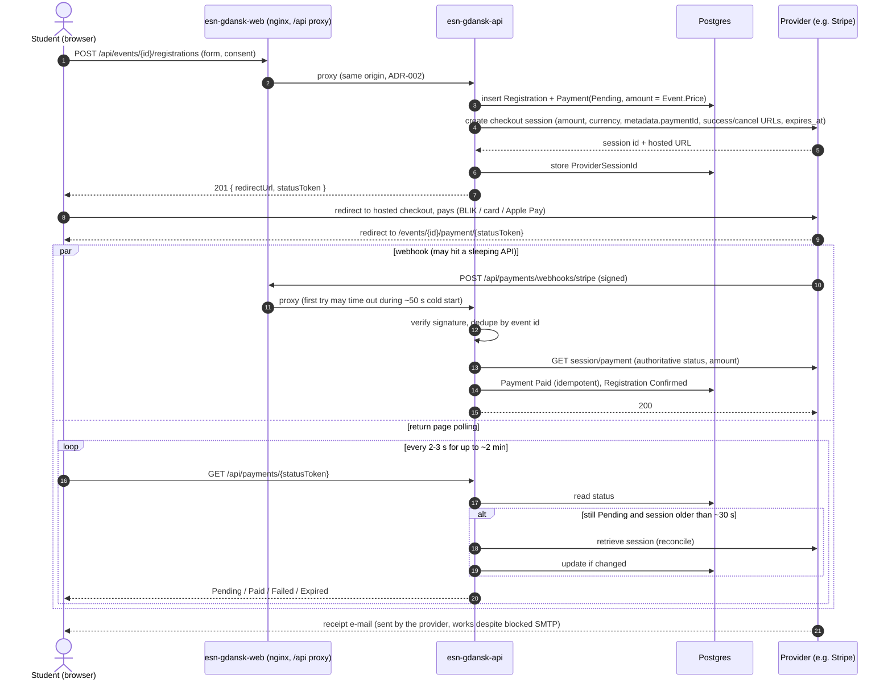
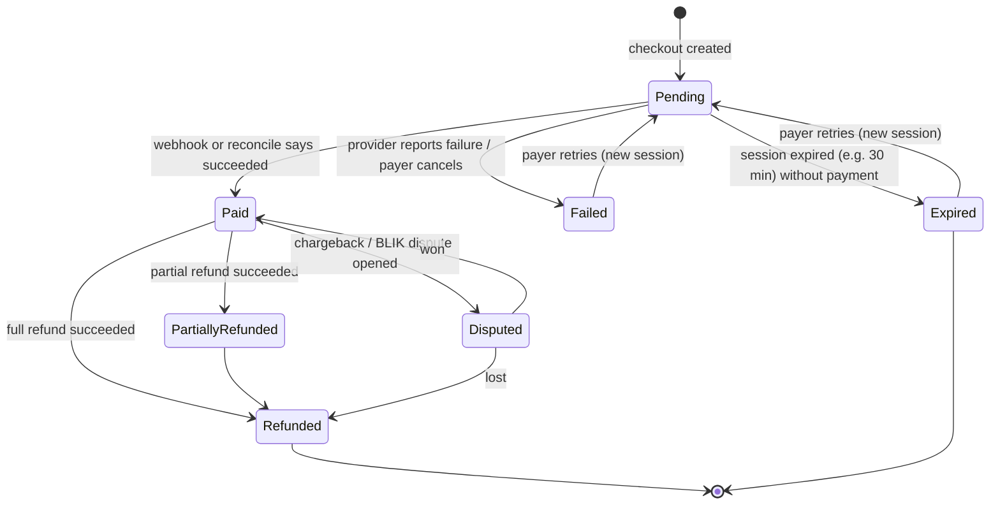
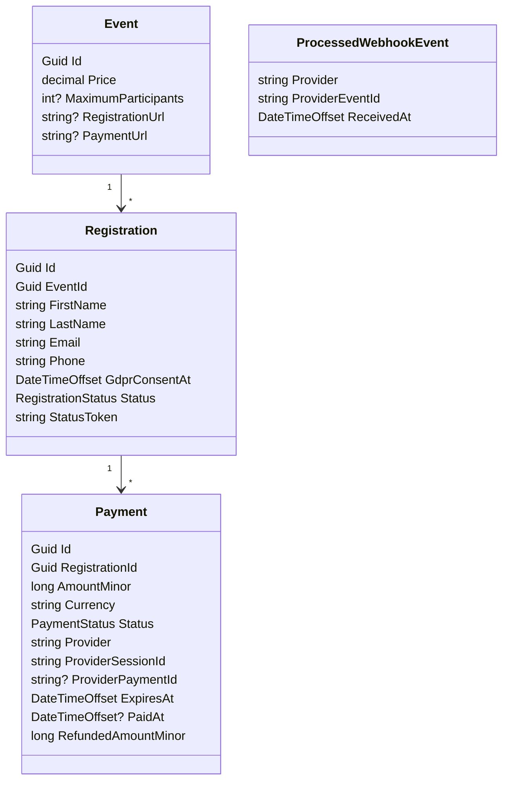

# Online payments for event participation fees: provider research

Status: research only (issue #106, depends on #105). No decision yet; the ADR is written once the owner/board picks an option.
Date: 2026-11-19. Facts were checked on official pages where they could be reached; anything marked **(unverified)** comes from third-party sources or could not be confirmed. Every fee should be confirmed in the provider's current price list or contract before the board decides.

## 1. Summary and recommendation

Context: **Stowarzyszenie ESN Gdańsk**, a registered association (KRS 0000783383 [30]) with legal personality under the Polish Associations Act (*Prawo o stowarzyszeniach*). The association itself signs the provider contract; it has a Nest Bank account and a cash register (*kasa fiskalna*). Payments are **participation fees paid when signing up through our own registration form (#105)**, not tickets: no ticket, QR code or check-in. Registration closes (deadline/capacity) in our form, so provider-side limits are not needed. Fees are about 20–100 PLN, a few hundred payments per semester, mostly to foreign Erasmus students (foreign cards, Apple/Google Pay, Revolut) and some Poles (BLIK). The owner prefers ready-made solutions: payment links first, checkout integration only if manual checking becomes too much work (#106 comments).

What exists today: `Event` already has `Price` (decimal) and `RegistrationUrl` (`backend/src/EsnApp.Domain/Events/Event.cs`). There is no Registration or Payment entity and no anonymous write endpoint besides login/reset-password. Everything runs on the Render free tier (`render.yaml`): the API sleeps after 15 min (~50 s cold start), the free Postgres expires after 30 days, and SMTP is blocked.

> **Update (owner decision):** Stripe is **excluded because of its cost**, and Revolut because it pays out only to a Revolut account. The current ranking without Stripe is in section 9.3; the Stripe recommendation below is kept for reference.

**Recommendation** (revised after the `skeptic` review, see section 7)

1. **Step 0, a legal/tax gate that blocks the provider choice.** The association's accountant answers three questions: is participation-fee income paid statutory activity (*odpłatna działalność statutowa*) or business activity (which needs an entry in the KRS register of entrepreneurs); is the association a VAT payer; and does the cash-register exemption (item 37 of the exemption regulation: the service is paid in full through a bank/post office to the bank account, and each payment identifies the transaction) apply to payments that arrive through the chosen operator. Tax practice treats PayU/PayPal payments as bank payments for item 37 [19]; we found no ruling on Stripe.
2. **Step 1, owner pre-checks (free, no contract).** (a) Start Stripe's free account setup to confirm that the form offers a registered association as an entity type (Stripe's Poland agreement admits "non-profit organisations" [20]; whether the form offers that option is **unverified**) and that PLN payouts to the Nest Bank account work. (b) Publish a terms/refund/contact page (address, NIP, KRS, refund policy, privacy policy, terms), which Stripe activation and P24 require [4] and which the PWA does not have yet. (c) Measure the payer mix (foreign card vs BLIK) on one event, e.g. with a single question in the current sign-up form.
3. **Level A, zero code.** For each paid event, paste the provider's payment link into the existing `Event.RegistrationUrl` field. Name, phone and e-mail can be collected on the payment page, and a terms checkbox can be required (verified for Stripe Payment Links [21]). Once #105 exists, our form closes registration (deadline/capacity), so the provider's "deactivate after N payments" option is not needed. A separate `PaymentUrl` field is added only together with #105.
4. **Provider for level A:**
   - Default: **Stripe Payment Links**, if the pre-checks pass and foreign cards are a large share. Native reusable links with a payment limit, custom fields, receipts and terms consent; payout to Nest Bank.
   - Fallback: **PayU payment links**, if Stripe onboarding fails, the accountant rejects Stripe for item 37, or most payers use BLIK. Cheaper per fee (BLIK 1.49% + 0.32 PLN).
   - Przelewy24 is the cheapest (1.29% + 0.30 PLN), but we found **no confirmed native payment-link feature without a shop or integration** [22], so it fits level A only if P24 confirms one.
5. **Level C (pretix) is out**, because the owner wants our own registration form (#105). Level B (own checkout + webhooks) is dropped from the recommendation for now. Reconsider it only if manual reconciliation takes more than ~2 h per event after one semester.

Cost per participation fee at list prices **(estimate)**:

| Fee | Stripe EEA card (1.5% + 1.00) | Stripe premium EEA card (1.9% + 1.00) | Stripe BLIK (1.6% + 1.00) | PayU BLIK (1.49% + 0.32) | P24 (1.29% + 0.30) |
|---|---|---|---|---|---|
| 20 PLN | 1.30 (6.5%) | 1.38 (6.9%) | 1.32 (6.6%) | 0.62 (3.1%) | 0.56 (2.8%) |
| 50 PLN | 1.75 (3.5%) | 1.95 (3.9%) | 1.80 (3.6%) | 1.07 (2.1%) | 0.95 (1.9%) |
| 100 PLN | 2.50 (2.5%) | 2.90 (2.9%) | 2.60 (2.6%) | 1.81 (1.8%) | 1.59 (1.6%) |

Per semester (300 fees x 50 PLN = 15,000 PLN) **(estimate)**: P24 ~284 PLN, PayU BLIK ~320 PLN, SumUp link ~293 PLN, Stripe ~525–585 PLN, **pretix ~900 PLN in total** (375 PLN pretix fee + ~525 PLN Stripe, about 6% of turnover). The fixed 1.00 PLN fee makes Stripe relatively expensive for small fees.

**What would change the recommendation**
- The accountant's answer to step 0, for example if item 37 is only safe with a Polish payment institution: then PayU (or P24, if it has links).
- The measured payer mix: mostly BLIK means PayU; mostly foreign cards means Stripe.
- Stripe's onboarding form does not offer a registered association: PayU.
- The board wants a Revolut Business account for other reasons and Revolut confirms BLIK acceptance: Revolut payment links **(unverified)**.
- Manual reconciliation takes more than ~2 h per event after a semester: reopen level B (needs paid Render plans, an ADR and a security review).

## 2. Comparison

### 2.1 Payment providers

| Provider | Methods relevant to us | Fees (list price) | Confirmation time | Payout | Payment links | API / SDK / sandbox | Webhook (signature, retries) | Onboarding for an association |
|---|---|---|---|---|---|---|---|---|
| **Stripe** | Cards (any country), Apple/Google Pay, BLIK, P24 (see restriction) | Standard EEA cards 1.5% + 1.00 PLN; premium EEA cards 1.9% + 1.00 PLN; UK 2.5% + 1.00 PLN; international 3.25% + 1.00 PLN (+2% FX); BLIK 1.6% + 1.00 PLN; P24 1.9% + 1.00 PLN. Refunds are free, but the original fee is kept [1] | Cards: seconds. BLIK: "immediate", result normally within 60 s [3]. P24: immediate, the customer has 1 h to authorise [4] | To any PL bank account (Nest Bank) on a rolling, weekly or monthly schedule [1]. P24 settles T+2 [4]. Default PL delay **(unverified)** | Yes, at no extra charge [1] | REST + official .NET SDK `Stripe.net` **(well known, not re-checked)**. Full sandbox; the CLI forwards webhooks to localhost [2] | HMAC-SHA256 `Stripe-Signature` with a timestamp (5 min tolerance). Retries for up to 3 days in live mode, a few over hours in sandbox. Manual resend up to 15/30 days. No ordering guarantee; dedupe by event ID [2] | Online KYC. The website must meet the activation requirements. P24 via Stripe excludes event promotion [4] |
| **PayU** | BLIK, pay-by-link (all PL banks), cards, Apple/Google Pay | BLIK 1.49% + 0.32 PLN from 1 June 2026 (official T&C) [5]. Card rate not confirmed **(unverified; blogs say 1.6% + 0.20 PLN)** | BLIK/cards: seconds. Pay-by-link: usually seconds to minutes **(estimate)** | To a PL bank account; timing **(unverified)** | Yes ("link do płatności" service) [7] | REST (OAuth client credentials), sandbox. No official .NET SDK **(unverified)** | `OpenPayu-Signature`: MD5 over body + second key. 20 attempts over 72 h (immediately, then 1, 2, 5, 10, 30 min, 1 h ... 72 h). Must answer 200; expect duplicates [6] | Online contract. An association attaches its statute and a KRS extract [7] |
| **Przelewy24** | BLIK, pay-by-link, cards, Apple/Google Pay | 1.29% + 0.30 PLN for BLIK, transfers and cards. Activation 59 PLN (refunded after 10 transactions in 2 months), no monthly fee. First 4 PLN payouts per month free, then 0.99 PLN. Refunds free [8] | BLIK/cards: seconds. Pay-by-link: seconds to minutes **(estimate)** | To a PL bank account on withdrawal; timing **(unverified)** | **(unverified)** | REST, sandbox; community SDKs only. The merchant must call `transaction/verify` after the notification or the funds are not credited [9] | `urlStatus` notification with a `sign` checksum. Retry schedule **(unverified)** | Online registration; requirements for associations **(unverified)** |
| **tpay** | BLIK, pay-by-link, cards | **(unverified)**: blogs quote 0.99% BLIK and cards from 1.4% (2026), or 1.59% + 0.39 PLN (older) [10] | As above **(estimate)** | **(unverified)** | **(unverified)** | REST, sandbox **(unverified)** | **(unverified)** | KYB takes 1–3 days **(unverified)** [10] |
| **Autopay** (ex Blue Media) | BLIK, pay-by-link, cards | Official price page not reachable (403) **(unverified)** | As above **(estimate)** | **(unverified)** | **(unverified)** | REST + ITN notifications **(unverified)** | **(unverified)** | **(unverified)** |
| **eService** | BLIK e-commerce, cards; has an NGO page [11] | No public e-commerce price list found; the known figures are for terminals **(unverified)** | — | — | **(unverified)** | **(unverified)** | **(unverified)** | Contract through sales; aimed at larger e-commerce **(unverified)** |
| **Revolut Business** | Cards, Revolut Pay, Apple/Google Pay. BLIK acceptance for merchants **not confirmed** | Older fee schedule: 0.8% for EEA consumer cards, 2.6% for other cards, plus a flat fee in PLN **(unverified, pricing page 403)** [12] | Cards: seconds | Next-day settlement to the **Revolut Business account**, not Nest Bank: the association would open a Revolut account and transfer from it [12] | Yes | Merchant API (REST), sandbox, webhooks **(details unverified, docs 403)** | **(unverified)** | Revolut KYB for the association **(unverified that associations are accepted)** |
| **Viva.com** | Cards, BLIK (PL merchants, enabled automatically, refunds supported) [13] | No published PL fee found **(unverified)** | BLIK/cards: seconds | To the Viva account, then to the bank **(unverified)** | Yes (Quick Pay permanent link; the payer enters the amount) [13] | Smart Checkout REST, sandbox **(unverified)** | **(unverified)** | **(unverified)** |
| **SumUp** | Cards, Apple/Google Pay. BLIK in links **not confirmed** | Payment links 1.95%, online 2.75%, no monthly fee (official PL pages) [14] | Cards: seconds | To a bank account **(timing unverified)** | Yes | An online API exists but is weaker for checkout **(unverified)** | **(unverified)** | Simple online sign-up **(unverified for associations)** |
| **Nest Bank** | In-person only: Nest POS softPOS (PayTel), from 0.65% + 0.06 PLN; requires a BIZnest account [15] | — | — | — | No e-commerce gateway found | — | — | Not an option for online payments **(no own gateway found)** |
| **Manual bank transfer to Nest Bank** | Transfer / Express Elixir | Free | Same session to next business day; instant only with Express Elixir **(estimate)** | Directly on the account | — | — | — | Nothing to sign |

### 2.2 Ticketing platforms (alternative to building #105; **out of scope**, the owner wants our own form)

| Platform | What it does | Fee (list price) | Payment methods | Notes |
|---|---|---|---|---|
| **pretix Hosted** | Event shop: form fields, capacity, waitlist, e-mail tickets/PDF, check-in app, refunds, exports | 2.5% of the ticket price excl. tax, max EUR 15 per ticket, plus the provider fee. Free tickets EUR 0.50 (first 500 per year free). **Special non-profit pricing**. No monthly fee [16] | Stripe, PayPal and Mollie listed; BLIK/P24 through Stripe/Mollie **(unverified)** | Open source (can be self-hosted later), EU (Germany). Best fit for a non-profit. |
| **Ticket Tailor** | Similar event shop | GBP 0.60 + VAT per paid ticket pay-as-you-go, from GBP 0.22 with prepaid credits. Free tickets free up to a limit [17] **(third-party sources)** | Bring your own Stripe/PayPal/Square | The flat fee hurts on a 20 PLN ticket. |
| **Eventbrite** | Marketplace + discovery | Poland: 1% + 2.99 PLN service fee per ticket (help article, date unclear) **(unverified)** [18]. Payment processing extra **(unverified)** | Cards, PayPal | Fees can be passed on to buyers. Heavy branding; buyer data stays in Eventbrite. |
| **Evenea** | Polish event registration + payments | **(unverified, no official price found)** | Polish methods expected **(unverified)** | Ask for a quote if a Polish-language vendor is preferred. |

## 3. Integration levels

### Level A: payment link only, manual reconciliation

How it works: the admin creates one payment link per event in the provider dashboard (a Stripe Payment Link with a fixed price, plus custom fields such as name and phone; the provider collects the e-mail anyway) and pastes it into the event form. Event details show a "Pay" button. Admins check payments in the provider dashboard and, once #105 exists, mark attendees as paid by hand.

Effort:
- Recommended: no code. Reuse `Event.RegistrationUrl` and let the payment page collect name, phone and e-mail until #105 ships [21].
- Only together with #105: add `PaymentUrl` (string?, an absolute https URL validated by FluentValidation) to `Event`, the DTOs and the admin create/update command (with an EF migration), plus a "Pay" button on event details (designed in Penpot first).
- Later, with #105: an admin "mark as paid" toggle on the attendee list.

Pros: hours of work, no new endpoint, no money logic, no PCI scope, works on the Render free tier, and the provider sends the receipt e-mail. Cons: a payment is linked to a registration only by matching names/e-mails; nothing stops someone paying for a full event; refunds and no-shows are handled by hand; the provider's page shows only generic text about the event. Risks: mismatched names/e-mails and payments for cancelled events. Both are tolerable at a few hundred payments per semester.

### Level B: hosted checkout + webhook updating our DB

**Not recommended for the foreseeable future** (see section 7, objection 5). It is kept here as a reference in case manual reconciliation becomes too much work.

How it works: the guest sign-up (#105) creates a `Registration` and a `Payment` (Pending) on the server. The amount comes from `Event.Price`, never from the client. The server creates a provider checkout session with our `paymentId` as metadata/reference and redirects the payer to the provider. The provider notifies our webhook. The handler verifies the signature, re-reads the session/order from the provider API, checks amount and currency, and moves the payment to Paid idempotently. The return page polls our status endpoint.

Effort (Stripe example, about 1.5–3 weeks of volunteer work after #105, estimate):
- Backend: `Payment` entity + EF migration. An `IPaymentProvider` interface in Application with a Stripe implementation in Infrastructure (`Stripe.net`). A `CreateCheckout` command used by the #105 sign-up. A webhook controller (raw body, signature check, dedupe by provider event ID, amount check). A `GET` status endpoint keyed by an unguessable token. Admin endpoints `POST api/admin/payments/{id}/refresh` and `POST api/admin/payments/{id}/refund`. Expiry of stale Pending payments (on read, or on a timer while the API is awake). Secrets in Render env (`Payments__Stripe__SecretKey`, `Payments__Stripe__WebhookSecret`) and documented in `.env.example`. Handler tests for a valid and an invalid signature, a duplicate event and a wrong amount.
- Frontend: return page (`/events/:id/payment/:token`) that polls the status, with a skeleton and success/failed/expired states. The attendee list shows payment status; admin buttons for refresh and refund.
- Ops: move Render Postgres and the API off the free plan (expiring DB, sleeping API). ADR, `security` review, terms of sale and privacy notice.

Pros: status lives in our DB, capacity counts only paid seats, the provider sends the e-mail automatically, refunds from the admin panel. Cons: a new anonymous write endpoint, money logic in our code, free-tier hosting is no longer acceptable, and more for a volunteer team to maintain. Risks: a missed or rejected webhook (mitigated by the reconciliation below), double fulfilment (idempotency), amount tampering (server-side price), leaked secret keys.

### Level C: ticketing platform (out of scope: the owner wants our own registration form)

How it works: each paid event gets a pretix (or Ticket Tailor) shop page, and the event in our app links to it through the existing `RegistrationUrl`. The platform handles the form, capacity, waitlist, payment, ticket e-mail, refunds and check-in; the data stays there.

Effort: none on the backend; none on the frontend (at most a button label). Set up the platform account, a Stripe/Mollie account connected to it, the GDPR text and a data processing agreement. Optional later: import attendee counts through the platform's API or webhooks.

Pros: covers #105 and #106 with no code, mature refunds/waitlist/check-in, works with our free hosting. Cons: an extra per-ticket fee, attendee data and stats (#99) live outside our app, volunteers get a second admin tool, and the look changes when the user leaves the PWA. Risks: vendor lock-in is low (pretix is open source and exports CSV).

## 4. Diagrams (level B)

### 4.1 Sequence

### 4.2 Payment status

Refunds are asynchronous (on Stripe, BLIK takes up to 120 min and P24 up to 3 business days [3][4]), so the admin UI needs a `RefundPending` flag or state if it shows refund progress.

### 4.3 Minimal data model (entities and fields only)

Field notes: `Event.PaymentUrl` is for level A only. `Phone` is stored in E.164 format with the prefix (#105 comment). `RegistrationStatus` is Pending, Confirmed or Cancelled. `StatusToken` is an unguessable random value used by the return page. `AmountMinor` is in grosze, copied from `Event.Price` when the payment is created. `Currency` is PLN. `Provider` is e.g. `stripe`, `payu` or `p24`. `(Provider, ProviderEventId)` has a unique index for idempotency.

## 5. Webhook specifics for our setup

- **Cold start vs retries.** On the free plan both `esn-gdansk-web` and `esn-gdansk-api` can be asleep. The first webhook delivery wakes them but may time out (~50 s cold start; the provider's timeout is **unverified** and probably shorter). We survive this because providers retry: Stripe for up to 3 days with exponential back-off in live mode (only a few retries over hours in sandbox, so test with the CLI) [2]; PayU 20 attempts, the first after 1, 2, 5 and 10 minutes [6]; the P24 schedule is **unverified**. The return-page polling (below) usually confirms the payment before the retry arrives. For real money, run the API and DB on paid plans anyway: the free DB expires after 30 days, which is unacceptable for payment records.
- **Signature verification.** Read the raw request body before any model binding (`Request.EnableBuffering()` and read the stream), then verify it the provider's way. Stripe: `Stripe-Signature` HMAC-SHA256 with a 5 min timestamp tolerance, via `EventUtility.ConstructEvent` [2]. PayU: `OpenPayu-Signature`, MD5(body + second key) [6]. P24: the `sign` checksum plus the mandatory `transaction/verify` call [9]. Compare in constant time and reject with 400 on failure. Secrets live only in Render env vars.
- **Never trust the payload alone.** After verification, re-fetch the session/order from the provider API and check `amount`, `currency` and our `paymentId` metadata against the DB row before marking it Paid.
- **Idempotency.** A unique index on `(Provider, ProviderEventId)` in `ProcessedWebhookEvent`. Status only moves forward: a late Pending/Failed event never overwrites Paid, because events can arrive out of order [2]. Return 200 for duplicates. Use the provider's idempotency key when creating sessions and refunds.
- **Respond fast.** Do the DB update inside the request (it is a single-row update, fine at our volume) but keep it short. No e-mail sending in the webhook path.
- **Reconciliation fallback.**
  1. The return page polls `GET /api/payments/{statusToken}`. If the payment is Pending and the session is older than ~30 s, the handler retrieves the session from the provider and updates the row.
  2. An admin "Refresh status" button (`POST /api/admin/payments/{id}/refresh`).
  3. Optional: a sweep of Pending payments on API start-up, or every N minutes while the API is awake. Render free has no cron; paid cron jobs exist **(price unverified)**.
  4. Expire Pending payments after the session expiry so seats are released.
- **New anonymous endpoints and the GET-only rule.** Level B adds `POST /api/payments/webhooks/{provider}`. It is anonymous (authenticated only by the signature), non-GET and outside `api/admin/*`, which breaks the invariant in CLAUDE.md. It also needs the #105 anonymous `POST /api/events/{id}/registrations`. Both need an ADR that amends the invariant, for example: "public controllers stay GET-only; anonymous writes are allowed only on the dedicated `PublicRegistrationsController` and `PaymentWebhooksController`, each listed in an allow-list test in `EsnApp.Api.Tests`". They also need a `security` review (rate limiting, body size limit, signature, replay window, logging without personal data). The ADR should also call out the status GET, because it has a reconcile side effect. Levels A and C add no endpoint.
- **Same-origin proxy.** The webhook URL goes through nginx (the `/api/` location in `docker/nginx.conf.template`), so ADR-002 still holds. nginx must not alter the body and must pass the signature header. It does both by default; verify it in tests with the Stripe CLI.

## 6. Open questions for the owner/board

1. What is paid for: event participation fees only, or also ESNcard/membership fees? (Confirmed: participation fees collected through our own registration form.)
2. Roughly what share of payers use foreign cards vs BLIK? (This decides Stripe vs P24/PayU.)
3. Level A (a payment link, no code) first? (Recommended: yes. Level C is out because the owner wants our own form; reopen B only if reconciliation takes more than ~2 h per event.)
4. Will the board sign the association up with Stripe (online KYC, with a board member as representative), or does it prefer a contract with a Polish operator?
5. Is a separate Revolut Business account acceptable, given that payouts would not land in Nest Bank directly?
6. Refund and cancellation rules: until when can a student cancel, is the refund full or partial, and what happens if the event is cancelled? Who presses "refund"?
7. Unpaid sign-ups: how long is a seat held (e.g. 30 min)?
8. Invoices/receipts: is the provider's receipt e-mail enough, or are invoices needed? Is the association a VAT payer, and does participation-fee income count as paid statutory activity or as business activity? Ask the accountant.
9. Budget for leaving the Render free tier (paid API + DB) if level B is chosen.
10. Terms of sale and privacy notice: who drafts and approves them, and how long attendee and payment data is kept.

## 7. Review: objections and responses

The `skeptic` agent reviewed this document (verdict: accept with changes). Each objection and the response:

1. **The legal/tax questions must come first and block the provider choice.** **Accepted.** They are now step 0 in the recommendation. Item 37 of the cash-register exemption regulation requires the service to be paid in full through a bank, post office or SKOK, with each payment identifiable; tax practice treats PayU/PayPal payments as bank payments, while payments through other non-bank institutions may not qualify [19]. We found no ruling on Stripe. The owner asks the association's accountant (and, if needed, files for an individual tax interpretation from KIS).
2. **Stripe's advantage rests on a payer mix nobody has measured.** **Accepted.** The premium EEA rate (1.9% + 1.00 PLN) [1] and a per-fee cost table are now in section 1: on a 20 PLN fee Stripe takes ~1.30 PLN (6.5%) against ~0.56 PLN (2.8%) at P24. "One provider for A and B" no longer counts as an argument, because B is dropped. Stripe stays the default only on the strength of verified Payment Links features [21], and only if the measured mix shows many foreign cards; otherwise the pick is PayU. Partly mitigated: P24's lower price helps level A only if P24 offers native payment links, which we could not confirm [22].
3. **Stripe onboarding of a Polish stowarzyszenie is unconfirmed, and activation needs a public terms/refund page.** **Accepted.** Our entity is confirmed (Stowarzyszenie ESN Gdańsk, KRS 0000783383, legal personality [30]), and Stripe's Poland services agreement admits non-profit organisations [20]. Whether Stripe's form offers a registered association as an entity type is still **unverified**. The owner does the free pre-onboarding (entity type, PLN payout to Nest Bank) before any ADR. The terms/refund/contact page is a prerequisite for any provider, not just Stripe (Stripe's P24 rules list the same items [4]).
4. **The pretix cost is understated.** **Accepted.** The total is now stated: ~900 PLN per semester (~6% of turnover) against ~284 PLN at P24. pretix is now out of scope anyway (the owner wants our own form).
5. **Level B is not worth it for the foreseeable future.** **Accepted.** B is dropped from the recommendation and marked "not recommended" in section 3. C (pretix) is out because the owner wants our own form, and B is reopened only if reconciliation takes more than ~2 h per event after a semester. A Stripe Payment Link can be limited to N completed payments [21], but this is not needed: our own form (#105) closes registration by deadline/capacity.
6. **Level A has hidden operational work.** **Accepted.** Owners are listed below.

   | Task | Owner (to be named by the board) |
   |---|---|
   | Terms of sale. They state that the right of withdrawal does not apply to leisure/entertainment services with a fixed date (art. 38 ust. 1 pkt 12 of the Polish consumer rights act; numbering **to be confirmed by the board's legal adviser**) and define the association's own cancellation/refund rules. | Board + legal adviser |
   | GDPR clause naming the payment provider as a recipient of personal data; retention period | Board (GDPR contact) |
   | Who holds dashboard access (at least two board members, 2FA on) | Treasurer |
   | Who issues refunds, and when (note: Stripe keeps its fee on a refund [1]) | Treasurer / event coordinator |
   | Monthly reconciliation of payouts against the accounting records | Treasurer + accountant |
   | Creating and deactivating the link for each event, and pasting it into `RegistrationUrl` | Event coordinator (admin panel) |

- **Skeptic's cheaper alternative (level A with zero code through `Event.RegistrationUrl`; `PaymentUrl` only with #105).** **Accepted** and adopted as the recommended level A (section 1, step 3; section 3).

No objection was rejected.

## 8. Focused comparison: Stripe, Autopay, PayU

Updated context from the owner. The association (Stowarzyszenie ESN Gdańsk, KRS 0000783383) **has a cash register** (*kasa fiskalna*) and wants **its own registration form in the app** (#105), so pretix (level C) is out. Each payment must be linkable to our registration (a reference ID) and its status should reach our DB. Research only; no implementation plan.

Autopay facts in this section come from its official integration documentation [23] unless marked otherwise. Autopay's price list could not be reached (autopay.pl returns 403 to automated fetch), and the Autopay–PKO BP terms say the fees are set in a separate price list [24].

| Criterion | Stripe | Autopay (ex Blue Media) | PayU |
|---|---|---|---|
| BLIK | 1.6% + 1.00 PLN [1] | **(unverified)**; resellers quote 1.58% + 0.39 PLN (Shoper) [25] | 1.49% + 0.32 PLN from 1 June 2026 [5] |
| PL / EEA card | Standard EEA 1.5% + 1.00 PLN, premium EEA 1.9% + 1.00 PLN (PL cards count as EEA) [1] | **(unverified)**; Shoper reseller rate 1.58% + 0.39 PLN [25] | **(unverified)**; blogs quote 1.6% + 0.20 PLN |
| Non-EEA card | 3.25% + 1.00 PLN (+2% FX); UK 2.5% + 1.00 PLN [1] | **(unverified)**, individual | **(unverified)**, individual (blogs: ~2.5–3.5%) |
| Pay-by-link (bank transfer) | Only via P24, 1.9% + 1.00 PLN, and P24 via Stripe excludes event promotion [1][4] | Core product; fee **(unverified)**, Shoper 1.58% + 0.39 PLN [25] | Core product; fee **(unverified)** |
| Cost of a 20 / 50 PLN fee (estimate) | Card 1.30 / 1.75; BLIK 1.32 / 1.80 PLN | ~0.71 / 1.18 PLN at the Shoper rate **(unverified)** | BLIK 0.62 / 1.07 PLN |
| Monthly / setup fee | None [1] | **(unverified)**; Shoper: one-off activation 49 PLN gross [25] | None **(unverified for 2026)** |
| Payment link without code + our registration ID | **Yes.** Reusable Payment Link from the dashboard; the app appends `?client_reference_id=<registrationId>` (up to 200 chars, alphanumeric, `-`, `_`), which comes back in `checkout.session.completed`; optional `prefilled_email`, redirect after payment [26] | **Not found.** Links appear only through integrators (Shoper) or the API "pre-transaction" [23]; no standalone panel link documented | **API only.** The documented payment link is an order created with `POST /api/v2_1/orders` with `extOrderId` and `validityTime` up to 3 months [27]; no panel generator documented |
| Hosted checkout API | Checkout Sessions (`client_reference_id`, `metadata`, `expires_at`) | POST form to `pay.autopay.eu` with `ServiceID`, `OrderID` (our ID, up to 32 chars, unique per service), `Amount`, `CustomerEmail` and a SHA256 `Hash` [23] | `POST /api/v2_1/orders` (OAuth) with `extOrderId`, `notifyUrl`, `continueUrl` [27] |
| Webhook / notification | HMAC-SHA256 `Stripe-Signature`; retries up to 3 days; dedupe by event ID [2] | ITN: Base64 XML POST, one transaction per message, SHA256 hash, must answer with a hashed `confirmationList` XML; retries every 3 min (x12), then 10 min (x144), hourly (x48), daily (x5), about 8 days in total (our sum) [23] | `OpenPayu-Signature` MD5(body + second key); 20 attempts over 72 h, first after 1, 2, 5, 10 min [6] |
| Status polling API | Retrieve Checkout Session / list sessions of a Payment Link (standard API, not re-checked) | `POST /webapi/transactionStatus` by `ServiceID` + `OrderID` [23] | `GET /api/v2_1/orders/{orderId}` **(not re-checked)** |
| Confirmation time | Cards: seconds. BLIK: normally within 60 s [3] | Notification sent immediately on status change [23]; per-method timing **(unverified)**: BLIK/cards seconds, pay-by-link seconds to minutes **(estimate)** | Notification on each status change [6]; BLIK/cards seconds, pay-by-link seconds to minutes **(estimate)** |
| Payer feedback | Redirect or custom message after payment [26]; Stripe receipt e-mail (setting) | GET redirect to the return URL with `ServiceID`, `OrderID`, `Hash` (verify it; ITN is the only binding status) [23]; e-mail to payer **(unverified)** | `continueUrl` redirect [27]; PayU e-mail to payer **(unverified)** |
| Refunds + notifications | Dashboard and API; `refund.updated` / `refund.failed` webhooks; fee kept [1][3] | API `transactionRefund` (full) and `transactionRefund/v3` (partial); ISTN notification with `isRefund=true`; window 12 months, **BLIK 6 months** [23] | Panel and `POST /api/v2_1/orders/{orderId}/refunds` (partial allowed); notification with `FINALIZED`/`CANCELED` [28] |
| Payout to Nest Bank | PLN to a PL account; first payout delayed ~7 business days in many EU countries, then the market default (often ~3 business days) [29]; exact PL default **(unverified)** | Balance payout processed "up to 30 minutes" after the request [23]; automatic schedule **(unverified)** | **(unverified)**; blogs say D+1 to D+7 |
| Onboarding a stowarzyszenie | Online KYC by the association (KRS 0000783383); the Poland agreement admits non-profits [20]; association option in the form **(unverified)** | **(unverified)**; Autopay is a KNF-supervised national payment institution [25] | Online contract; statute + KRS extract (available for KRS 0000783383) [7] |
| Sandbox | Full sandbox + CLI [2] | `testpay.autopay.eu`, `testcards.autopay.eu`, test scenarios [23] | Sandbox **(well known, not re-checked)** |
| .NET SDK / REST quality | Official `Stripe.net`; best-in-class docs | No .NET SDK found; form POST + XML ITN, older style, very long single-page docs (PL/EN) [23] | No official .NET SDK **(unverified)**; JSON REST, decent docs (PL/EN) |
| English UI for foreign payers | Yes, localised automatically, `locale` parameter [26] | Page languages PL, EN, DE, CS, ES, FR, IT; non-PL languages must be agreed during integration [23] | EN supported **(not re-checked)** |
| Fiscal receipts | None (no Polish cash-register integration) | None found in the docs **(unverified)** | None found **(unverified)** |

**Fiscal receipts with an existing cash register.** None of the three issues Polish fiscal receipts. Either each online payment is entered on the cash register (a manual step per payment, or an e-receipt service), or the accountant confirms that these sales fall under the item 37 exemption [19]. That decision belongs to the accountant and does not depend on the provider, except that the Stripe question from section 7 still applies.

**Getting the status into our DB without an anonymous webhook.** All three offer a status API, so a minimal variant is an **admin-only "sync payments" action**: the backend asks the provider for the status of each Pending registration (Stripe: sessions of the payment link filtered by `client_reference_id`; Autopay: `transactionStatus` by `OrderID`; PayU: order by ID). It runs under `api/admin/*`, so the GET-only invariant holds and no ADR exception is needed. Real-time status would need the webhook endpoint from section 5.

**Verdict**
- **Easiest to start:** **Stripe.** It is the only one of the three with a documented no-code reusable payment link that carries our registration ID (`client_reference_id`) back to us, plus the best .NET SDK and sandbox.
- **Cheapest:** **PayU** on verified numbers (BLIK 0.62 PLN on a 20 PLN fee against 1.32 PLN at Stripe). Autopay may be similar or cheaper, but its price list is **unverified**.
- **Best automation:** **Stripe** for developer effort (SDK, CLI, signed JSON webhooks). **Autopay** has the most robust retries (~8 days) and a clean `OrderID` = our ID model, but its XML/hash protocol takes more work. PayU is in between.

## 9. Full comparison of viable providers

Owner decisions: **Revolut is out** (payouts only to a Revolut account) and **Stripe is out** because it is too expensive; its data stays in sections 2 and 8 for reference. Prices below were re-checked on the official pages the owner sent (read on 2026-11-19):

| Page | Read? |
|---|---|
| tpay.com/oferta [35] | yes |
| mollie.com/pl/pricing [36] | yes |
| poland.payu.com/oferta-handlowa [37] | yes; the linked full price-list PDF was not read |
| przelewy24.pl/bramka-platnicza [38] | yes |
| autopay.pl/oferta/platnosci-online | **unreadable (HTTP 403)**, so Autopay prices stay unverified |

"nzw." means not verified.

### 9.1 Screening (must-haves)

The must-haves are: (1) a hosted payment page, so no card data touches our side; (2) BLIK plus foreign cards; (3) payout to the Nest Bank PLN account; (4) the provider accepts a registered association (Stowarzyszenie ESN Gdańsk, KRS 0000783383); (5) a way to attach our registration ID and read the payment status (webhook or status API).

**Excluded:**
- **Stripe:** excluded by the owner (cost). The 1.00 PLN fixed fee gives ~1.30 PLN on a 20 PLN fee [1].
- **Revolut Business:** excluded by the owner; payouts go only to a Revolut account.
- **Nest Bank:** no online gateway, only the Nest POS softPOS [15].
- **Paynow (mBank):** requires an mBank business account [31].
- **imoje / ING gateway:** sold to ING business customers [32]; a payout to a non-ING account is nzw.
- **Viva.com:** money lands in a Viva account first (nzw.); no published PL fees [13].
- **SumUp:** BLIK in payment links/online not confirmed; no verified status lookup by our ID [14].
- **eService:** no public e-commerce price list or API docs [11].
- **PayPal:** BLIK and Polish merchant fees could not be verified (403) [33].

**Viable:** Przelewy24, PayU, tpay, Autopay and the new candidate **Mollie**. Mollie passes on: a hosted page; BLIK 1.30% + 0.50 PLN and all card types priced in PLN [36]; payment links included [36]; webhooks plus status by re-fetching the payment, with Payment Links supporting webhooks [39]. Two Mollie must-haves are still nzw.: a PLN payout to a Polish bank account (Nest Bank) and acceptance of an association. Its PLN price list for Poland suggests a PLN balance and payouts, but that is not confirmed.

### 9.2 Comparison of the viable providers (Stripe dropped)

Fees use list prices. For 20/50 PLN payments, "PL card" is a domestic consumer card, "EEA" an EEA consumer card and "non-EEA" an international card, all paid in PLN.

| Criterion | Przelewy24 | PayU | tpay (Starter) | Mollie | Autopay |
|---|---|---|---|---|---|
| BLIK | 1.29% + 0.30 PLN [38][8] | 1.1% + 0.32 PLN shown; the page also shows "1.49%" without a label [37] (T&C: standard 1.49% + 0.32 [5]) | 1.59% + 0.41 PLN [35] | 1.30% + 0.50 PLN [36] | nzw. (Shoper reseller 1.58% + 0.39 [25]) |
| Cards | 1.29% + 0.30 PLN; the page also shows "1.9%" without a label [38] | 1.1% + 0.30 PLN (also "1.49%") [37]; no PL/EEA/non-EEA split | 1.59% + 0.39 PLN for all cards, no split [35] | PL 1.20% + 1, EEA 1.80% + 1, EEA commercial 2.90% + 1, non-EEA 3.25% + 1 PLN [36] | nzw. |
| Non-EEA card | no split for PLN payments; card payments in EUR 2%, GBP/USD 3.6% [38] | nzw. | same as all cards [35] | 3.25% + 1 PLN [36] | nzw. |
| 20 PLN: BLIK / PL card / EEA / non-EEA | 0.56 / 0.56 / 0.56 / 0.56 (non-EEA nzw.) | 0.54 / 0.52 / 0.52 / nzw. (1.49%: 0.62 / 0.60) | 0.73 / 0.71 / 0.71 / 0.71 | 0.76 / 1.24 / 1.36 / 1.65 | ~0.71 (nzw.) |
| 50 PLN: BLIK / PL card / EEA / non-EEA | 0.95 / 0.95 / 0.95 / 0.95 (non-EEA nzw.) | 0.87 / 0.85 / 0.85 / nzw. (1.49%: 1.07 / 1.05) | 1.21 / 1.19 / 1.19 / 1.19 | 1.15 / 1.60 / 1.90 / 2.63 | ~1.18 (nzw.) |
| Activation / monthly | 59 PLN activation, refunded after 10 transactions in 2 months; 0 monthly [38] | one-off 29 PLN registration ("was 199"); monthly not listed [37] | 99 PLN activation; 0 monthly (Business plan: 99 PLN/month) [35] | no setup or monthly fee online [36] | nzw. |
| Payouts | first 4 PLN payouts per month free, then 0.99 PLN; timing not stated [38] | not on the page (nzw.) | 2 PLN per payout (free on Business) [35] | first 5 free, then 1.05 PLN (under 2 M PLN/yr); daily, weekly or monthly schedule [36] | on request, up to 30 min [23] |
| Refund fees | free [38] | nzw. | non-card 1 PLN; card refund charged at the card rate [35] | not listed | nzw. |
| Payment link without code | "Generator linku" listed as a feature [38] | API only (`extOrderId`) [27] | link generator in every package [35] | payment links included [36] | not found [23] |
| Our ID + status | `sessionId` (nzw.) + `urlStatus` notification with `sign` + mandatory `verify` call [9] | `extOrderId` + signed notifications, 20 tries / 72 h [27][6] | `crc` + JWS notifications, 37 tries / ~1.8 days [34] | `metadata` (nzw.) + webhook carrying only the payment `id`; we re-fetch the status (no signature needed); 10 tries / 26 h, 15 s timeout [39] | `OrderID` + ITN, ~8 days of retries, `transactionStatus` [23] |
| Onboarding of the association | nzw. | statute + KRS extract [7]; payments up to 2,500 PLN accepted before verification [37] | KYB (nzw.) | nzw. | nzw. |
| .NET / REST quality | REST, community SDKs | JSON REST, good docs | REST + JWS | clean REST; community .NET SDK (nzw.) | form POST + XML |
| Fiscal receipts | none (nzw.) | none (nzw.) | none (nzw.) | none (nzw.) | none (nzw.) |

At our volume (~2,500 PLN per month, estimate), tpay's Business plan (0.99%, 99 PLN/month) costs more than Starter. tpay also lists TpayGO (0.99% + 0.39 PLN, 1 PLN activation, 1 PLN per payout) [35], but it is described as a phone-based plan; whether it covers online payment links is nzw. Mollie's 15 s webhook timeout is shorter than Render's ~50 s cold start, so the first attempt can fail; the retries at 1, 2 and 4 min cover that [39].

### 9.3 Ranking without Stripe (top 3)

**Cheapest** (verified list prices)
1. **PayU:** 0.52–0.54 PLN on a 20 PLN fee if the page's 1.1% is the current rate. If the unlabeled 1.49% (the standard rate in the T&C) applies, it is 0.60–0.62 PLN. Plus a one-off 29 PLN.
2. **Przelewy24:** a flat 0.56 / 0.95 PLN for every method; activation refunded, refunds free, 4 free payouts per month.
3. **tpay Starter:** 0.71–0.73 PLN, plus 99 PLN activation and 2 PLN per payout.

Mollie is competitive only for BLIK (0.76 PLN); on cards its 1 PLN fixed fee puts it close to Stripe.

**Easiest to integrate**
1. **PayU:** JSON order API with `extOrderId`, documented association documents, sandbox, panel refunds.
2. **Mollie:** the simplest webhook model (only the ID arrives, then we re-fetch, so no signature code) and payment links with webhooks. Its Nest Bank payout and association onboarding are still nzw.
3. **tpay:** link generator in every package and JWS-signed notifications (verification is mandatory).

Przelewy24 comes 4th: notification checksum plus a mandatory `verify` call.

**Best automation**
1. **PayU:** status and refund notifications (refund `FINALIZED`/`CANCELED`), 72 h of retries, refunds by API.
2. **Mollie:** webhooks for payments, refunds and chargebacks, 26 h of retries; re-fetching means the status is always current.
3. **Autopay:** ~8 days of retries, `transactionStatus`, refund ISTN; held back by XML and its unreadable price list.

**Overall:** PayU is the best fit unless its 1.1% turns out to be a time-limited promotion, in which case Przelewy24 is a close second on cost.

## Sources

1. Stripe pricing, Poland: https://stripe.com/pl/pricing
2. Stripe webhooks (signature, retries, duplicates, ordering): https://docs.stripe.com/webhooks
3. Stripe BLIK: https://docs.stripe.com/payments/blik
4. Stripe Przelewy24 (including prohibited categories): https://docs.stripe.com/payments/p24
5. PayU Poland terms and conditions (May 2026, read via search snippet): https://poland.payu.com/wp-content/uploads/sites/14/2026/05/Terms-and-conditions.pdf
6. PayU payment lifecycle and notifications: https://developers.payu.com/europe/docs/payment-flows/lifecycle/
7. PayU onboarding for associations / payment link service: https://developers.payu.com/europe/docs/get-started/set-up-account/register/ and https://poland.payu.com/wp-content/uploads/sites/14/2020/03/Wymagania_i_zlecenia_dla_us%C5%82ugi_link_do_platnosci.pdf
8. Przelewy24 fee table: https://www.przelewy24.pl/oferta/tabela-prowizji-i-oplat
9. Przelewy24 notification/verify flow (community library docs): https://github.com/mnastalski/przelewy24-php
10. tpay (third-party comparison only): https://freenance.io/przedsiebiorczosc/przelewy24-vs-tpay-2026-porownanie-bramka-platnosci-prowizje-rejestracja/
11. eService NGO page: https://www.eservice.pl/en/services/non-governmental-organizations
12. Revolut Business fees / accept payments (both returned 403 to automated fetch; figures from search snippets): https://www.revolut.com/en-PL/legal/business-basic-fees/ and https://revolut.com/pl-PL/business/accept-payments
13. Viva.com BLIK and Quick Pay: https://developer.viva.com/payment-methods/local-payment-methods/blik/ and https://www.viva.com/pl-pl/product/online/quick-pay
14. SumUp payment links / online payments: https://www.sumup.com/pl-pl/platnosci-linkiem/ and https://www.sumup.com/pl-pl/platnosci-online/
15. Nest Bank Nest POS: https://bank.pl/nest-bank-wprowadza-dla-posiadaczy-konta-firmowego-terminal-platniczy-w-kieszeni/
16. pretix Hosted pricing: https://pretix.eu/about/en/pricing
17. Ticket Tailor pricing (third-party summaries): https://getpulsesignal.com/pricing/tickettailor and https://www.tickettailor.com/pricing
18. Eventbrite organizer fees: https://www.eventbrite.com/help/en-us/articles/755615/
19. Cash-register exemption item 37 and online payment operators (secondary sources, not legal advice): https://ksiegowosc.infor.pl/podatki/vat/kasy-fiskalne/759839,Sprzedaz-internetowa-a-zwolnienie-z-kasy-rejestrujacej.html and https://ksiegowosc.infor.pl/podatki/vat/kasy-fiskalne/294909,Nie-musisz-miec-kasy-fiskalnej-gdy-wszyscy-klienci-placa-ci-przelewem.html
20. Stripe Services Agreement, Poland (eligibility: businesses and non-profit organisations located in Poland): https://stripe.com/en-fi/legal/ssa/pl
21. Stripe Payment Links customisation (payment limit with auto-deactivation, phone/name/custom fields, terms of service consent): https://docs.stripe.com/payment-links/customize
22. Przelewy24 payment links appear only through integrations such as Base.com/BaseLinker (no native panel link found): https://base.com/pl-PL/pomoc/wiedza/przelewy24/
23. Autopay online payment gateway documentation (transaction start, ITN, retry scheme, transactionStatus, refunds, languages, test hosts): https://developers.autopay.pl/online/dokumentacja and overview https://developers.autopay.pl/online/
24. Autopay terms for PKO BP (price list is a separate document): https://www.pkobp.pl/api/public/2d4af3f1-4c37-4ef1-899d-ba9094bc61c9.pdf
25. Shoper Płatności with Autopay (reseller rates, KNF status): https://www.shoper.pl/systemy-platnosci/autopay
26. Stripe Payment Links URL parameters (`client_reference_id`, redirect): https://docs.stripe.com/payment-links/url-parameters
27. PayU payment link (order API, `extOrderId`, `validityTime`): https://developers.payu.com/europe/docs/payment-solutions/payment-link
28. PayU refunds: https://developers.payu.com/europe/docs/payment-flows/refunds/
29. Stripe default payout speeds in Europe: https://support.stripe.com/questions/default-payout-speeds-in-europe-and-canada
30. Stowarzyszenie ESN Gdańsk, KRS 0000783383: https://rejestr.io/krs/783383/stowarzyszenie-esn-gdansk
31. mBank Paynow (FAQ: mBank business account required; 0.95% standard commission): https://www.mbank.pl/firmy/system-platnosci-online-paynow
32. ING online payment gateway (imoje redirects here): https://www.ing.pl/bramka-platnicza-imoje
33. PayPal Poland merchant fees (403 to automated fetch): https://www.paypal.com/pl/webapps/mpp/merchant-fees
34. tpay notifications (JWS signature, retry schedule, md5sum with `tr_crc`, refunds): https://docs-api.tpay.com/en/webhooks/
35. tpay offer and price list: https://tpay.com/oferta
36. Mollie pricing, Poland: https://www.mollie.com/pl/pricing
37. PayU commercial offer: https://poland.payu.com/oferta-handlowa/
38. Przelewy24 payment gateway offer: https://www.przelewy24.pl/bramka-platnicza
39. Mollie webhooks (id-only payload, retries, timeout, Payment Links): https://docs.mollie.com/reference/webhooks
